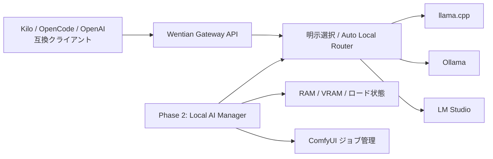
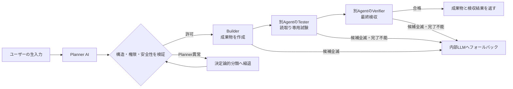

# Wentian Gateway 正式仕様

## 2026-10-29 自動保守と実行範囲の既定値

自動保守は専用領域で既定の継続許可を使用し、Agent別の期限更新を要求しません。プロジェクトの作業は一度設定した範囲を現在の接続先で共有し、取消まで利用します。Agentの一時停止・明示取消・新接続先・範囲外操作は別に扱います。[既定権限とプロジェクト共通範囲の現行仕様](docs/execution_defaults.md)と[公開機能と制限](docs/feature_scope.md)を参照してください。

## 2026-10-10 メール機能の現行仕様

AI先行の分類・保存、必要な分類の自動追加、自由追加・改名、5種類の外観選択に対応します。分類に人の確認は必須ではありません。[Mail Solutions現行仕様](docs/mail_solutions_specification.md)にモデル接続・API・保存先・検証範囲・未対応事項を記載します。

## 2026-10-07の実装差分

サイト管理、Personal Cloud基盤、ComfyUI非依存の動画・音声制作、取得許可に基づくモデル自動保守を追加しました。[公開機能と制限](docs/feature_scope.md)を現行実装の差分台帳とします。以下のPhase記述にあるComfyUIは既存の任意接続であり、新しい制作機能の依存先ではありません。Personal Cloudの全面完成、外部公開、実GPU検証、本番動画モデルによる品質確認は完了扱いにしません。

## 1. 製品定義

Wentian Gateway は、1 台の PC 上にある複数のローカル AI バックエンドを単一の OpenAI 互換 API として公開し、最終的には PC の RAM/VRAM とモデル特性を考慮して安全に運用するローカル AI 基盤です。

接続集約を担う **Phase 1: 軽量 Gateway** と、リソースおよびモデルのライフサイクルを管理する **Phase 2: ローカル AI Manager** を明確に分離します。Phase 1 の品質を確立してから Phase 2 の自動運用を有効化します。



## 2. 共通原則

- **Local First（ローカル優先）**: 外部送信は既定で行わない。
- **Safe by Default（安全な既定値）**: ローカルホスト待受、限定 CORS、秘密情報の非表示を既定とする。
- **Explicit over Magic（暗黙処理より明示性）**: 選択結果と理由を観測可能にし、不明なモデルを根拠なく安全と判定しない。
- **Compatibility（互換性）**: OpenAI 互換クライアントが非ストリームとストリームの双方を利用できることを目標とする。
- **Backend Isolation（バックエンド分離）**: LLM チャットと ComfyUI のジョブ型処理を同じルーティングプールに混在させない。

## 3. Phase 1: 軽量 Gateway

### 3.1 目的とスコープ

Kilo/OpenCode などが接続先を切り替えずに llama.cpp、Ollama、LM Studio を利用できる、軽量で予測可能な Gateway を完成させます。

- OpenAI 互換のモデル一覧とチャット API
- `provider/model-id` による明示選択
- 利用可能なローカル候補を順番に試す Auto Local Router（自動ローカルルーター）
- タイムアウト、キャンセル、障害時フォールバック
- 非ストリーム JSON と SSE（サーバー送信イベント / Server-Sent Events）の透過中継
- バックエンド障害を安定した Gateway エラーへ変換
- 状態、応答時間、モデル、直近の選択結果を確認する Monitor UI（監視 UI）
- 環境変数の読込・検証、ローカル限定の安全な既定値、任意の API キー認証
- 単体、統合、クライアント互換性テスト

### 3.2 非目標

- プロンプト内容からの最適モデル判定、モデル品質・能力・速度の自動採点
- RAM/VRAM 適合性の保証、モデルの自動ロード/アンロード
- OOM（メモリ不足 / Out of Memory）からの完全自動回復
- ComfyUI ワークフロー実行、クラウドの無料料金判定
- 複数 PC や Kubernetes を対象にした分散スケジューリング

### 3.3 モデル ID と Auto の意味

直接指定は `llamacpp/<model-id>`、`ollama/<model-id>`、`lmstudio/<model-id>` とします。正規仮想モデル ID は次のとおりです。

```text
wentian-auto/local
```

これは、利用可能なローカルモデルを設定優先度とタスク/セッションの Affinity（親和性）に従って順に試すフォールバックポリシーです。「能力上の最適」「最速」「メモリに収まる」「無料」のいずれも保証しません。

従来名 `wentian-auto/free` は移行期間中の互換エイリアスとし、非推奨を表示します。本システムは料金を検証していないため、新規設定には使用しません。

### 3.4 ルーティング規則

1. 明示 ID は指定プロバイダーとモデルだけへ転送する。
2. Auto Local は、有効かつヘルス確認済みでモデルを列挙できるローカルプロバイダーを候補にする。
3. 設定優先度を基本順序とし、タスク ID またはセッション ID による安定した Affinity を適用する。
4. タイムアウト、接続失敗、再試行可能な上流エラーだけで次候補へ進む。
5. 認証エラー、入力不正、明示的キャンセルなどは無条件にフォールバックしない。
6. 選択プロバイダー、実モデル、試行履歴、処理時間を秘密情報を除いて観測可能にする。

### 3.5 完成条件

- 3 バックエンドそれぞれでモデル列挙とチャットが成功し、明示指定が誤配送されない。
- Auto Local で先行候補停止時に、許可された次候補へフォールバックする。
- 非ストリームは OpenAI 互換 JSON、ストリームは正しい SSE ヘッダー、チャンク、終了通知を返す。
- クライアント切断時に上流へキャンセルを伝播する。
- タイムアウト、上流 4xx/5xx、全候補失敗が安定したエラー形式になる。
- デフォルトで `127.0.0.1` のみに待ち受け、無制限 CORS を行わない。
- 認証有効時は未認証を拒否し、キー、Authorization、完全なプロンプトを通常ログへ出さない。
- README、設定例、実装、テストの挙動が一致する。

## 4. Phase 2: ローカル AI Manager

### 4.1 目的とスコープ

PC の利用可能リソース、現在のロード状態、モデル能力、要求特性を判断し、OOM を避けながらライフサイクルを管理します。

- CPU、RAM、GPU、VRAM の Inventory（資源台帳）
- プロバイダー別のロード済みモデル、使用量、実行中ジョブの検出
- モデルサイズ、量子化、コンテキスト長、KV Cache を含むメモリ所要量推定
- 安全マージンを含む `Safe / Warning / Blocked / Unknown` 判定
- ロード、アンロード、同時実行、排他制御、OOM 予防と有限回の復旧
- コーディング、推論、ツール、ビジョン等の Capability Metadata（能力メタデータ）
- レイテンシー、TTFT、成功率、Circuit Breaker（サーキットブレーカー）
- 判断理由、操作履歴、手動オーバーライドを提供する Manager UI
- ComfyUI のワークフローレジストリ、画像生成ジョブ、VRAM 競合制御
- 明示オプトインかつ外部送信表示付きの Remote/BYOK

### 4.2 非目標

- モデル品質・安全性の絶対保証、未知バックエンドの無設定完全自動制御
- OS/ドライバー障害からの自動復旧
- ユーザー確認なしのモデル/データ削除や課金 API 利用
- クラウド相当のマルチテナント基盤

### 4.3 選択ポリシー

1. 必須能力、コンテキスト長、入出力形式を満たす。
2. 推定メモリと安全マージンを含めて実行可能である。
3. 障害状態、実行中処理、切替コストを許容できる。
4. ユーザー設定の品質、速度、消費資源の重みに対してスコアが高い。
5. 根拠不足は `Unknown` とし、危険な自動ロードを行わない。

### 4.4 完成条件

- 対応環境で RAM/VRAM とロード状態を取得し、取得不能を安全と誤判定しない。
- 推定使用量と実測の比較テスト、許容誤差、安全マージンを文書化する。
- `Blocked` は自動ロードせず理由を UI/API に示す。
- 同時要求でもライフサイクル操作を直列化し、使用中モデルをアンロードしない。
- 注入した OOM、上流停止、タイムアウトから有限回で収束し、無限再試行しない。
- 能力要件を満たさないモデルへ配送しない。
- 自動/手動選択の判断理由と操作履歴を追跡できる。
- ComfyUI と LLM の VRAM 競合時に、設定に従い待機・拒否・解放を選べる。
- Remote 送信は明示設定を必須とし、送信先を識別できる。
- E2E テストで正常系、資源不足、競合、復旧を再現できる。

## 5. API 仕様

### 5.1 Phase 1 必須 API

| メソッド | パス | 説明 |
|---|---|---|
| `GET` | `/` | Monitor UI |
| `GET` | `/health` | Gateway の Liveness（生存性） |
| `GET` | `/v1/models` | 仮想モデルと検出済みモデル |
| `GET` | `/v1/providers` | 秘密値を除くプロバイダー情報 |
| `GET` | `/api/providers` | UI 用ヘルス、応答時間、モデル情報 |
| `POST` | `/v1/chat/completions` | 非ストリーム/ストリームの中継 |
| `POST` | `/v1/responses` | Responses APIの非ストリーム/ストリーム中継 |
| `POST` | `/v1/embeddings` | Embeddings API中継 |
| `POST` | `/v1/audio/transcriptions` | Multipart音声文字起こし中継 |
| `POST` | `/v1/messages` | Anthropic Messages API中継 |
| `POST` | `/v1/rerank` | Reranker API中継 |

OpenAI 互換フィールドを壊さず、Wentian 固有情報は衝突しない `wentian` メタデータまたはレスポンスヘッダーで返します。要求モデル、解決モデル、プロバイダー、試行回数を追跡可能にします。

### 5.2 Phase 2 拡張 API

| メソッド | パス | 説明 |
|---|---|---|
| `GET` | `/v1/manager/status` | RAM/VRAM、ComfyUI、プロバイダー検出状態 |
| `GET` | `/v1/manager/models` | モデルの安全判定と候補スコア |
| `POST` | `/v1/manager/unload-plan` | 明示承認を必要とするアンロード計画。状態変更はしない |
| `GET` | `/v1/metrics` | 成功率、Latency、TTFT を含む集計 |
| `GET` | `/v1/routing/recent` | 直近のルーティング履歴 |
| `GET` | `/v1/manager/events` | 秘密・プロンプトを除外した上限付き永続イベント |
| `GET` | `/v1/manager/external-agents` | 組込・手動登録エージェントのリアルタイムCLI状態 |
| `POST` | `/v1/manager/external-agents` | 外部エージェントを手動登録しローカル台帳へ保存 |
| `GET` | `/v1/manager/agent-marketplace` | GitHub Star人気度上位10候補とリアルタイムCLI状態 |
| `POST` | `/v1/manager/agent-install/plan` | 外部エージェント導入のdry-run計画 |
| `POST` | `/v1/manager/agent-install/approval` | 1回限りの導入承認Token発行 |
| `POST` | `/v1/manager/agent-install/execute` | 固定Allowlistの承認済み導入 |
| `POST` | `/v1/manager/lifecycle/plan` | 状態変更のdry-run |
| `POST` | `/v1/manager/lifecycle/approval` | 認証済み1回限り承認トークン |
| `POST` | `/v1/manager/lifecycle/execute` | Feature Flag・認証・承認付き実行 |
| `POST` | `/v1/media/comfyui/jobs` | Feature Flag・認証付きWorkflow投入 |
| `GET` | `/v1/media/comfyui/jobs/:id` | Workflow状態取得 |

状態変更APIは実装済みですが既定無効です。Ollamaのロード／アンロードはFeature Flag、管理APIキー、dry-run、短期限1回限り承認、実行後検証、監査を必須とします。LM Studio／llama.cppは環境固有Adapterの実装が必要です。ComfyUIジョブも別Feature Flagと管理APIキーを要求します。

## 6. Planner中心・外部Agent優先の実行仕様

### 6.1 基本原則

`wentian agent`は、通常のユーザー入力を最初にPlanner AI（計画AI / Planner AI）へ渡し、意図、必要能力、添付候補、Tool（ツール / Tool）、外部委譲の要否をVersion付き構造化計画へ変換します。固定ルールは主たる意味解析器ではなく、Planner出力の検証、安全境界の強制、およびPlanner停止時の縮退処理に使用します。

制作、実装、修正など成果物の生成を求める依頼は、ユーザーが「外部Agent」と明記しなくてもExternal Agent Orchestrator（外部エージェント・オーケストレーター / External Agent Orchestrator）の対象とします。内部LLM（大規模言語モデル / Large Language Model）への直接依頼を第一選択にはしません。



### 6.2 役割と権限

| 役割 | 責務 | 権限 |
|---|---|---|
| Planner | 入力の意味解析、能力・Tool候補、外部委譲計画の生成 | ファイル・コマンドを直接実行しない |
| Builder | 指定されたWorkspace（作業領域 / Workspace）内に成果物を作成・修正 | 明示された`allowed_write_paths`だけを書込み可能 |
| Tester | 成果物に対する非破壊テストと問題報告 | 原則読取り専用 |
| Verifier | 実ファイル、実行ログ、テスト結果、受入基準の最終検収 | Builderとは別Agent、原則読取り専用 |
| Orchestrator | 候補選定、再試行、Timeout、取消し、Manifest記録 | Policy（ポリシー / Policy）の範囲内だけで実行 |

同じファイルへ複数Agentを同時に書き込ませません。制作工程はBuilder、Tester、Verifierの順で直列化し、書込み競合のない独立レビューだけを最大3件まで並列化できます。外部Agentの自己申告は合格根拠にせず、後段のAgentとWentianが実体を確認します。

### 6.3 選定、再試行、フォールバック

1. `.agent_orchestration`の`summary.json`、`report.md`、`raw_logs/`、Manifestを読み、直近24時間以内の正常なHealth Check Cache（生存確認キャッシュ / Health Check Cache）を再利用します。
2. キャッシュが古い場合は全Agentを一斉確認せず、その役割の候補だけを軽量確認します。CLIの生存とファイル操作能力は別々に判定します。
3. 役割ごとに適格な候補を順番に試し、失敗したAgentの次候補へ再投入します。前段が完了しない状態で後段へ進みません。
4. 外部Agentを編成できない、または当該役割の候補を使い切って工程を完了できない場合に限り、内部LLMへフォールバックします。
5. Plannerが無応答、不正JSON、またはSchema（スキーマ / Schema）不適合の場合は、安全な決定論的分類へ縮退します。これは外部Agent失敗時の内部LLMフォールバックとは区別します。

現在の直接Runner（ランナー / Runner）はgoose、crush、Kilo、OpenCodeに対応します。Hermes、Claude、Cline、OpenClawは台帳・既存オーケストレーションスクリプトを通じて扱い、直接Runner対応前に実行可能とは判定しません。

### 6.4 中断、表示、記録

- Builderの既定Timeoutは180秒、TesterとVerifierは90秒です。
- 実行中の`Esc`は現在の要求を中断します。Windowsでは`taskkill /T /F`の終了を待ち、対象PIDの残存を再確認します。残存時は最大2回まで終了処理を行い、停止確認が完了するまで次のAgentを開始しません。
- CLIはPlanner呼出し、計画結果、Agentへの委譲、成功・失敗、再試行、内部LLMへのフォールバックを発生時に逐次表示します。
- 外部Agent実行中は5秒ごとに、役割、Agent、PID、経過時間、最終出力経過、累積受信BytesをHeartbeatとして表示します。Agent出力は制御文字を除去し、最大1秒に1回へ抑制して表示します。
- 各実行は`<workspace>/.wentian/orchestration/runs/<task-id>/manifest.json`へ、選択Agent、役割、時刻、終了状態、失敗理由、再投入結果に加え、停止対象PID、停止試行回数、停止確認結果を記録します。秘密情報やPrompt全文は通常ログへ保存しません。
- `WENTIAN_ENABLE_EXTERNAL_ORCHESTRATION=false`では外部Runnerを起動せず、計画とManifestだけを生成します。既定値は`true`です。

停止確認結果は次の契約に従います。

| 状態 | CLI表示 | 後続処理 |
|---|---|---|
| `verifiedStopped=true` | `verified=stopped` | 停止確認後、次の外部Agent候補または入力へ進む |
| `verifiedStopped=false` | `verified=still-running` | Manifestへ異常を記録し、次候補と内部LLMを起動せず要求を停止する |

PID単独では別プロセスとの同一性を保証できないため、手動対応時はManifestのTask ID、Agent、起動・終了時刻と照合し、無関係なプロセスを停止してはなりません。

## 7. セキュリティとプライバシー

- 待受既定値は `127.0.0.1`。`0.0.0.0`/LAN 公開時は警告し、認証なし公開を既定で拒否する。
- CORS は明示オリジンだけを許可する。
- Gateway/上流 API キー、Authorization、Cookie、プロンプト本文を応答や通常ログへ出さない。
- SSRF 対策としてプロバイダー URL のスキーム、URL内認証情報、代表的なクラウドメタデータ宛先を検証する。社内・localhost のプライベートアドレスは本製品の正規接続先なので許可し、接続先は利用者入力ではなく管理者管理の `providers.json` と環境変数だけから構成する。
- Remote/BYOK は既定無効とし、外部送信を UI に明示する。
- ロード、アンロード、設定変更、リモート送信を監査ログへ記録する。

## 8. 現状と目標との差分

Phase 1 と Phase 2 の安全な中核を実装済みです。実機やクライアント差がある項目は継続検証します。

| 項目 | 現状認識 | 目標 |
|---|---|---|
| 接続集約 | 実装済み | 実クライアントごとの継続互換性試験 |
| Auto | 能力・ロード状態・メモリ安全性・Circuit Breaker による順位付け | 能力メタデータの継続整備 |
| `free` | 無料判定なし | `local` へ移行 |
| ストリーム | SSE透過中継、TTFT記録、OpenCode／Kiloと途中切断後の生存試験を実施済み | 対応クライアント追加時の継続互換性試験 |
| UI | Managerダッシュボードと承認付き状態変更UIを実装済み | 実環境別の継続受入試験 |
| メモリ保護 | RAM、NVIDIA／AMD／Intel VRAM検出、推定、安全判定を実装 | 実機別の継続検証 |
| ComfyUI | ジョブ投入・状態API実装済み（既定無効） | 実Workflow別の受入試験 |
| セキュリティ | localhost既定、任意APIキー、CORS制限を実装 | 公開構成の監査と認可の細分化 |
| `.env` | アプリケーションで読込済み。数値・真偽値・URL・CORS Originを起動時検証 | 実環境での継続検証 |
| Planner・外部Agent | Planner優先分類、Builder→Tester→Verifier、役割内再試行、Manifest、Esc・Timeoutを実装 | Runner対象Agentと自動受入テストの拡充 |

詳細な構成は [全体アーキテクチャー](./docs/ARCHITECTURE.md)、導入から運用までの操作は [利用手順書](./docs/USER_GUIDE.md)、再現可能な受入試験は [公開機能と制限](docs/feature_scope.md) を参照してください。

## 9. 設定契約

Phase 1 では以下を扱い、未対応設定をサンプルへ掲載しません。

| 環境変数 | 説明 | 既定値 |
|---|---|---|
| `LLAMACPP_BASE_URL` | llama.cpp Base URL | `http://127.0.0.1:8080/v1` |
| `LLAMACPP_API_KEY` | llama.cpp API キー | バックエンド要件に従う |
| `OLLAMA_BASE_URL` | Ollama Base URL | `http://127.0.0.1:11434/v1` |
| `OLLAMA_API_KEY` | Ollama API キー | バックエンド要件に従う |
| `LMSTUDIO_BASE_URL` | LM Studio Base URL | `http://127.0.0.1:1234/v1` |
| `LMSTUDIO_API_KEY` | LM Studio API キー | バックエンド要件に従う |
| `COMFYUI_BASE_URL` | ComfyUI URL | `http://127.0.0.1:8188` |
| `WENTIAN_HOST` | Gateway 待受アドレス | `127.0.0.1` |
| `WENTIAN_API_KEY` | Gateway の Bearer / `x-api-key` 認証 | 未設定（認証なし） |
| `WENTIAN_CORS_ORIGINS` | 許可オリジンのカンマ区切り | localhost のみ |
| `WENTIAN_REQUEST_TIMEOUT_MS` | 上流チャットのタイムアウト | `120000` |
| `WENTIAN_HEALTH_TIMEOUT_MS` | 検出・ヘルス確認のタイムアウト | `2000` |
| `WENTIAN_AGENT_ORCHESTRATION_DIR` | 外部エージェントHealth Check Cacheの格納ディレクトリ | `C:\workspace\workspace\.agent_orchestration` |
| `WENTIAN_AGENT_READY_REFRESH_MS` | Daemonが外部Agentを再確認して能力別Ready Poolを更新する間隔。最小30秒 | `300000` |
| `WENTIAN_TRAINING_MAX_RECORDS` | 明示有効化した自己LLM学習例の最大保持件数 | `10000` |
| `WENTIAN_TRAINING_MAX_BYTES` | 自己LLM学習用JSONLの最大容量 | `67108864` |
| `WENTIAN_ENABLE_AGENT_INSTALL` | 承認付き外部エージェント導入を有効化 | `false` |
| `WENTIAN_ENABLE_EXTERNAL_ORCHESTRATION` | 制作依頼をbuilder→tester→verifierの外部Agentへ優先委譲する。`false`なら計画とManifestだけを生成 | `true` |
| `WENTIAN_PLANNER_MODEL` | 入力を最初に構造化実行計画へ変換するPlannerモデル | `wentian-auto/all` |
| `WENTIAN_PLANNER_EXTERNAL_FALLBACK` | 分類API不通時の正常確認済みKilo／OpenCodeへの自動代替 | `true` |
| `WENTIAN_PLANNER_TRAINING_ROOT` | 分類用の確認済みデータ・学習ジョブ・有効モデル保存先 | `.wentian/planner-training` |
| `WENTIAN_TRAINING_PYTHON` | 分類モデルの学習・推論に使う専用Python | `.wentian/planner-engine/Scripts/python.exe`（Windows） |
| `WENTIAN_CONFLUENCE_BASE_URL` | 接続先ConfluenceのHTTPSベースURL | 未設定（利用者が環境に合わせて指定） |
| `WENTIAN_CONFLUENCE_PLAYWRIGHT_ROOT` | Playwright導入済みプロジェクト | Wentianのインストール先 |
| `WENTIAN_CONFLUENCE_AUTH_STATE` | Git管理外のConfluence認証状態 | `.wentian/confluence-auth.json` |
| `PORT` | Gateway ポート | `8787` |

`.env` はアプリケーションが明示的に読み込むか、起動ランタイムから環境変数として注入する必要があります。

## 10. リリースゲート

Phase 2 のロード/アンロードは既定無効のまま、Feature Flag（機能フラグ）、管理APIキー、dry-run、短期限・1回限り承認、実行後検証、監査ログを必須にします。`Unknown` または未対応環境では読み取り専用監視へ縮退します。各リリース判定にはテスト結果、既知制約、セキュリティ確認、文書との一致を含めます。

### 10.1 CLI・Agent契約

- `wentian agent` は単発、対話、`:multi`～`:end` の複数行入力に対応します。
- `wentian server` は前景起動、`wentian daemon` はPID台帳付き常駐起動です。
- `--port auto` は8787～8806から利用可能なポートを選択します。
- Agentは日本語・中国語・英語へ追従し、現在パスなどの確定情報をLLMに推測させません。
- 制作依頼はPlannerが自動編成し、外部AgentのBuilder、Tester、Verifierを優先します。内部LLMは外部工程を完了できない場合のフォールバックです。
- Agent実行中は処理イベントを逐次表示し、`Esc`で現在の要求を中断できます。
- `/update`は読取り専用計画、`/update apply <TOKEN>`は60秒Tokenによる明示承認付き更新です。CleanなGit作業ツリー、対象Commit一致、Fast-forward、`npm ci`、Build、全テストを必須とし、失敗時は更新前CommitへRollbackします。Rollback直前に新しい編集を検出した場合は、利用者の変更保護を優先して自動Resetを禁止します。
- 自己LLM学習データは既定無効とし、`/training on`後の成功したユーザー入力と最終回答だけをローカルJSONLへ保存します。秘密値・個人パスを伏字化し、画像本体、Tool生出力、内部思考を保存しません。
- 天気、為替、認証済みConfluenceは専用取得経路を使い、取得日時と出典を表示します。
- Confluenceの秘密情報抽出要求を拒否し、セッションを許可済みホスト以外へ送信しません。

詳細は [CLI・Agent機能仕様](docs/CLI_REFERENCE.md) を参照してください。

## 11. 用語集

| 用語 | 定義 |
|---|---|
| Gateway | 複数バックエンドへの API 接続を一本化する層 |
| Manager | 資源、モデル、ジョブの状態とライフサイクルを管理する層 |
| `wentian-auto/local` | Phase 1 のローカルフォールバック用仮想モデル ID |
| `wentian-auto/remote` | `providers.json`で参加を許可した外部サービスだけの自動ルーティング |
| `wentian-auto/all` | ローカルと外部サービスを横断する自動ルーティング |
| `wentian-auto/free` | 無料保証のない非推奨互換エイリアス |
| Memory Guard | RAM/VRAM と推定使用量から危険な操作を抑止する Phase 2 の機構 |
| Auto Router | 制約とポリシーに従って候補を選択するルーター |
| Local First | 外部送信を既定で行わず、ローカル処理を優先する原則 |
| TTFT | リクエスト開始から最初のトークンまでの時間 |


## 共通ナビゲーション（2026-10-29更新）

左メニューは通常幅と幅88pxのコンパクト表示を切り替えます。コンパクト表示でも項目名を常時表示し、分類・項目ごとに専用アイコンを割り当てます。開閉状態の保持、キーボード操作、三言語、権限別表示を含む詳細は[共通メニュー仕様](docs/unified_navigation.md#折りたたみ表示と項目別アイコン2026-10-29)を参照してください。


## Agentの利用可否と保守の実行範囲（2026-10-29）

可用数0件の場合は、構造化された状態から一時停止・CLI起動失敗・実行許可待ち・モデル未ロード・接続未確認・作業未検証の件数を表示します。保守の実行許可は専用領域へ限定でき、モデル未ロードと許可不足を混同しません。Ollamaのクラウド判定には実APIの遠隔メタデータを使います。[公開機能と制限](docs/feature_scope.md)を参照してください。
