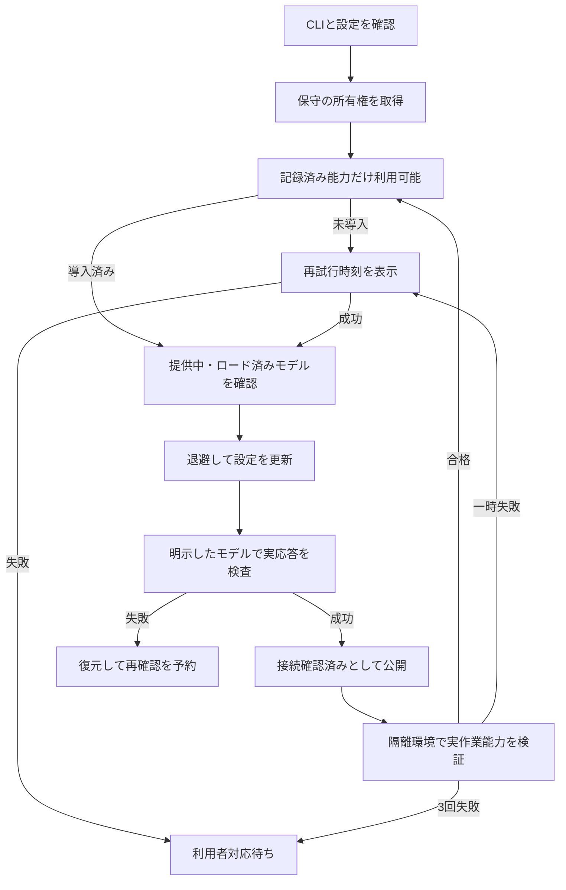

# エージェント接続の自動修復

## 判定

CLI（コマンドライン / Command Line Interface）の版を取得できても、モデルからの実応答がなければ利用可能にしません。接続確認と、実ファイルの読取り・変更・ホスト検証の能力試験は別の結果として表示します。

## 修復の手順

1. CLIの生存と設定の変化を確認します。未導入なら、登録済み・未停止の既知エージェントを公式パッケージから自動導入します。
2. 無料モデルの提供を確認し、一覧取得または実応答に失敗した場合はローカル推論サーバーのモデル一覧から候補を検証します。有料モデルは使いません。
3. LM Studioではロード済みモデルを優先し、廃止済みの設定値を繰り返しません。
4. 設定をバックアップ（Backup）して更新し、Gooseにはプロバイダーとモデルを起動引数で明示します。Codexは既存の `.codex/config.toml` のモデル・プロバイダー設定を使い、専用Runner（`codex exec --json`）で実行します。設定が無い場合は推測せず、利用者によるモデルIDの明示指定を求めます。
5. 短い確認文字列の実応答を検査します。CLIが終了コード0でエラー文章を返した場合も失敗です。
6. 成功後の実設定の指紋を保存し、24時間まで再利用します。失敗時は復元し、完了時点から1分後を次回確認予定とします。

## 一覧の状態と利用可能の判定

一覧の「リアルタイム状態」は、CLIの起動確認、モデル接続、実作業能力の3段階をまとめた表示です。

| 表示 | 意味 | 作業への割当 |
| --- | --- | --- |
| CLI未導入 / CLI起動失敗 | CLIが未導入、または起動確認に失敗 | 不可。自動導入または再確認 |
| 接続確認中 / 接続確認失敗・再試行待ち | モデル応答の確認中、または接続に失敗 | 不可 |
| 接続確認済み・作業未検証 | モデルの実応答は合格したが、作業能力の有効な証拠なし | 不可 |
| 実作業検証中 | 隔離環境で実ファイルを使った能力試験中 | 不可 |
| 実作業検証失敗・再試行待ち | 作業能力試験に失敗し、再試行時刻待ち | 不可 |
| 実作業検証・利用者対応待ち | 同じ設定で3回失敗し、自動試行を一時停止 | 不可。失敗理由と記録を調査 |
| 実作業検証期限切れ・再確認待ち | 合格記録が期限切れ | 不可。再確認が必要 |
| 実作業検証済み | 現在のモデル・接続設定・CLI版と一致する有効な作業合格記録あり | 記録済み能力の範囲内で可 |

「利用可能」件数へ含める条件も、接続確認だけでなく現在の設定に一致する実作業合格が有効であることとします。作業試験の失敗は、一覧から理由・失敗種別・次回試行予定を確認できます。

接続検査の待機上限は180秒です。Gooseの接続検査と保守の小規模読取り検査には1024トークンの出力予算を指定します。一般の制作・会話では通常の予算を使います。推論強度（Thinking Effort）はオフを要求しますが、プロバイダーとモデルが対応しない場合は出力予算と待機上限で制御します。

## CLI導入の保守

`WENTIAN_AGENT_AUTO_INSTALL` は既定で有効です。`false` なら未導入状態の理由として自動導入停止を表示します。候補カタログに存在するだけでは導入せず、登録済みかつ一時停止していないものだけを対象にします。解除・削除したエージェントは再導入しません。

導入中、起動確認成功、失敗・再試行待ち、手動対応が必要な状態を `agent-installations.json` に保存します。通信失敗等は1分から最大1時間の間隔で再試行します。導入コマンドの終了コードだけでは成功にせず、実際のCLIを起動して確認します。停止操作は進行中の導入を中断します。子プロセスの停止が不明な場合は重複導入を止めます。

Windowsのnpm（エヌピーエム / npm）導入では、Node.js 24 LTSをWentian専用領域へ準備します。公式HTTPSのチェックサムを照合し、PC全体のNode.jsとPATH設定は変更しません。常駐サーバーは既知のユーザー単位のnpm・WinGet導入先も検索します。導入方法をカタログで確認できない登録には、手動対応の理由を表示し、任意のCLI名からインストールコマンドを作りません。

OpenClawは単発の `agent exec` と実際の作業場所を使います。会話確認ではツールを無効にし、実作業では必要なローカルツールだけを許可します。既存の配送設定・プラグイン・履歴を単発実行へ持ち込みません。回答のJSON（ジェイソン / JSON）封筒は本文へ変換して検査します。

作業検証のマーカーは区切り空白を許容し、入力値は完全一致で検査します。実ファイル・設定保全・試験実行記録の検査は維持します。検証方式の変更時は旧失敗キャッシュを再利用しません。

導入元: [Crush公式手順](https://github.com/charmbracelet/crush)、[Cline公式手順](https://cline.bot/cli)、[OpenClaw公式手順](https://docs.openclaw.ai/install)、[Node.js公式配布](https://nodejs.org/dist/latest-v24.x/)。

## 複数サーバーの競合防止

同じ保存先を共有する複数のサーバーが、設定を互いに上書きすると修復が安定しません。SQLiteの排他トランザクション（Exclusive Transaction）で保守の所有者を決め、設定変更から実応答・能力試験まで同時実行を防ぎます。強制終了で残った所有権は、所有者PIDの停止を確認してから回収します。

## 開発変更の反映

ソースの変更だけでは、既に稼働中のサーバーへ適用されません。実行中の仕事と待受PIDを確認して再起動し、実応答と管理画面の状態まで検収してください。別ポートの旧サーバーも同じ保存先を共有していないか確認します。
