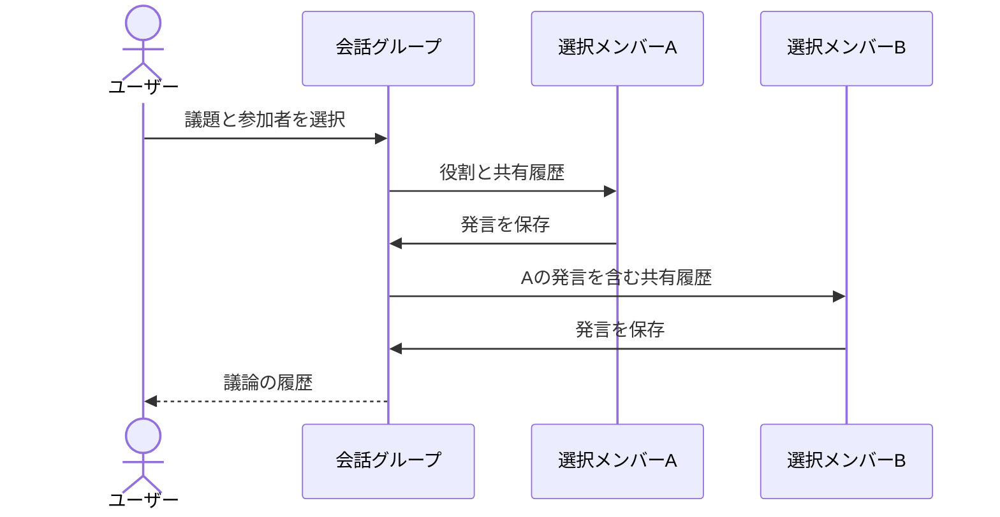
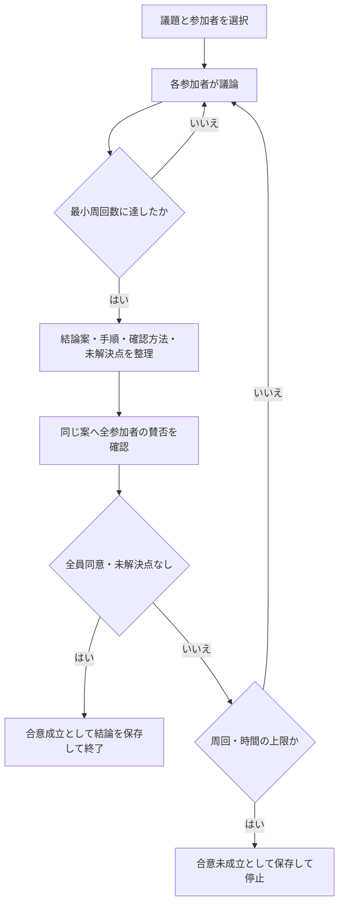
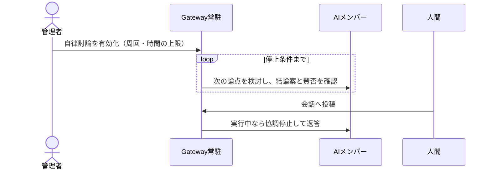

# AI会話グループ（Group）

## 人間のビデオ会議と遠隔支援

群画面の「ビデオ会議」から、同じ群の人間メンバーによる音声・映像・画面共有と、本人の同意付きWindows遠隔支援へ移動できます。AIのテキスト討論とは独立したプラグインです。[仕様・導入と検証](meetings_remote_assistance.md) を参照してください。

## 成果作成を既定にする進行方式

通常投稿・手動開始・自律実行では、司会AIによる担当選択、共有成果案の更新、完成条件の検証、書斎保存を行います。従来の会話は「自由討論」で利用できます。詳しくは [公開機能と制限](feature_scope.md) を参照してください。

## 一覧・管理画面

`/workbench/groups` の「AIグループ一覧・管理」で、管理者がグループ名、種類、参加者数、発言数、公開先、削除状態を確認できます。既存の `/workbench#groups` と共通メニューにも入口があります。会話・AIメンバー編集は各行の「会話」または変更パネル内のリンクから開きます。

名前変更、ページ別の公開・閉鎖、全ページ閉鎖、削除、復元に対応します。削除は会話履歴を保全する論理削除であり、全公開ページを閉鎖して通常一覧から除外します。「削除済み」フィルターから復元できますが、自動では再公開しません。AI議論中は名前変更と削除を拒否します。A2Aグループは通信・取引履歴を保護するため削除を拒否し、表示名変更と公開・閉鎖のみ可能です。

一覧APIには会話本文、メール、IPなどを含めません。管理操作は管理者認証と同一オリジン検査を通過する必要があります。公開の「閉鎖」は掲載の解除であり、AI会話やA2A通信の停止とは別です。[公開機能と制限](feature_scope.md)を参照してください。

## 会話グループの作成・運用

`wentian setup --port auto` の工作台にある「AI会話グループ」で主題を指定して作成します。参加者指定が空の場合は関連する専門メンバーを自動追加し、既存の空グループも管理者が選択した時に補完します。名前・役割・会話実行先は追加・編集・削除できます。CLIの空グループ作成には既定メンバーを設定しません。人数の固定上限はありません。各メンバーは独立した役割プロンプト（Prompt）と共有履歴で議論します。人間の参加、Plan／Action、公開・閉鎖を含む最終仕様は [公開機能と制限](feature_scope.md) を参照してください。

既定の実行先 `wentian-agent/auto` は、基盤のバックグラウンド（background）管理が更新する待機候補群（Ready Pool）を利用します。役割別の候補・稼働状態・実績・失敗後の待機時間で選び、同じ議論内では担当を維持しながら別参加者へ候補を分散します。旧設定 `wentian-auto/local`、`wentian-auto/all`、`wentian-auto/remote`、`wentian-auto/free` も、グループ議論ではこの管理済みエージェント経路へ送ります。一般チャットの自動モデル選択は変更しません。

会話用ランナー（Conversation Runner）はGoose、Hermes、Claude、Crush、Kilo、OpenCode、OpenClaw、Clineに対応します。最新の状態がavailableかつhealthyの候補を使用し、制作能力の分類やAPI代替用の除外設定では会話候補を除外しません。明示エージェント指定と失敗実績による冷却は維持します。履歴以外のファイル調査・変更、コマンド実行、Web調査を禁止する依頼文を渡し、毎回空の一時作業領域から起動します。Goose、Hermes、Claudeは専用の制限引数も使用します。他のランナーはツールの完全無効化を保証しません。応答形式が不正な場合は次の候補へ進みます。会話用候補がない場合は理由付きで失敗し、未検証のLLMへ自動代替しません。明示モデルID（例: `ollama/qwen2.5:7b`）を設定した場合だけ、そのモデルへ直接接続します。

議論に参加するメンバーを選び、議題を送信します。1〜5周で終了し、追加の議題で続行できます。全履歴は作業領域の `.wentian/groups/` に保存します。モデルへ送る履歴は直近60発言・最大48000文字です。登録人数に上限はありませんが、参加者が増えるほどモデル呼び出しと待ち時間が増えます。



## コマンドライン（CLI）

```powershell
wentian group create "開発相談室"
# 出力されたIDを以下のGROUP_IDに置き換えます。
# 以下のIDは例です。作成時に出力された自分のIDを設定してください。
$env:GROUP_ID = "group-28949898-6278-487a-99a8-2a6c6d79ab67"
# 管理済みの利用可能なエージェントから役割に応じて自動選択します。
wentian group add-member $env:GROUP_ID --name "小林" --role "設計を検討する" --model "wentian-agent/auto"
wentian group add-member $env:GROUP_ID --name "佐藤" --role "使いやすさを検討する" --model "wentian-agent/auto"
wentian group discuss $env:GROUP_ID --prompt "WentianのAI会話グループについて、失敗表示と再試行の具体的な改善案を相談してください" --rounds 2 --participants "小林,佐藤"
wentian group update-member $env:GROUP_ID --name "佐藤" --new-name "田中" --role "テストを検討する" --model "wentian-agent/auto"
wentian group remove-member $env:GROUP_ID --name "小林"
wentian group show $env:GROUP_ID
```

`--participants` を省略すると全員が発言します。`--workspace` で保存先、`--server` で議論用Gatewayを指定できます。更新コマンドでは名前以外の役割・実行先を再指定してください。Gatewayの稼働と10分以内に更新された管理キャッシュ（cache）が必要です。Gatewayは `wentian daemon start --port 8787` で起動できます。工作台の実行先入力には利用可能なエージェントも候補として表示されます。

管理済み経路は提案・理由・確認方法の構造と最低限の長さを検査し、2周目以降は他者の案への検討も要求します。空回答・形式不備・実行失敗は、設定された最大候補数まで次候補に引き継ぎます。実際の担当・引継ぎ理由・実測時間は発言の `execution` に保存し、画面でも担当を表示します。形式合格は内容の正しさや有用性を保証するものではありません。

`discussion.status` は `running`、`completed`、`failed`、発言数は `completedTurns` / `totalTurns` に保存します。画面の「全発言の取得終了」は取得・保存の終了を示し、提案の品質合格とは区別します。変更前の履歴に状態がなければ「過去の議論状態は未記録」と表示します。

補助スクリプト（Script）は `scripts/agent-group.ps1` と `scripts/agent-group.py` です。モデル失敗時も確定済みの発言を保持します。同時編集・議論はロック（Lock）で拒否します。異常終了でロックが残った場合は、実行プロセスの停止を確認して対応する `.lock` を削除します。議論は会話のみで、成果物の完成を保証するものではありません。

## 結論・合意までの自動続行

`--until-consensus` を付けると、初期検討の後に結論案を整理し、選択した参加者全員へ同じ案の賛否を確認します。全員が明示的に同意し、反対・未解決点がなく、実施手順と確認方法が揃った場合に自動終了します。整理担当の「全員が合意した」という文章だけでは終了しません。

```powershell
# 最低2周検討し、その後は各周で合意を確認します。最大8周または20分で停止します。
wentian group discuss $env:GROUP_ID --prompt "WentianのAI会話グループ機能の改善案を1つに絞り、実施手順と確認方法を合意してください。" --rounds 2 --until-consensus --max-rounds 8 --max-minutes 20 --participants "小林,佐藤,田中"
```

Python補助スクリプトからも同じ機能を使用できます。

```python
"""既存グループで、上限付きの自動合意を実行します。"""
import os
import subprocess
import sys

# PowerShellで設定したGROUP_IDを、起動したPythonへ引き継ぎます。
group_id = os.environ["GROUP_ID"]
# 同じCLI引数を配列として渡し、日本語と参加者の区切りを保持します。
result = subprocess.run([
    "py", "-3.14", "scripts/agent-group.py", "discuss", group_id,
    "--prompt", "WentianのAI会話グループ機能の改善案を1つに絞り、実施手順と確認方法を合意してください。",
    "--rounds", "2", "--until-consensus", "--max-rounds", "8",
    "--max-minutes", "20", "--participants", "小林,佐藤,田中",
], check=False)
# 実行失敗を呼び出し元へ伝えます。未合意の上限停止は保存された状態で区別します。
sys.exit(result.returncode)
```

- `--rounds`: 自動続行では判定開始前の最小周回数（1〜5、既定1）。指定なしの従来モードでは固定周回数。
- `--max-rounds`: 自動続行の最大周回数（最小周回数以上、最大20、既定8）。
- `--max-minutes`: 自動続行の時間上限（1〜120分、既定20）。
- 合意確認は通常発言とは別の呼出しで、各判定につき整理1回＋参加人数分の賛否確認を行うため、時間・利用量が増える。

工作台では「結論・合意まで自動続行」を選び、最大周回数と時間を指定します。合意時は結論・実施手順・確認方法を表示します。上限到達時は `inconclusive`（合意未成立）として、最後の結論案と反対・未解決点を保存します。議題を追加して再実行すると履歴を引き継げます。自動続行を選ばない場合は従来の固定回数のままです。

`discussion.checks` に案のハッシュ（hash）、全参加者の賛否・理由、判定結果を逐次保存します。別の案への同意、不正なJSON、応答失敗は合意扱いにせず `failed` として確定履歴を保持します。AI参加者の合意は、人間の承認や提案の実装完了・事実の正しさを意味しません。



## AIの自律討論（サーバー常駐）

人間が参加しなくても、AIメンバーが自ら議題を決めて議論を続けられます。実行はGatewayサーバーに常駐するため、会話画面を閉じても続きます。管理者は会話画面の「AIの自律討論（サーバー常駐）」パネルで有効化・停止と、最大周回数・最大時間を設定します。

停止条件は「合意成立・周回上限・時間上限・人間の発言・停止操作」です。停止後は自動で再開しません。人間が発言すると実行中の自律討論を協調停止し、途中経過を残してから返答します。会話のみを続け、Plan／Actionや実ファイル操作は起動しません。

設定は会話本文と同じ台帳へ混ぜず、`.wentian/groups/<id>.autonomy` に保存します。初期の議題がないグループには題名から論点を提起させます。詳細は [公開機能と制限](feature_scope.md) を参照してください。



## メンション

会話入力の `@名前`、`@all` / `@everyone`、`@here` に対応する。候補補完、宛先AIへの選択的な返答依頼、本人宛ての画面内未読通知を利用できる。仕様と制約は [公開機能と制限](feature_scope.md) を参照。

## Wentian Startup Forge

群聊内の「Wentian Startup Forge · 構想を事業へ」から、AIチーム・事業仮説・検証計画・依存関係付きタスクを生成し、既存のGoalへ登録して実行・一時停止できる。管理者向けの機能で、元の群メンバーと会話履歴は置換しない。操作・API・保存先・制限は [Startup Forge仕様](startup_forge.md) を参照。
