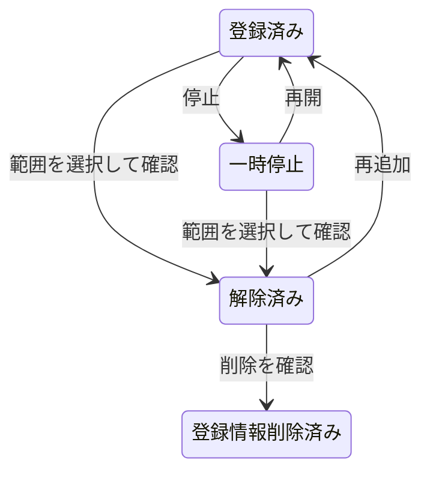

# 外部エージェント管理

一覧は `No / 外部エージェント / リアルタイム状態 / 最終確認 / 補足 / 操作` の6列です。証跡と確認コマンドは補足へ表示します。

- ▲▼は利用優先順位を保存します。自動選択では利用可能な候補の間でこの順位を優先し、接続・作業能力の検証条件は引き続き適用します。明示したエージェント順序と継続会話の担当は維持します。
- 一時停止は自動保守と利用を停止します。再開は停止設定を解除します。
- アンインストール時に「Wentianの登録だけ解除」「PC上のCLI本体も削除」を選択します。キャンセルでは登録を変更しません。
- CLI（コマンドライン / Command Line Interface）本体の削除は、Windowsのnpmシム（Shim）とパッケージの実ファイルから導入元を確認できる場合に対応します。削除対象を表示し、管理者・対象・有効期限に紐付けた承認で実行します。確認できない導入方法では元のアンインストーラーを案内します。
- 解除したエージェントは「高度な機能 → エージェントを追加」の解除済み一覧へ移動します。再追加または登録情報の削除ができます。登録情報の削除はCLI本体・認証情報・履歴を削除しません。

順位・解除済み情報はマシン設定の `agent-management.json` に保存します。試験では `WENTIAN_AGENT_MANAGEMENT_FILE` で隔離します。
