# Wentian Gateway 全体アーキテクチャー

## 2026-10-07の追加コンポーネント

Personal Cloudは端末登録・署名付き通信・コンテナ実行・配置判断を `src/personal-cloud/` に分離します。制作系は `src/video-generation.ts` と `src/media-production.ts` が認証・所有者・永続キュー（Queue）を管理し、専用Pythonワーカー（Worker）がComfyUIなしで生成・FFmpeg編集を実行します。`src/media-model-maintenance.ts` は取得許可と版を保持してモデルを修復します。`src/media-agent-capabilities.ts` はCLI・Web会話へ共通の能力・診断を渡します。[公開機能と制限](feature_scope.md)から詳細仕様と検証範囲を参照できます。

Mail Solutionsは `src/mail-operations.ts` が業務・分類保存、`src/mail-taxonomy.ts` が自由分類設定、`src/mail-ai.ts` と `scripts/propose-mail-categories.py` が基底モデル接続を担当します。未分類を開くとAIが先に判断・保存し、人の修正は任意です。主保存先はSQLiteと原文ファイル、分類設定は学習ディレクトリの `taxonomy.json`、PostgreSQLとMinIO/S3は任意です。既定はWentianの有効学習設定の基底モデルを再利用し、外部エージェントへ委任しません。[Mail Solutions現行仕様](mail_solutions_specification.md)にAPI・制約・検証範囲を記載します。

## 1. 目的

Wentian Gatewayは、OpenAI互換クライアントの接続先を一本化し、ローカルおよび外部のLLM（大規模言語モデル / Large Language Model）へ安全にルーティングするローカルファーストのGateway（ゲートウェイ / Gateway）です。Manager（マネージャー / Manager）は、RAM／VRAM、モデル能力、ロード状態、障害状態を観測し、自動選択と安全なライフサイクル操作を支援します。

## 2. システム全体構成

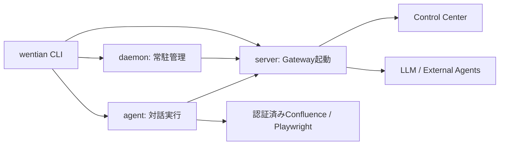

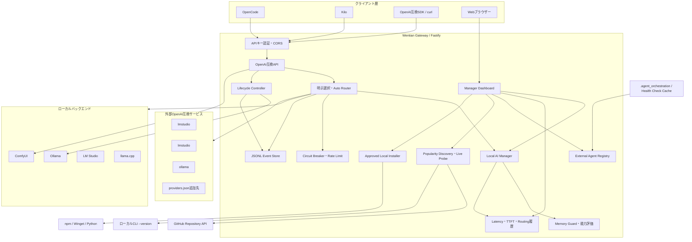

## 3. コンポーネント責務

| コンポーネント | 実装 | 主な責務 |
|---|---|---|
| APIサーバー | `src/server.ts` | Fastify起動、認証、CORS、API公開、ルーティング統合 |
| 設定 | `src/config.ts` | `providers.json`解析、URL安全性、環境変数スキーマ検証 |
| Proxy | `src/proxy.ts` | 許可パス、HTTPエラー分類、SSE中継、切断・タイムアウト伝播 |
| Manager | `src/manager.ts` | RAM／VRAM観測、モデル検出、必要メモリ推定、安全性と能力順位付け |
| Lifecycle | `src/lifecycle.ts` | dry-run、短期限承認、Ollama状態変更、実行後確認、ComfyUIジョブ |
| Storage | `src/storage.ts` | Routing／Metric／Audit／CircuitイベントのサニタイズとJSONL永続化 |
| Dashboard | `src/dashboard.ts` | Control Centerとしてプロバイダー、モデル、資源、外部エージェント、履歴、管理操作を表示 |
| External Agent Registry | `src/external-agents.ts` / `src/manual-agent-registry.ts` | CLIリアルタイム検査、組込・手動登録、ローカル台帳の安全な永続化 |
| Terminal Draft Editor | `src/terminal-draft.ts` | TUI複数行入力、カーソル移動、Shift/Ctrl+Enter改行、端末互換フォールバック |
| Image Input | `src/image-input.ts` | ファイル・Windowsクリップボード画像、形式・容量検査、Data URL化、モデル単位のVisionルーティング要求 |
| Agent Marketplace | `src/agent-marketplace.ts` | GitHub Star人気度、上位10候補、ローカルCLI生存確認、承認付き導入 |

## 4. チャット要求の流れ

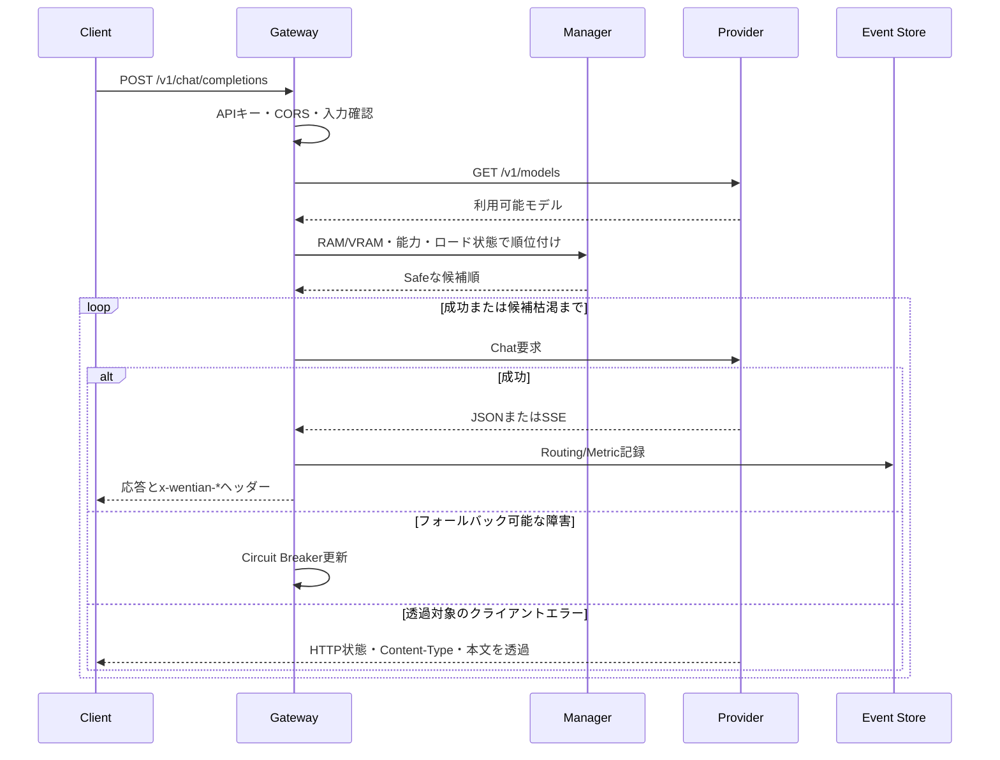

仮想モデルのスコープは次のとおりです。

| モデルID | 候補範囲 |
|---|---|
| `wentian-auto/local` | ローカルLLMのみ |
| `wentian-auto/remote` | 外部LLMのみ |
| `wentian-auto/all` | ローカルと外部 |
| `provider/model-id` | 指定プロバイダーの指定モデル |

## 5. Managerの安全判定

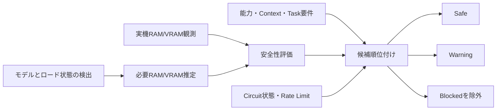

`Unknown`、資源不足、未対応Adapter（アダプター / Adapter）は安全側へ倒し、状態変更せず読み取り専用監視へ縮退します。

## 6. 状態変更の安全境界

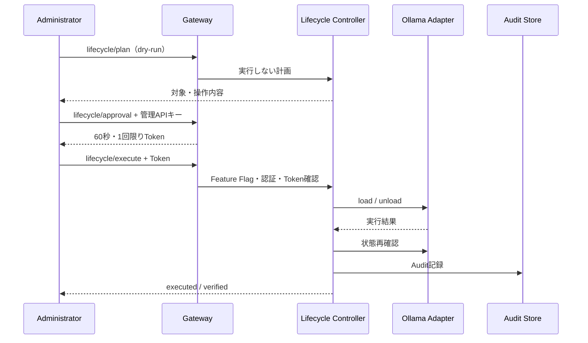

状態変更とComfyUIジョブは既定無効です。`WENTIAN_ENABLE_STATE_CHANGES=true` または `WENTIAN_ENABLE_COMFYUI_JOBS=true` に加え、`WENTIAN_API_KEY`による管理認証が必要です。

## 7. データと秘密情報

- `providers.json`: Providerメタデータ。秘密鍵は書かず、`apiKeyEnv`で環境変数名を参照します。
- `.env`: ローカル秘密情報を含み得るためGit管理外です。
- `.wentian/events.jsonl`: サニタイズ済みイベント。Prompt（プロンプト / Prompt）、Token、Authorizationなどは禁止キーとして除外します。
- `.e2e/`: E2Eログ。Git管理外です。

## 8. 現在の対応範囲

- OpenAI Chat Completions、Responses、Embeddings、Audio Transcriptions
- Anthropic Messages、Rerank
- JSONおよびSSE透過中継、クライアント切断伝播
- Auto Local／Remote／All、フォールバック、セッションAffinity（アフィニティ / Affinity）
- RAM、NVIDIA／AMD／Intel VRAM、モデル安全性、Circuit Breaker、Latency／TTFT
- Ollamaの承認付き状態変更、ComfyUIジョブ境界
- LM Studio／llama.cppの状態変更は共通Adapter境界までで、未対応環境では読み取り専用です。

## 9. Agent入力解析の現状と目標設計

### 9.1 現在の処理方式

現在の`wentian agent`は、通常のユーザー入力を最初にPlanner AI（計画AI / Planner AI）へ渡すPlanner中心方式です。TypeScriptのルールベース（Rule-based）処理は、Plannerより先に意味を決める主経路ではなく、構造化出力の検証、安全境界、Planner異常時のフォールバックを担当します。

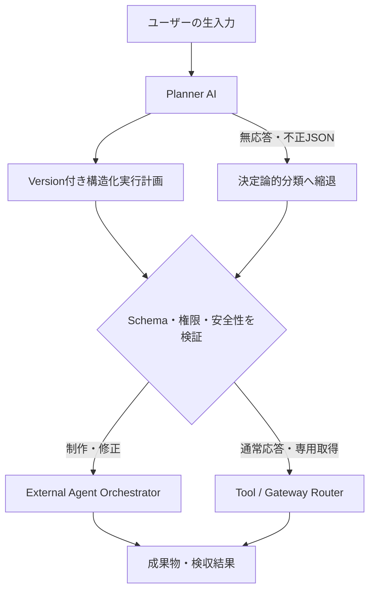

Plannerは意図、必要能力、添付候補、Tool候補、外部委譲を自然言語から構造化します。パスの実在確認、秘密情報保護、書込み範囲、コマンド許可、モデル能力の強制は決定論的コードが担当します。これにより、新しい言い回しへの対応をPlannerへ寄せながら、AIの判断だけでファイル操作やコマンド実行を許可しない構成にしています。

### 9.2 Planner中心方式の目標

入力の意味理解をPlanner AIへ任せ、構造化された実行計画を決定論的コードが検証・実行する基盤は実装済みです。今後はPlanner Schema、能力照合、受入判定の精度と対応Runnerを拡充します。

`WENTIAN_PLANNER_MODEL`または`agent-selection.json`でPlannerを指定し、既定値は`wentian-auto/all`です。有効化済み自己学習モデルを優先し、APIが不通の場合はSystem Promptを保持して正常確認済みKilo／OpenCodeで分類を代替します。各出力に同じSchema検証を適用します。認証・利用制限・予算エラーは外部接続で回避せず、APIの不正JSONは同じモデルで修正を試みます。全経路失敗時は固定キーワードから書込み権限を推測せず安全停止します。詳細は[公開機能と制限](feature_scope.md)と[公開機能と制限](feature_scope.md)を参照してください。

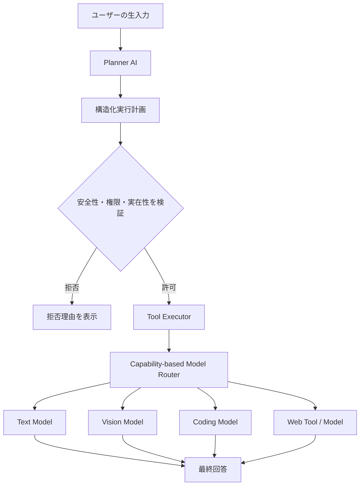

Plannerの出力例を次に示します。実際のスキーマは実装時にVersion（バージョン / Version）を付け、JSON Schemaで検証します。

```json
{
  "language": "ja",
  "intent": "analyze_image",
  "text": "何の画像ですか教えて",
  "attachments": [
    {
      "type": "local_file",
      "path": "C:\\Users\\user\\screen.png"
    }
  ],
  "required_capabilities": ["vision"],
  "tools": ["read_image"],
  "response_language": "ja"
}
```

### 9.3 外部エージェント自動オーケストレーション

Plannerが制作・実装・修正、独立して並行化できる作業、または外部エージェントによるレビューが有効な作業と判断した場合は、External Agent Orchestrator（外部エージェント・オーケストレーター / External Agent Orchestrator）へ構造化タスクを渡します。制作依頼ではユーザーが外部委譲を明記しなくても、次の外部Agent優先経路を選択します。

Gateway Daemon（ゲートウェイ・デーモン / Gateway Daemon）は要求がない間もExternal Agent Readiness Manager（外部エージェント待機管理 / External Agent Readiness Manager）を動かします。起動直後と既定5分間隔で生存確認し、正常なAgentを`image`、`text`、`coding`、`testing`、`verification`へ分類します。結果は`.wentian/external-agent-readiness.json`へAtomicに保存されるため、別プロセスの`wentian agent`も要求到着時にReady Poolを即時利用できます。

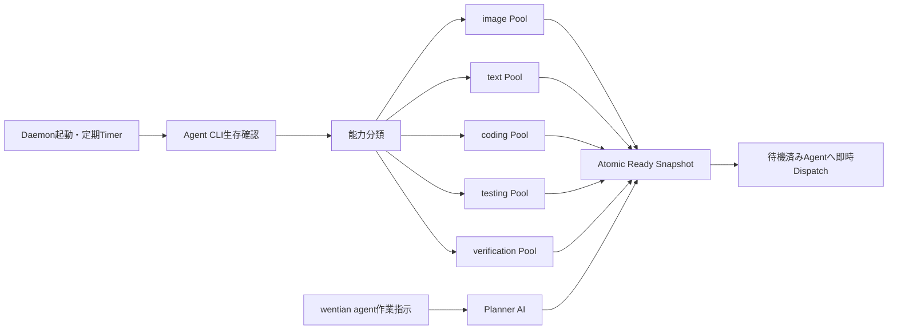

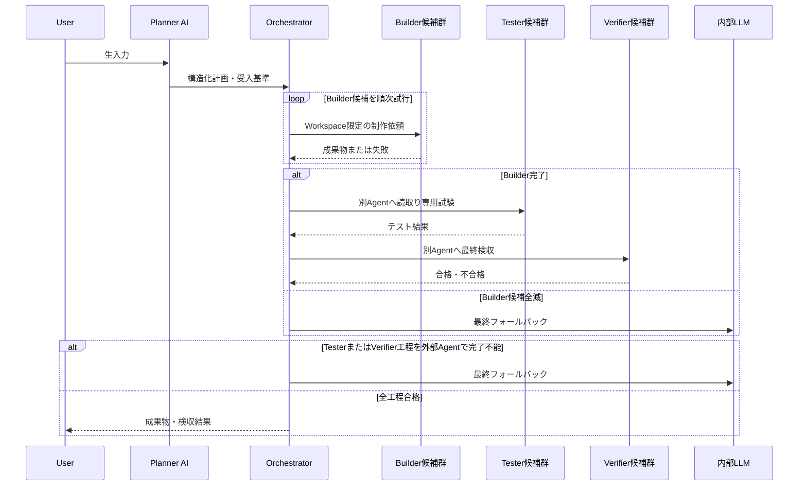

同一役割の候補は順番に再試行し、候補を使い切る前に内部LLMへ切り替えません。制作工程は書込み競合を避けるため直列で進め、独立した読み取り専用レビューだけを最大3件まで並列実行できます。

Timeoutまたは`Esc`による中断時は、Windowsのプロセスツリー終了処理の完了と対象PIDの消滅確認を待ちます。残存時は最大2回まで終了を試行し、その確認結果をCLIとManifestへ記録してから次候補へ進みます。外部のBuilder、Tester、Verifierがすべて完了した場合は内部LLMを呼ばず、外部Agentの成果物と検収結果を最終結果とします。

プロセス管理の状態遷移は次のとおりです。

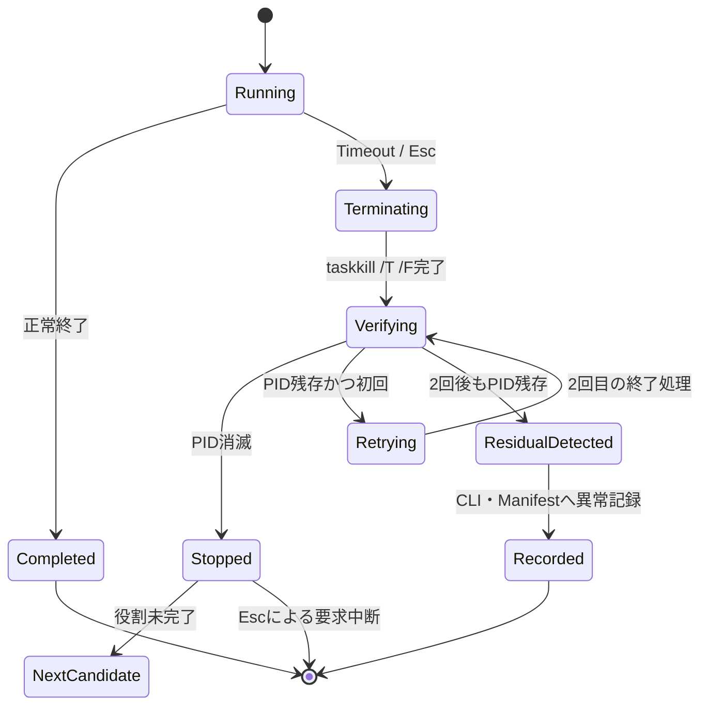

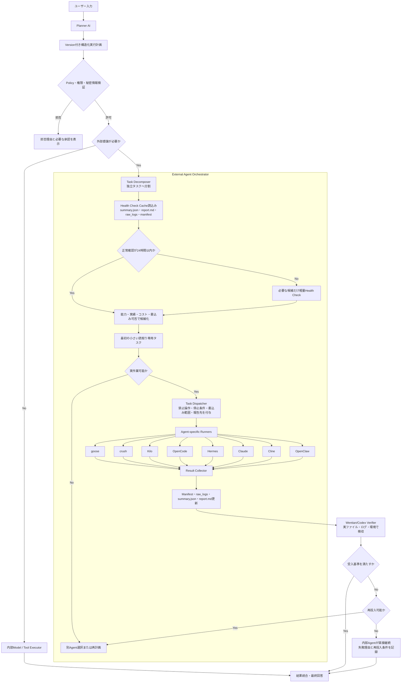

自動選定ではCLIが存在するだけで実作業可能とは判定しません。Health Check（生存確認 / Health Check）と、対象ファイルの先頭行読取りなどの小さい読み取り専用タスクを分けて評価します。直近24時間以内の正常な証跡は再利用し、PC再起動、CLI・モデル・設定・認証情報の変更、直近失敗、24時間超過、重要または長時間作業の場合だけ必要な候補を再確認します。

PlannerからOrchestratorへ渡すタスクには、少なくとも次を含めます。

| フィールド | 内容 |
|---|---|
| `task_id` / `parent_task_id` | 親子関係を追跡できる一意なタスクID |
| `objective` | エージェントが達成すべき具体的な目的 |
| `required_capabilities` | 読取り、編集、Terminal、Web、Browser、レビューなどの必要能力 |
| `allowed_write_paths` | 書込みを許可するファイルまたはディレクトリー |
| `forbidden_operations` | delete、drop、patch、scale、外部送信などの禁止操作 |
| `stop_conditions` | Timeout、同一エラー回数、権限不足などの停止条件 |
| `acceptance_criteria` | 成果を採用するためのテストと確認条件 |
| `report_path` | 完全な実行コマンド、結果、未解決事項を保存する場所 |

複数エージェントへ並行投入するのは、タスク間に書込み競合がなく、成果を独立して検収できる場合に限定します。同一ファイルを複数エージェントが編集する場合は、原則として一方を実装担当、他方を読み取り専用レビュー担当にします。外部エージェントの報告は自動採用せず、Verifierが実ファイル、実行ログ、テスト結果、環境状態を確認してから統合します。

#### 現在の実装状態

前掲の全体図には将来対応Runnerも含みます。現在実装されている範囲と未実装範囲は次のとおりです。

| 機能 | 状態 |
|---|---|
| 外部エージェント台帳、CLI存在・Versionのリアルタイム確認 | 実装済み |
| `.agent_orchestration/summary.json`の証跡読込みとControl Center表示 | 実装済み |
| 承認付き外部エージェント導入API | 実装済み・既定無効 |
| AGENTS.mdに基づく24時間キャッシュ、軽量確認、禁止操作の運用 | 手順として運用中 |
| Plannerによる入力分類、Task Schema生成、Agent能力の自動照合 | 実装済み |
| Agent別Runnerによる自動編成 | goose、crush、Kilo、OpenCodeに対応。制作はbuilder→tester→verifierを順次実行し、独立レビューは最大3件を並列実行 |
| Manifest更新と成果統合 | 実装済み |
| 成果物の自動受入テスト、失敗理由に応じた再投入 | 段階実装中 |

制作依頼ではPlannerが外部委譲を自動設定し、書込み可能なbuilderを1つ、読み取り専用testerとverifierを別Agentへ割り当てます。内部LLMのTool実行は、外部Agent編成不能または全段階を完了できなかった場合だけフォールバックとして使用します。`WENTIAN_ENABLE_EXTERNAL_ORCHESTRATION=false`を設定するとRunnerを停止し、計画とManifestだけを生成できます。AGENTS.md固有の詳細ルールと既存`.agent_orchestration`スクリプトは引き続き上位Policyとして適用します。

### 9.4 AIと決定論的コードの責務分離

AIに入力解釈を任せても、ファイルアクセスやコマンド実行を無検証で許可してはいけません。責務は次のように分離します。

| 判断・処理 | 担当 |
|---|---|
| 入力内のパス、質問、意図、希望言語の候補抽出 | Planner AI |
| 必要な能力とTool候補の作成 | Planner AI |
| Providerと実モデルの候補順位付け | Gateway Router |
| パスの実在、形式、サイズ、許可範囲の検証 | 決定論的な安全検証コード |
| コマンドの許可、Timeout、破壊操作の拒否 | 決定論的な安全検証コード |
| 秘密情報、外部送信、認証、承認の検証 | 決定論的な安全検証コード |
| Tool実行結果を使った最終回答 | 選択された実行モデル |

ローカルファイルのパス文字列をPlannerが画像候補と判断しても、AI自身がWindowsファイルを直接読めるわけではありません。Wentianがパスを検証してファイルを読み込み、安全な形式へ変換した後、Vision対応モデルへ渡します。

### 9.5 継続移行方針

Plannerは主経路へ移行済みです。既存ルールは撤去せず、安全ガードと障害時の縮退経路として維持します。以後は次の項目を段階的に強化します。

1. Planner用のVersion付き構造化出力Schemaを拡張し、互換性を維持する。
2. パス検証、Tool権限、秘密情報、外部送信制御をPolicy層へ集約する。
3. Hermes、Claude、Cline、OpenClawを含むAgent別Runnerを、安全性検証後に追加する。
4. 成果物種別ごとの自動受入テストと、失敗理由に応じた再投入を拡充する。
5. Manifest、raw logs、成果物、検収結果を単一Task IDで追跡する範囲を広げる。
6. 判断理由、選択Tool、要求能力、Agent選択をCLIへリアルタイム表示し続ける。

この設計により、新しい自然言語表現への適応性を高めながら、AIの誤判断による任意ファイル読取りや危険なコマンド実行を防止します。
