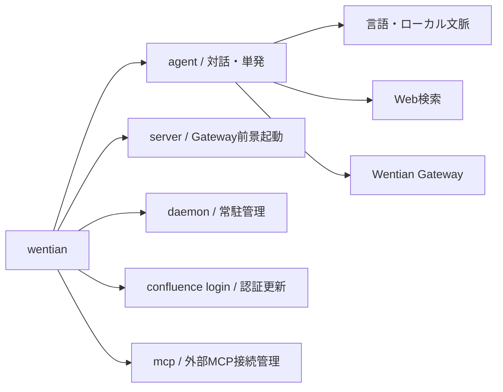
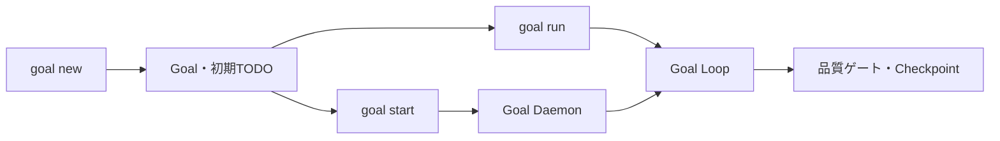
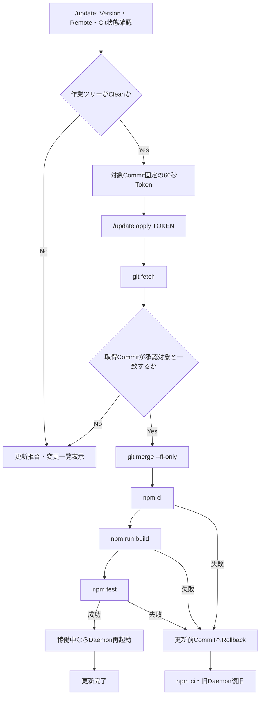
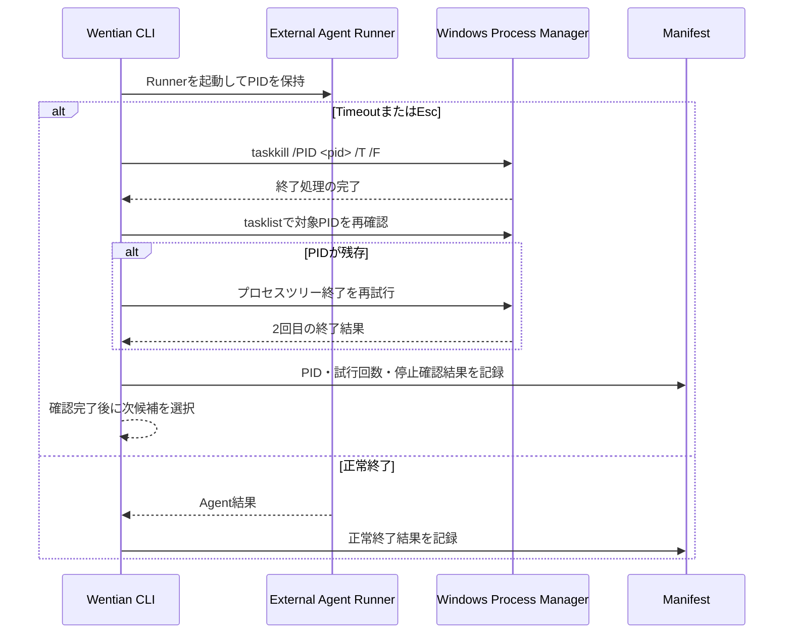

# Wentian CLI・Agent機能仕様

## 2026-10-29 実行範囲の既定値

Agent自動保守と `wentian agents verify` の専用領域での検証は、既定の保守権限を使用します。Agentごとの1〜24時間の許可更新は不要です。通常の会話・プロジェクト作業は、一度設定したプロジェクト範囲を再利用します。範囲外・接続先変更・明示取消の診断はAgent画面から確認します。一時停止を再開しても、取り消した権限は復元しません。[現行仕様](execution_defaults.md)を参照してください。

## 2026-10-07の追加・修正

- `wentian daemon restart` は旧常駐サーバー（デーモン / daemon）のポート解放を待って再起動します。別プロセスが使用しているポートは占有しません。
- `wentian node enroll`、`run`、`diagnose`、`verify-gpu` は [Personal Cloudの利用手順](personal_cloud_implementation.md) を参照してください。
- Agentの `inspect_media_capabilities` はローカル制作環境を読み取り専用で診断します。CLI・Web会話へ能力と現在の準備状態を渡し、小型動画モデルの検証専用制限も説明します。
- 生成・編集の会話ツールは未公開です。実制作は `/media-studio` と `/videos` を使います。起動済みCLIは `/exit` 後に `wentian agent` で再起動します。[公開機能と制限](feature_scope.md)を参照してください。

外部MCPの接続設定・許可・実行例は [MCPクライアント利用方法](./MCP_CLIENT_USAGE.md) を参照してください。`wentian mcp` は稼働Gatewayへ管理者のAPIキーで接続し、`--server URL` はすべての操作で使えます。変更承認は本人・ツール・引数固定の60秒単発です。

## 1. コマンド構成



| コマンド | 用途 |
|---|---|
| `wentian web [--port PORT\|auto] [--hostname HOST] [--cors ORIGIN] [--no-open]` | Gatewayを起動し、モデル選択・複数ターン・ストリーミング対応のWeb対話画面を既定ブラウザーで開く |
| `wentian doctor [--server URL] [--json]` | Daemon、Health、モデル、MCP、Provider、OpenCode／Kilo、外部Agentキャッシュを読み取り専用で一括診断 |
| `wentian mcp list` | 外部MCP接続の設定・接続状態をJSON表示 |
| `wentian mcp add --config FILE` / `update ID --config FILE` / `remove ID` | 1接続JSONの登録・更新・削除 |
| `wentian security api-key generate [--force]` | Windowsの現在ユーザー環境変数へ強い`WENTIAN_API_KEY`を保存。既存値は通常維持し、`--force`で再発行 |
| `wentian mcp connect\|disconnect\|reconnect\|enable\|disable ID` | 接続・切断・再接続・有効／無効 |
| `wentian mcp tools\|resources\|templates\|prompts\|ping\|notifications ID` | 発見・生存確認・通知 |
| `wentian mcp request ID METHOD --json JSON` | 資料・プロンプト取得・補完・購読・ログレベル |
| `wentian mcp approve\|call ID TOOL --json JSON [--approval-token TOKEN] [--server URL]` | 変更承認・実行。許可済み読み取りは承認不要 |
| `wentian agent [依頼]` | 単発または対話型Agentを起動 |
| `wentian agent --web [依頼]` | 一般Web検索を明示 |
| `wentian agent --verbose [依頼]` | 中間イベントとTODOを常時表示 |
| `wentian agent --execution-mode direct\|delegate\|propose\|auto --allow-write PATH --timeout-ms MS --wait-on-limit --json -- [依頼]` | 実行方式・許可範囲・期限を明示。構造化結果と終了コードを返す。`--wait-on-limit` は上流利用制限（HTTP 429／402）で待って再試行する明示スイッチ（既定は待機せず即失敗） |
| `wentian agents [--json]` | 接続確認と実装能力検証の内訳を台帳の読み取りだけで報告（Agentを起動せずTokensを消費しない）。実装能力検証済みが0件のときは終了コード2 |
| `wentian agents verify [AGENT_ID...\|all] [--cache-dir DIR]` | 実装能力検証（単体実行とWentian経由の同一小修正＋ホスト検収）を実行して能力台帳へ記録。合否は終了コード0／2／1 |

制作完了は実差分・ホスト受入検証・原本反映で判定します。検収待ちは終了コード2、失敗は1、時間切れは124です。詳細は[公開機能と制限](feature_scope.md)を参照してください。

書込み範囲の既定値は空です。依頼文で明示した作業先（`C:\temp` など）への書込みは、その作業先内の `.` として自動許可します。明示作業先がなく、`--allow-write` も依頼文の許可範囲もない場合は検収待ちで停止します。全体許可を明示する場合は `--allow-write .` を使用します。受入設定がない制作は、変更をTargetへ反映したうえで `needs_review`（終了コード2）になります。Git無視対象は隔離コピーへ含めず、許可対象へ指定しても変更できません。

### 実装能力検証（Work Capability Verification）

`wentian agents` は「接続確認済み（応答が返る）」と「実作業を任せられる（小修正を完遂できる）」を分けて報告します。実装能力検証が未合格のAgentはBuilderへ昇格せず、制作Taskは外部CLIを起動せずに停止理由を残します。検証は台帳（`.wentian/agent-work-capabilities.json`）へ24時間の有効期限付きで記録され、未完了時は15分→最大6時間の間隔で再試行、同一設定で連続3回失敗すると対応待ち（再試行24時間）になります。

```powershell
wentian agents                       # 状態報告のみ（Agentを起動しない）
wentian agents verify all            # 全管理対象の実装能力検証（実CLIを起動しTokensを消費する）
pwsh -NoProfile -File scripts/verify-agent-work.ps1 -StatusOnly
python scripts/verify-agent-work.py --agent goose
```

終了コードは0（合格）、2（未合格＝検収待ち）、1（検証実行の失敗）、124（時間切れ）です。

開発時に`npm link`で登録すると、任意のディレクトリーから起動できますが、リンク先のチェックアウトを直接実行します。そのため開発リポジトリ内で事前に`npm ci`を実行してください。通常利用では公式インストーラーを使います。ランチャーは自身の配置場所からインストール元を求めるため、開発時のチェックアウトパスを製品へ固定しません。設定、Provider定義、Daemon台帳はインストール元を参照し、Agentのファイル読取り・書込み・コマンド実行範囲はコマンドを起動したカレントディレクトリーになります。
| `wentian server` | Gatewayをフォアグラウンド起動 |
| `wentian daemon start/status/logs/restart/stop` | Gatewayの常駐管理 |
| `wentian confluence login` | 可視ブラウザーでConfluence認証状態を更新 |

## 2. Server・Daemon

```powershell
wentian server --port 8787 --hostname 127.0.0.1
wentian server --port auto
wentian daemon start --port auto --hostname 127.0.0.1
wentian daemon status
wentian daemon logs
wentian daemon restart
wentian daemon restart --port auto
wentian daemon stop
```

- 既定ポートは `8787`、既定バインド先は `127.0.0.1` です。
- `--port auto` は `8787..8806` を順番に検査します。
- PID、ポート、開始時刻、ログは `.wentian/runtime/` に保存します。
- `daemon status` は稼働状態、接続URL、Health URL、PID、開始時刻、ログ位置を常に表示します。
- 起動中PIDがある場合は二重起動を拒否します。
- `restart`は既存Daemonを停止してから新しいDaemonを起動し、外部Agentのバックグラウンド生存確認も再開します。
- 更新後は`status`、`/health`、`/v1/manager/external-agents`の順に確認します。
- mDNS（マルチキャストDNS / Multicast DNS）は未実装です。

```powershell
wentian daemon restart
wentian daemon status
curl.exe -sS 'http://127.0.0.1:8787/health'

ローカルLLM Providerが停止中でも外部Agent Text Poolが利用可能なら、`/health`はHTTP 200と`status=fallback_ready`を返します。両経路が利用不能な場合だけHTTP 503になります。詳細は[公開機能と制限](feature_scope.md)を参照してください。
curl.exe -sS 'http://127.0.0.1:8787/v1/manager/external-agents'
```

## 3. Agent入力

```powershell
wentian agent "現在のパスを教えて"
wentian agent "本日の飯田橋の天気を教えて"
wentian agent "USD/JPYの為替を教えて"
```

通常の複数行入力:

```text
wentian agent
wentian> 1行目（Shift+Enterで改行）
... 2行目（矢印キーで前の行も修正可能）
```

| キー | 動作 |
|---|---|
| `Enter` | 入力内容を送信 |
| `Shift + Enter` | 改行 |
| `Ctrl + Enter` | 改行（対応端末） |
| `Ctrl + J` | 互換性の高い改行 |
| `↑` / `↓` | 単一行入力時は送信履歴を呼び出し／進める。複数行ドラフト内では行移動 |
| `Home` / `End` | 現在行の先頭・末尾へ移動 |
| `Backspace` / `Delete` | カーソル前後の文字を削除 |
| `Ctrl + C` | 入力中ならドラフト取消し、空欄ならAgent終了 |

`↑`/`↓` による送信履歴呼び出しは最新100件を保持し、同一内容の連続送信は1件へまとめられます。Codex CLIと同じく、`↑` で履歴を遡り `↓` で戻ると、ナビゲート開始時点の編集中テキストが復元されます。

### Goal操作

| Slash Command | コマンドライン | 動作 |
|---|---|---|
| `/goal new <TITLE>` | `wentian agent --goal new <TITLE>` | Goalと最初のTODOを作成 |
| `/goal list` | `wentian agent --goal list` | Goal一覧を表示 |
| `/goal run <ID>` | `wentian agent --goal run <ID>` | 現在の端末でGoal Loopを実行 |
| `/goal start <ID>` | `wentian agent --goal start <ID>` | Goal Daemonをバックグラウンド起動 |
| `/goal status <ID>` | `wentian agent --goal status <ID>` | 進捗とDaemon状態を表示 |
| `/goal stop <ID>` | `wentian agent --goal stop <ID>` | Goal Daemonを停止 |



### Slash Command

対話型Agentでは、Codexと同様に先頭へ`/`を付けたSlash Command（スラッシュコマンド / Slash Command）を使用できます。終了には`/exit`または`/quit`を使用します。従来の`exit`と`quit`も互換性のため利用できます。

`/`を入力した瞬間に、利用可能なSlash Command候補を即時表示します。さらに`/st`のように続けて打鍵すると、プレフィックスに一致する候補だけに絞り込みます。Codex風の入力体験を維持しつつ、ミスタッチで未対応コマンドを送信する事故を防ぎます。すべての表示はWindows Terminal+OpenTUI経路とレガシーreadline経路の両方で動作します。

| コマンド | 動作 |
|---|---|
| `/status` | Workspace、Server、Daemon、Model、会話件数、添付画像、外部Agent Ready Poolを表示 |
| `/update` | 現在版、Remote最新版、Git状態を確認し、更新可能なら60秒Tokenを発行 |
| `/update apply <TOKEN>` | 承認済みCommitを更新、検証し、成功時にDaemonを再起動 |
| `/training status` | 自己LLM学習データの有効状態、件数、容量、保存先を表示 |
| `/training on` / `/training off` | 学習例の蓄積を明示的に有効化・無効化 |
| `/model` | 現在のモデルを表示 |
| `/model <MODEL>` | この対話で使用するモデルを変更 |
| `/new` / `/clear` | 会話履歴を消去して新しい会話を開始 |
| `/image <FILE>` | 画像を添付 |
| `/paste-image` | クリップボード画像を添付 |
| `/images` | 送信待ち画像を一覧表示 |
| `/clear-images` | 送信待ち画像をすべて解除 |
| `/multi` | 互換複数行入力を開始 |
| `/help` | Slash Command一覧を表示 |
| `/exit` / `/quit` | Wentian Agentを終了 |

未対応の`/`コマンドはAIへの質問として送信せず、エラーと`/help`の案内を表示します。URLなど、先頭からSlash Command形式になっていない文章には影響しません。入力途中で`/`を打ち込んだ直後から候補一覧が表示されるため、未対応コマンドへ進む前に正しい候補へ戻ることができます。

### Session保存・再開

対話型Agentは会話をローカルのSession（セッション / Session）へ自動保存します。`/exit`、`/quit`、または空入力での`Ctrl+C`による終了時には、Token usage（トークン使用量 / Token Usage）、Session ID、再開コマンドを表示します。

```text
Token usage: total=135 input=120 (+ 80 cached) output=15 (reasoning 4)
このセッションを再開するには、次を実行してください:
  wentian resume wt-20260904-123456-abcdef12
```

`wentian resume <SESSION_ID>`は指定Sessionを直接再開します。IDを省略した`wentian resume`では、更新日時が新しい順に保存済みSessionを表示し、番号で選択できます。Provider（プロバイダー / Provider）がUsageを返さない場合、該当リクエストのToken数は`0`として扱います。

### Version更新

`/update`は確認だけを行い、ソースを変更しません。`git ls-remote`で現在Branch（ブランチ / Branch）のRemote Commitを確認し、作業ツリーに未コミットまたは未追跡ファイルがある場合はTokenを発行しません。

```text
wentian> /update
Version Update（バージョン更新 / Version Update）
  current version: 0.5.0
  branch: main
  update available: true
  worktree clean: true
  approval token: <60秒Token>
  実行: /update apply <60秒Token>
```

更新を明示承認する場合だけ、表示された完全なコマンドを60秒以内に実行します。

```text
wentian> /update apply <60秒Token>
```

実行順序は次のとおりです。



更新記録は`.wentian/updates/<timestamp>-<commit>.json`へ保存します。Fast-forward（ファストフォワード / Fast-forward）できない更新、承認後にRemote Commitが変化した更新、未保存変更がある更新は拒否します。検証失敗時の`git reset --hard`は、更新開始前とRollback直前の両方でCleanであることを確認した場合だけ更新前Commitへ戻すために使用します。更新中に新しい編集を検出した場合は、その編集を消さず自動Rollbackを停止してManifestへ記録します。

### 自己LLM学習データ

学習データ蓄積は既定無効です。利用者が`/training on`を実行した後の成功した会話だけを、`.wentian/training/examples.jsonl`へJSONL形式で保存します。

```text
wentian> /training on
wentian> /training status
wentian> /training off
```

各Record（レコード / Record）は`user`と最終`assistant`の2メッセージ、利用モデル、言語、画像枚数、Schema Versionを持ちます。APIキー、Bearer Token、Password、Secret、メールアドレス、`C:\Users\<name>`は保存前に伏字化します。画像Data URL、画像内容、Toolの生出力、内部Chain of Thoughtは保存しません。1メッセージは最大32,000文字、既定で最大10,000件・64 MiBを保持し、古いRecordから削除します。

保存先はGit管理外です。収集時は`Training example saved`をCLIへ表示します。

端末が修飾キー付きEnterを識別できない場合は、`Ctrl + J`または次の互換モードを使用します。

Windows TerminalではOpenCode/Kiloと同じ`@opentui/core`のTextarea（テキストエリア）と`useKittyKeyboard: {}`を利用します。OpenTUIのネイティブ入力層が日本語IMEと修飾付きEnterを処理し、Windows Terminalのグローバルなキーバインドは変更しません。対応端末でない場合は従来入力と`:multi`を使用できます。

### 複数行入力の実装経緯と送信後の表示

Wentianの複数行入力は、次の順序で発展しました。

| 世代 | 入力方式 | 特徴 |
|---|---|---|
| 初期実装 | Node.js Readline（リードライン / Readline）と`:multi`～`:end` | 行を配列へ蓄積する方式。送信前に複数行を自由にカーソル編集する機能はありません。 |
| 独自Editor版 | Raw Mode（ローモード / Raw Mode）と`TerminalDraft` | カーソル移動、削除、再描画、Unicodeコードポイントを独自管理します。端末によって修飾付きEnterや日本語IMEの扱いが異なる課題があります。 |
| Windows Terminal版 | OpenTUIの`TextareaRenderable` | OpenCode/Kiloと同じ入力基盤を利用し、IME、修飾キー、複数行編集をOpenTUIへ委譲します。Wentianは入力欄だけを一時的に起動するため、OpenCode/Kiloのような常駐型の会話TUIではありません。 |

既存フレームワーク（Framework）の利用は必須ではありません。Wentianの独自Editorもフォールバックとして残しています。ただし、端末ごとのキーシーケンス、Kitty Keyboard Protocol（キティ・キーボード・プロトコル）、日本語IME、文字幅、カーソル再描画をすべて独自に保守するコストと不具合リスクを抑えるため、Windows TerminalではOpenTUIを使用します。

OpenTUIの入力欄は送信時に破棄されますが、Wentianは破棄後に送信済みの質問を通常出力へ書き戻します。そのため、PowerShellのスクロールバックには質問と回答の両方が次の形式で残ります。

```text
wentian> 1行目の質問
... 2行目の質問
回答内容
```

`wentian`だけを実行した場合はCLIヘルプを表示します。対話型Agent（エージェント / Agent）を開始するには`wentian agent`を実行してください。

対話中は質問・回答・Tool Call結果を会話履歴として保持します。ファイル名が明記された依頼ではCLIが対象ファイルを先読みし、それ以外のローカル操作ではTool対応モデルを選択します。利用可能なローカルToolは`read_file`、`write_file`、`run_command`です。ファイル操作は起動時のワークスペース内に限定され、`run_command`は30秒でTimeout（タイムアウト / Timeout）し、削除、Git状態変更、Kubernetes状態変更、外部通信などを拒否します。

既定はCompact Mode（コンパクトモード / Compact Mode）です。中間イベントとTODO更新をTranscript（トランスクリプト / Transcript）へ蓄積し、画面にはWorking状態と完了時の `… +N lines (ctrl + t to view transcript)` だけを表示します。実行中に`Ctrl+T`を押すとTranscriptを展開・再折りたたみでき、`--verbose`または環境変数`WENTIAN_PROGRESS_MODE=verbose`を指定すると従来どおり全イベントを常時表示します。待機中は`• Working (Ns • esc to interrupt)`を250ミリ秒ごとに更新し、`Esc`でFetch（フェッチ / Fetch）と実行中の子プロセスへAbort Signal（中断シグナル / Abort Signal）を送ります。

### 外部Agentの厳密なプロセス管理

制作依頼を外部Agentへ委譲した場合、Wentianは起動したRunner（ランナー / Runner）のPIDを要求単位で管理します。BuilderのTimeout（タイムアウト / Timeout）は180秒、TesterとVerifierは90秒です。Timeoutまたは`Esc`を検出した場合、Windowsでは次の手順を直列に実行します。

外部Agentが長時間処理している間も、5秒ごとにHeartbeat（ハートビート / Heartbeat）を表示します。標準出力または標準エラー出力が届いた場合は、制御文字とANSI Escape（ANSIエスケープ / ANSI Escape）を除去した直近行を最大1秒に1回表示します。

```text
• External process started
  └ agent=opencode, role=builder, pid=1234, timeout=180s
• External output
  └ agent=opencode: package.jsonを確認しています
• Working builder (20s • esc to interrupt)
  └ agent=opencode, pid=1234, last-output=3s ago, received=4096 bytes
```

`last-output`は最後に出力を受信してからの秒数、`received`は累積受信Bytes（バイト / Bytes）です。出力量が増えていればAgentは処理を継続しています。出力が増えなくてもプロセスが存在する間はHeartbeatが続き、Timeoutまで待つか`Esc`で中断できます。



親プロセスだけを停止して子プロセスを残さないよう、`taskkill`には`/T`と`/F`を必ず付けます。終了命令はFire-and-forget（投げっぱなし / Fire-and-forget）にせず、コマンド終了とPID確認を待ちます。PIDが残る場合は最大2回まで試行し、`verifiedStopped`を`false`として記録します。

CLI表示例:

```text
• builder failed
  └ agent=kilo: 外部Agentが180秒でTimeoutしました。プロセス停止確認=成功 (PID=9668)
• Process tree termination
  └ pid=9668, attempts=1, verified=stopped
• Delegated builder
  └ agent=opencode
```

Manifest（実行台帳 / Manifest）は`<workspace>/.wentian/orchestration/runs/<task-id>/manifest.json`へ保存します。中断されたReport（レポート / Report）の`termination`には次の項目を記録します。

| 項目 | 内容 |
|---|---|
| `pid` | 終了対象RunnerのPID |
| `platform` | 実行OS |
| `requestedAt` / `completedAt` | 終了要求と確認完了の時刻 |
| `attempts` | 終了処理の試行回数 |
| `verifiedStopped` | 対象PIDの消滅確認結果 |
| `detail` | `taskkill`の終了コードまたは停止処理の説明 |

Builder、Tester、Verifierがすべて成功した場合は、内部LLMを追加呼出しせず、外部Agentの成果物と検収結果を最終結果として会話履歴へ保存します。外部工程を完了できなかった場合だけ内部LLMへフォールバックします。

| 直接Toolコマンド | 動作 |
|---|---|
| `:read <path>` | ワークスペース内のUTF-8テキストファイルを読み取る |
| `:write <path> <content>` | ワークスペース内へ本文を書き込む。本文中の`\n`は改行になる |
| `:run <command>` | ワークスペースを作業ディレクトリとして非破壊的なPowerShellコマンドを実行する |

| 対話コマンド | 動作 |
|---|---|
| `:multi` / `：multi` | 互換複数行入力を開始 |
| `:edit` | ドラフト全体を外部エディターで自由編集 |
| `:show` | 行番号付きでドラフトを表示 |
| `:replace <行> <内容>` | 指定行を置換 |
| `:insert <行> <内容>` | 指定位置へ行を挿入 |
| `:delete <行>` | 指定行を削除 |
| `:undo` | 最後の1行を取り消し |
| `:end` | 改行付きで一括送信 |
| `:cancel` | 入力を破棄 |
| `exit` / `quit` | Agentを終了（互換形式。推奨は`/exit`または`/quit`） |

一括貼り付けと標準入力パイプでも行を順番に処理します。

## 4. 言語・ローカル文脈

### 画像入力

単発実行では`--image`を繰り返して最大4枚を指定できます。

```powershell
wentian agent --image "C:\temp\screen.png" "この画像を分析してください"
wentian agent --image "C:\temp\before.png" --image "C:\temp\after.png" "違いを説明してください"
```

対話実行では次のコマンドを使用します。Windows Terminalへのファイルのドラッグ＆ドロップで入力されたパスも`:image`の後へ指定できます。

| コマンド | 動作 |
|---|---|
| `:image <ファイル>` | PNG・JPEG・WebP・GIFを添付 |
| `:paste-image` | Windowsクリップボードの画像を一時PNGとして添付 |
| `:images` | 送信待ちの画像一覧を表示 |
| `:clear-images` | 送信待ちの画像をすべて解除 |

Windows Terminalでは`Ctrl + Shift + V`でもクリップボード画像を添付できます。通常の`Ctrl + V`は従来どおりテキスト貼り付けとして残します。画像ショートカットが端末設定で利用できない場合は`:paste-image`を使用します。

画像ファイルをWindows Terminalへドラッグ＆ドロップするか、引用符付き絶対パスを入力して送信した場合も、自動的に画像添付として認識して分析します。閉じ引用符の直後には`"C:\\temp\\screen.png"何の画像ですか`のように質問文を続けられます。文章の途中に書かれたパスは誤添付防止のため自動認識しません。その場合は`:image <ファイル>`を使用してください。

1枚10 MiB、最大4枚、合計20 MiBです。拡張子だけでなくファイルシグネチャー（File Signature）も検査します。長辺1024pxを超えるPNGは元ファイルを変更せず一時PNGへ自動縮小します。画像はOpenAI互換のData URLとして送信され、`visionModels`で明示許可されたVision対応モデルだけへ送ります。応答成功後に添付を解除し、失敗時は再送できるよう維持します。Gatewayの既定Body Limit（本文上限）は30 MiB、Vision要求の既定Timeout（タイムアウト / Timeout）は300秒です。

現在の明示Visionモデルは`lmstudio/local-model`と`ollama`配下モデルです。`lmstudio`内でも`local-model`など、`visionModels`に含まれないモデルへ画像は送りません。

- 日本語、中国語、英語を簡易判定し、入力言語で回答します。
- 挨拶、現在パスはLLMへ送らずWentian自身が回答します。
- LLMへ渡す実行情報はOS、アーキテクチャー、現在ディレクトリ、現在時刻だけです。
- 環境変数、APIキー、Cookie、パスワードは含めません。

## 5. Web検索

| 種類 | 検出 | 情報源 | 注意点 |
|---|---|---|---|
| 天気 | 天気、天候、weather | Open-Meteo | 地名検索後に現在値を直接表示 |
| 為替 | 為替、レート、通貨ペア | Frankfurter | 最新営業日の参照レート |
| 一般検索 | `--web`、最新、検索等 | DuckDuckGo Instant Answer | 結果がなければ推測しない |
| Confluence | 許可済みURLと数値pageId | Playwright認証セッション | 本文を外部LLMへ転送しない |

`USD/JPN` は `USD/JPY` へ補正します。天気・為替・Confluenceの取得結果は出典付きコンテキストとしてAgentへ渡し、最終回答はAgentが生成します。

### ローカルLLMが0件の場合

CLIはファイル・コマンドのツールを常に提供するため、`--model wentian-auto/local` または既定のローカル指定でも、会話入口と最終回答は `wentian-auto/all`（全Providerの自動選択）として解決します。新規セッションの既定モデルは `wentian-auto/all` です。ローカルだけに限定したい場合は、Web画面またはAPIの `wentian-auto/local` を使用してください。

全Providerの自動選択でも回答できない場合、またはGatewayへ接続できない通常チャットでは、自動Runner対応済み候補をHealth Cacheで絞り込み、利用可能な外部Agentを最大3候補まで直列実行します。各候補は読み取り専用の会話回答役として起動し、成功した時点で終了します。外部Agentの起動には実行権限画面での許可が必要です。失敗またはTimeout時はプロセス停止を確認してから次候補へ進み、全候補が失敗した場合はManifestの保存先を含むエラーを返します。認証エラーは自動fallbackの対象外です。

外部Agentが終了コード0でも、応答先Providerの `Service Unavailable` または「利用可能なLLMモデルがありません」を返した場合は失敗として扱い、次候補へ引き継ぎます。

OpenAI互換の `/v1/chat/completions` も、autoモデルでLLM候補が0件または全Provider失敗の場合にKilo、OpenCodeの順でfallbackします。CrushをWentianのProviderとして使う構成では循環依存を防ぐため、このAPI fallbackからCrush自身を除外します。`WENTIAN_ENABLE_API_EXTERNAL_FALLBACK=false` で無効化できます。

外部Agentへ切り替わっても、同一Sessionの直近のuser/assistant会話（最大12,000文字）を役割付きで渡します。これにより「そのファイル」「さらに遅く」などの省略表現でも、前のファイルパスや決定を引き継げます。`/new` または `/clear` の実行後は履歴を引き継ぎません。

Windowsではnpmで導入されたKilo/OpenCodeのshimが子プロセスのPATHから見えない場合があるため、npm global配下の実体を解決して起動します。

## 6. 認証済みConfluence

```powershell
wentian confluence login
wentian agent "https://confluence.example.com/pages/viewpage.action?pageId=12345 の内容を確認して"
```

初回または期限切れ時にログインコマンドを実行し、表示されたChromiumでログイン後、端末でEnterを押します。PlaywrightのStorage State（ストレージ状態 / Storage State）はローカルにのみ保存します。`WENTIAN_CONFLUENCE_BASE_URL`と同じHTTPS Originの数値`pageId`だけを許可します。

Preshared Key、パスワード、秘密鍵、APIキー、トークンそのものの抽出・表示は拒否します。秘密値を伏せた設定手順の要約は可能です。セッション期限切れは一般LLMへフォールバックしません。

## 7. ラッパー

```powershell
pwsh -NoProfile -File scripts/wentian.ps1 daemon status
python scripts/wentian.py daemon status
```

PowerShell版とPython版はいずれも引数を配列で渡し、シェル文字列連結を行いません。
