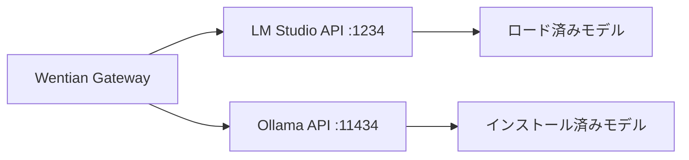

# ローカルLLM設定仕様

## 接続先

WentianはOpenAI互換APIを提供するローカル推論サーバーを利用します。既定の接続先は次の通りです。

| Provider | API base URL | 用途 |
|---|---|---|
| `lmstudio` | `http://127.0.0.1:1234/v1` | 既定のローカル推論先 |
| `ollama` | `http://127.0.0.1:11434/v1` | Ollamaでモデルを配置した場合の推論先 |

モデル一覧は `/models` から取得します。`autoModels`は指定せず、利用可能なモデルを固定しません。



## 既定Agentモデル

`local-model` は例示IDです。LM StudioまたはOllamaに導入したモデルの実際のIDを `WENTIAN_LOCAL_LLM_MODEL` へ設定してください。Agentの接続保守は無料モデルを優先し、無料モデル一覧を確認できて候補がなければローカルモデルへ切り替えます。モデル一覧取得そのものに失敗した場合は、未確認の接続先を自動で採用しません。

次の環境変数で外部Agentの接続保守に使うローカル設定を上書きできます。Gatewayのプロバイダー定義は `providers.json` を編集してください。ファイル内の定義は組み込みの既定値に優先します。Aiderを使う場合は `.aider.conf.yml` の例示モデルIDも実際のIDへ変更してください。

| 環境変数 | 既定値 |
|---|---|
| `WENTIAN_LOCAL_LLM_BASE_URL` | `http://127.0.0.1:1234/v1` |
| `WENTIAN_LOCAL_LLM_MODEL` | `local-model` |

外部Agent用のCLI設定をWentianが管理する場合、Provider名は `wentian-local` 系の汎用名を使用します。設定反映前にバックアップを作成し、検証失敗時はWentianが変更した項目だけを復元します。

## Workflow integrationとConfluence

Workflow integrationは `WENTIAN_INTEGRATION_BASE_URL` を、Confluenceは `WENTIAN_CONFLUENCE_BASE_URL` を設定して接続します。どちらも既定ホストはありません。ConfluenceにはHTTPS URLを指定し、ログインセッションはローカルのStorage Stateへ保存します。接続先を変える際は、URLのホストを利用環境に合わせてください。

## Dockerイメージ

補助Dockerfileは `WENTIAN_BASE_IMAGE` build argでベースイメージを受け取ります。既定は `wentian-gateway:latest` です。

```powershell
docker build --build-arg WENTIAN_BASE_IMAGE=wentian-gateway:latest -f Dockerfile.workflow-mcp .
```
