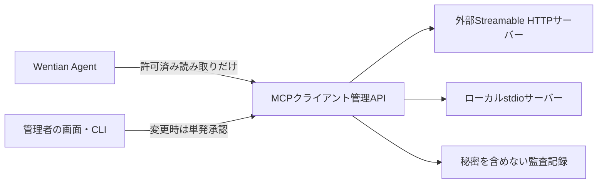

# WentianをMCPクライアントとして使う

更新日: 2026-10-05

MCP（モデルコンテキストプロトコル / Model Context Protocol）クライアントは、Wentianから外部サーバーのツール・資料・プロンプトを利用する接続基盤です。逆方向の公開方法は [MCPサーバー利用方法](./VSCODE_MCP_USAGE.md)、実装範囲は [MCP実装仕様](./MCP_IMPLEMENTATION_SPEC.md) を参照してください。

## 実装の必要性と利用場面

| 利用場面 | 接続先 | Wentianでの利用 |
|---|---|---|
| 社内資料検索 | ナレッジ検索・資料リソース | 根拠付き回答、調査 |
| 開発連携 | Issue・PR・ビルド状態 | 作業計画、変更検証 |
| データ基盤 | スキーマ・集計結果 | データパトロールの調査材料 |
| 運用監視 | ログ・サービス状態 | 異常調査、稼働確認 |
| 工程支援 | 工程専用ツール | 必要な連携だけを許可して利用 |

組み込みツールと専用HTTP連携に加え、共通方式で外部機能を追加できます。接続先ごとの専用実装を減らすため、作業実行・管理基盤として必要な機能として実装しました。外部ツールをWentianの `/mcp` 経由で再公開する汎用プロキシーとは別です。



## 前提と保存先

- クライアント機能は起動済みGatewayを使用します。`WENTIAN_ENABLE_MCP=true` はWentian自身の `/mcp` 公開用で、外部への接続には不要です。
- 画面・APIは管理者ログイン、CLIはGatewayの `WENTIAN_API_KEY` が必要です。キー未設定だけでは管理APIを匿名利用できません。
- 設定はインストール先 `.wentian/mcp-servers.json`、監査は `.wentian/mcp-audit.jsonl`。`WENTIAN_MCP_CLIENT_CONFIG`、`WENTIAN_MCP_CLIENT_AUDIT` で変更できます。
- 起動時は設定だけ読みます。明示接続、ツール発見、呼び出し時に接続します。Agent開始時の発見でも有効接続のプロセスが起動する場合があります。

## 設定JSON

画面と `add --config FILE` は**1接続分**のJSONを受け付けます。保存ファイル全体の `{ "version": 1, "servers": [...] }` を渡す形式ではありません。未知プロパティは拒否されます。

```json
{
  "id": "knowledge",
  "name": "社内ナレッジ",
  "transport": "http",
  "url": "https://mcp.example.com/mcp",
  "enabled": true,
  "headers": { "Authorization": "KNOWLEDGE_MCP_AUTH" },
  "allowedTools": ["search_documents", "create_issue"],
  "readOnlyTools": ["search_documents"],
  "timeoutMs": 30000
}
```

`headers` の値は秘密そのものではなく**Gatewayプロセスの環境変数名**です。上例では `KNOWLEDGE_MCP_AUTH` の値を `Bearer 実際のキー` とします。`Bearer` は自動追加されません。URLに認証情報・クエリー・フラグメントは指定できません。

stdio（標準入出力）の例です。`server.js` は利用者が用意する外部MCPサーバーです。

```json
{
  "id": "local-docs",
  "transport": "stdio",
  "command": "node",
  "args": ["C:/workspace/wentian-gateway/local-mcp/server.js"],
  "cwd": "C:/workspace/wentian-gateway",
  "env": { "DOCUMENT_TOKEN": "LOCAL_DOCUMENT_TOKEN" },
  "enabled": true,
  "allowedTools": ["search_documents"],
  "readOnlyTools": ["search_documents"],
  "roots": [{ "uri": "file:///C:/workspace/wentian-gateway", "name": "作業場所" }],
  "timeoutMs": 30000
}
```

`env` もGateway環境変数名による参照です。子プロセスへ全環境変数は渡さず、必要な基本環境と明示参照だけを渡します。`cwd` と `roots` は作業領域内に限定。外部領域は管理者が `allowOutsideWorkspace: true` を明示します。rootsは場所の通知でありOSのサンドボックスではありません。

`allowedTools` は正確な名前の配列で、空は実行不可、`*` は不可です。`readOnlyTools` はその部分集合です。サーバーの `readOnlyHint` だけでは許可しません。タイムアウトは100〜300000ミリ秒です。

## 管理画面

`http://127.0.0.1:8787/mcp-connections` または共通メニューの「MCP接続」を開きます。

1. 管理者ログイン後、設定JSONで「新規登録」。既存接続は選択して「選択接続を更新」。
2. 「接続」「再接続」で確認。「使用禁止」は無効化・切断。
3. 「ツール一覧」で名前と入力スキーマを発見。管理者は未許可の候補も発見できますが、実行は許可一覧で制限。
4. ツール・引数JSONを指定。変更操作は内容確認して承認後、60秒以内に「実行」。
5. リソース・プロンプト・補完・購読・pingは操作名とJSONで実行。「受信通知」で保存された通知を表示。

認証401・403や404を成功扱いしません。処理中の二重操作を防ぎ、接続・ツール・引数を変更すると画面の承認を破棄します。

## CLI（コマンドライン / Command Line Interface）

`--server URL` は省略時 `WENTIAN_SERVER`、未設定なら `http://127.0.0.1:8787`。結果はJSON、HTTP失敗はエラーです。キーは環境変数のみから取得します。

| コマンド | 内容 |
|---|---|
| `wentian mcp list` | 設定・接続状態・処理数 |
| `wentian mcp add --config FILE` | 1接続JSONの登録 |
| `wentian mcp update ID --config FILE` | 更新・切断 |
| `wentian mcp remove ID` | 削除・切断 |
| `wentian mcp enable ID` / `disable ID` | 有効／無効 |
| `wentian mcp connect ID` / `disconnect ID` / `reconnect ID` | 接続操作 |
| `wentian mcp tools ID` / `resources ID` / `templates ID` / `prompts ID` | 一覧発見 |
| `wentian mcp ping ID` / `notifications ID` | 生存確認／受信通知 |
| `wentian mcp request ID METHOD --json JSON` | 資料取得・プロンプト取得・補完・購読等 |
| `wentian mcp approve ID TOOL --json JSON` | 変更操作の単発承認 |
| `wentian mcp call ID TOOL --json JSON [--approval-token TOKEN]` | 呼び出し |

```powershell
# 認証キーWENTIAN_API_KEYをGatewayと同じ値で環境変数に設定済みとします。
# 接続設定JSONには秘密ではなく、Gateway起動前に設定した環境変数名を記載します。
wentian mcp add --config .\knowledge-mcp.json
wentian mcp connect knowledge
wentian mcp tools knowledge

# 明示許可済みの読み取りは変更承認なしで利用できます。
wentian mcp call knowledge search_documents --json '{"query":"運用手順"}'

# 変更は同じ引数・同じ本人の認証で、60秒以内に1回だけ実行します。
$WentianArguments = '{"title":"確認依頼"}'
$WentianApproval = wentian mcp approve knowledge create_issue --json $WentianArguments | ConvertFrom-Json
if ($LASTEXITCODE -ne 0) { throw '承認に失敗しました。' }
wentian mcp call knowledge create_issue --json $WentianArguments --approval-token $WentianApproval.approvalToken

# URIは実際の一覧結果へ置き換えます。
wentian mcp request knowledge resources/read --json '{"uri":"docs://operations"}'
```

```python
import json
import subprocess

# WentianがPATHへ登録済みで、WENTIAN_API_KEYを設定した環境で実行します。
# シェル文字列を評価せず、引数配列で日本語JSONを渡します。
subprocess.run(["wentian", "mcp", "list"], check=True)
subprocess.run([
    "wentian", "mcp", "call", "knowledge", "search_documents", "--json",
    json.dumps({"query": "運用手順"}, ensure_ascii=False),
], check=True)
```

WindowsでWentianが `.cmd` のみの場合、Pythonの起動名はインストール済み `wentian.cmd` の絶対パスへ置き換えます。

## 管理API

全経路は `/api/mcp` 配下、管理者セッションまたはGatewayキーのBearer認証が必要です。ブラウザーの変更は同一オリジン限定。本文の `subject` / `userId` で認証主体を変更できません。

| メソッド・パス | 本文・内容 |
|---|---|
| `GET /servers` | `{ "servers": [...] }`。秘密値ではなく環境変数名のみ |
| `POST /servers` / `PUT /servers/:id` | 1接続設定JSON。更新IDはパスで固定 |
| `DELETE /servers/:id` | 削除・切断 |
| `POST /servers/:id/enable`・`disable`・`connect`・`disconnect`・`reconnect` | 空JSON `{}` |
| `POST /servers/:id/request` | `{ "operation": "resources/read", "params": { "uri": "..." } }` |
| `POST /servers/:id/approve` | `{ "name": "tool", "arguments": {} }` → `approvalToken`, `expiresInSeconds` |
| `POST /servers/:id/call` | `{ "name": "tool", "arguments": {}, "approvalToken": "..." }` |
| `GET /servers/:id/notifications` | 受信通知 |
| `GET /servers/:id/tools-list`・`resources-list`・`resources-templates-list`・`prompts-list`・`ping` | 各操作結果 |
| `GET /agent-tools` | 許可済み読み取りツールと接続ごとの失敗 `errors` |
| `POST /agent-call` | `{ "serverId": "...", "name": "...", "arguments": {} }`。読み取りのみ |

汎用 `request` は `tools/list`, `resources/list`, `resources/read`, `resources/templates/list`, `prompts/list`, `prompts/get`, `completion/complete`, `resources/subscribe`, `resources/unsubscribe`, `logging/setLevel`, `ping`。`tools/call` は専用経路の許可・承認を通します。接続先が提供しない能力は失敗します。

プロンプト例: `{ "operation": "prompts/get", "params": { "name": "example", "arguments": { "request": "調査" } } }`。ログ設定例: `{ "operation": "logging/setLevel", "params": { "level": "warning" } }`。MCP結果が `isError: true` の場合があるため、HTTP 200だけで業務成功と判断しません。

## Agentの読み取り統合

`wentian agent` は有効接続の `allowedTools` と `readOnlyTools` の両方にあるツールだけを開始時に取得し、衝突しない名前でモデルへ渡します。一部接続失敗でも正常なツールを残して警告します。管理権限がない場合・旧GatewayではMCPツールなしで既存Agentを利用します。

追加ツールは次のAgent実行から発見します。呼び出しごとにGatewayでも許可を検証し、途中の禁止・無効化を反映します。変更ツールは承認トークン付きでもAgent専用APIで拒否します。一般利用者向けのプロジェクト別MCP権限は未提供で、現在は管理者境界です。

## 承認・監査・制限

- 承認は本人・接続・ツール・引数固定、60秒、1回消費。JSON構成変更時は再承認。切断・設定更新・再起動でも無効化します。
- 発見したJSONスキーマでツール入力を検証します。説明や注釈から権限を推測しません。
- HTTP切断は外部操作へ中断通知します。完了済み外部変更の取り消しではありません。
- 監査は時刻、接続ID、操作、主体、ツール、成否のみで、引数・応答・認証情報を含めません。
- 通知はメモリー内で最大100件、再起動で失われます。永続監査とは別です。
- Streamable HTTPとstdio対応。旧HTTP+SSE専用サーバーのフォールバックはありません。
- rootsを応答できます。Sampling／Elicitationはホスト処理を注入する拡張点だけで、標準Gatewayはコールバックを提供・広告しません。
- OAuth認証プロバイダー注入の拡張点はありますが、UIでのOAuthログイン・トークン管理とWentian OAuth認可サーバーは未提供です。通常は環境変数参照ヘッダーを使用します。
- MCP Tasks拡張・外部ツール自動再公開・個別製品のUI相互運用確認は範囲外です。Wentian永続タスクIDの照会は別機能です。

401／403、無効接続、環境変数未設定、未許可ツール、期限切れ承認、入力スキーマを確認してください。秘密を漏らさないため通信失敗の生の詳細は管理APIへ返しません。
