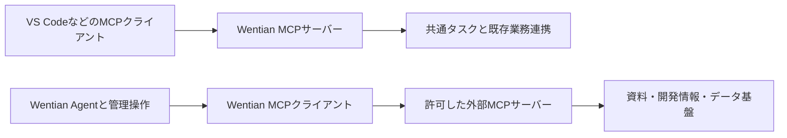

# Wentian MCPサーバー・クライアント仕様

作成日: 2026-10-05。利用手順は [MCPクライアント利用ガイド](./MCP_CLIENT_USAGE.md) と [MCPサーバー接続ガイド](./VSCODE_MCP_USAGE.md) を参照してください。最終検証は別途、検証記録に残します。

## 実装する理由

WentianはMCPサーバー（Server）として仕事を外部へ公開する機能と、MCPクライアント（Client）として外部機能を使う機能を併用します。資料検索、GitHubなどの開発状況取得、データベース照会、運用監視、並列工程の情報取得に利用します。接続先ごとの専用HTTP連携を増やす代わりに、登録したMCPサーバーのツール・資料・プロンプトを同じ仕組みで扱えるようにします。

単なるモデル中継だけを行う場合、MCPクライアントは必須ではありません。Wentian自身が作業を計画・実行する用途では、外部情報の取得と実行機能の拡張に必要な基盤です。このため今回の実装対象に含めます。

MCP接続でGitHub Copilotなどの推論モデルを置き換えるわけではありません。推論の接続先はOpenAI互換APIの`/v1`、ツールの接続先は`/mcp`です。外部ツールの再公開・集約は、自分のAgentから呼び出す機能とは別の権限設計を必要とします。

## 実装方針

- 公式TypeScript SDKを固定版で採用し、独自通信の推測実装を避けます。
- サーバーはStreamable HTTPと標準入出力（stdio）で利用します。既存業務ツールと所有者分離を維持します。
- クライアントはStreamable HTTPとstdio接続、ツール（Tools）、リソース（Resources）、プロンプト（Prompts）の発見・取得・呼び出しを提供します。
- 接続設定、明示した許可範囲、タイムアウト、接続解除、更新・再接続、実行結果、監査記録を管理します。
- 管理API、CLI、共通デザインの管理画面から設定・確認します。Wentian Agentへは明示的に読み取り許可したツールだけを渡します。
- 更新・削除・送信などの操作は、対象・引数・操作主体を固定した単発承認で実行します。外部サーバーの「読み取り専用」注釈だけでは許可しません。
- 秘密値は環境変数参照で登録し、一覧・ログ・Agentの入力へ出しません。stdioの起動はシェルを挟まず登録した実行ファイルと引数を使います。
- セッションは認証主体に固定します。管理操作の権限とOrigin検証を、MCP接続の認証と区別して実施します。

## 完了条件

1. 既存ツールの入力検証・所有者分離・業務連携を維持する。
2. 公式SDKクライアントとWentianサーバーの初期化、一覧、呼び出し、通知、切断を実通信で検証する。
3. Wentianクライアントと公式SDKの検証サーバーをHTTP・stdio双方で接続する。
4. ツールだけでなくリソース・プロンプトの操作を検証する。
5. 未許可操作、承認の再利用・主体違い・引数違い、無効化、認証失敗、タイムアウト、中断、秘密値の露出を検証する。
6. Agentから許可された外部ツールを呼び出し、その実結果で回答する経路を検証する。
7. ビルドと既存機能を含む適切なテストに合格する。
8. 利用ガイド・接続例・対応機能と制約・検証記録を更新し、Gitへコミットして同期する。

MCPの任意拡張は、対応するケイパビリティー（Capabilities）だけを宣言します。Sampling、Elicitation、OAuth、Tasks拡張などについては、実装と検証の有無を対応表へ個別に記載し、未実装を「全仕様準拠」と報告しません。

## 参照する公式資料

- [TypeScript SDK](https://ts.sdk.modelcontextprotocol.io/)
- [サーバーとトランスポート](https://ts.sdk.modelcontextprotocol.io/server)
- [クライアント](https://ts.sdk.modelcontextprotocol.io/client)
- [ツールの仕様と信頼境界](https://github.com/modelcontextprotocol/modelcontextprotocol/blob/main/docs/specification/2025-06-18/server/tools.mdx)

## 対応表と検証結果

公式SDKは `@modelcontextprotocol/sdk@1.32.0` に固定します。実通信では `2025-11-25` を指定して初期化します。対応版の交渉・要求検証・キャンセル通知はSDKが処理します。

| 機能 | Wentianサーバー | Wentianクライアント |
|---|---|---|
| 初期化・版交渉・ping | SDKで処理 | SDKで処理 |
| Streamable HTTP | POST、GET通知ストリーム、DELETE終了 | 登録、接続、切断、再接続 |
| 標準入出力（stdio） | HTTPへのSDKブリッジとPowerShell/Python起動版 | シェルを介さない子プロセス起動 |
| ツール（Tools） | タスク・巡回・工程の11ツール | 発見、入力スキーマ検証、許可一覧、実行 |
| リソース（Resources） | 所有者別タスク一覧・読取・テンプレート | 一覧、読取、テンプレート一覧 |
| 購読（Subscriptions） | タスク変更通知、一覧変更通知 | 購読・解除・直近100件通知表示 |
| プロンプト（Prompts） | `wentian-task-plan` | 一覧・取得 |
| 補完（Completion） | タスクIDの前方一致補完 | `completion/complete` |
| ログ（Logging） | レベル設定、本文を含めない実行通知 | レベル設定要求 |
| ルート（Roots） | 要求しない | 明示されたファイルURIを提供 |
| サンプリング（Sampling）・追加質問（Elicitation） | 要求しない | ホストのコールバック（Callback）注入時のみ有効。本番管理画面では無効 |
| OAuth | 認可サーバーは提供しない | SDK認証プロバイダー注入点のみ。本番の対話認証画面は未実装 |
| MCP Tasks拡張 | 未実装。既存Wentianタスクは業務ツールとして公開 | 未実装 |
| Agent統合 | 既存の所有者別タスク実行基盤 | 管理者が許可した読み取り専用ツールだけをモデルへ提供 |

管理者の明示許可を持たないツールは実行しません。読み取り専用一覧にない操作は、主体・接続先・ツール名・引数に固定した60秒の一回限りの承認が必要です。Agent自動実行にはこの承認経路を提供せず、更新系ツールを公開しません。

HTTPのMCPセッションは認証主体へ固定し、30分無通信で終了します。認証未設定のローカル利用は単一所有者です。APIキーと管理者Cookieがある場合はその主体へ分離します。公開ホスト・Originの明示許可と、管理APIの同一Origin検証を行います。

設定と監査はインストール先 `.wentian/mcp-servers.json`、`.wentian/mcp-audit.jsonl` が既定です。環境変数で保存先を変更できます。秘密値は環境変数名で参照し、監査には時刻・主体・操作・接続ID・ツール名・成否だけを記録します。

プロトコル要求のキャンセルは持続的な業務タスクの取消とは別です。投入後の仕事を止めるには `wentian_cancel_task` または工程取消ツールを使用します。外部stdioプログラム自体を隔離するOSサンドボックスは提供しません。登録・外側の作業領域許可は管理者操作です。

公式SDK同士の相互運用（Interoperability）、HTTP/stdio、所有者分離、通知、承認・再利用拒否、許可取り消し、Agent CLIから外部ツールの実結果を使った回答をテストします。VS Codeや各MCP製品の実画面操作は個別の受入確認が必要です。
