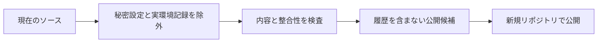

# オープンソース公開の準備

WentianはMITライセンス（MIT License）で配布します。プロジェクトと依存するソフトウェアの著作権表示・ライセンスを保持してください。

企業固有の接続先、アカウント、社内サービス名、個人の配備パス、実環境の検証原票と画像は公開候補へ含めません。例示メールとドメインは予約済み名称を使います。自動検査の合格だけで全内容の公開可否を保証するものではありません。

## 公開文書と私有文書

導入・利用・公開インターフェースは[公開ドキュメント一覧](index.md)から参照できます。内部の設計草案、事業戦略、故障調査、交付・検証の原票はコードと別の私有文書リポジトリで管理します。実装と検証の範囲は[公開機能と制限](feature_scope.md)にまとめます。

`public_release_documents.json`が公開文書・添付資料の完全一致リストです。`docs/`配下の新規ファイルは既定で非公開です。レビュー後にリストへ追加してください。ファイル不在、重複、範囲外パス、非配布文書への相対リンクは検査で拒否します。私有資料へのリンクを公開側の必須手順にしません。

現在の作業リポジトリのGit履歴は残したままです。ここから通常の`git push`を行うことと、下記の公開候補を新しいリポジトリへ公開することは別の操作です。

## 設定の移行

- 外部ワークフロー連携は `WENTIAN_INTEGRATION_*` を使用します。
- 業務レコード連携のモードは `business-records` です。保存済み設定は管理画面で更新してください。
- `WENTIAN_LOCAL_LLM_MODEL` に実際のモデルIDを設定します。`local-model` は例示値です。
- メール接続スクリプトは `WENTIAN_MAIL_IMAP_HOST`、`WENTIAN_MAIL_IMAP_USER`、`WENTIAN_MAIL_SES_USERNAME`、`WENTIAN_MAIL_SES_PASSWORD` を要求します。外部アプリの起動には `WENTIAN_BUSINESS_RECORDS_SCRIPT` も設定します。
- 外部連携の認証ヘッダーとAPIパスを汎用名へ変更しています。接続先の仕様に合わせたアダプター（Adapter）が必要です。
- `.env` と `.wentian/` はローカル専用です。メール、認証状態、実行台帳を配布しないでください。

## 公開候補の生成

```powershell
pwsh -NoProfile -File scripts/prepare-open-source.ps1
```

```text
python scripts/prepare-open-source.py
```

公開候補は `.wentian/public-release/wentian-source.zip`、検査結果とSHA-256は同じ場所の `manifest.json` へ保存します。検出事項がある場合は生成を停止します。自動検査で検出できない自由記述や音声・動画の内容は、配布前に人が確認してください。

`--audit-only`（PowerShellでは`-AuditOnly`）は候補の検査のみ実行し、`audit.json`へ公開文書一覧、除外文書一覧、各配布ファイルのSHA-256を保存します。`--self-test`（`-SelfTest`）で秘密設定・未承認文書・非配布リンクの回帰検査を実行できます。利用者のPython実行ファイルはPowerShell版の`-Python`で指定できます。

## Git履歴

既存のGit履歴には削除前の情報が残っています。この履歴を含むリポジトリは公開しないでください。生成したアーカイブを新しいディレクトリへ展開し、新規リポジトリ（Repository）として公開してください。既存の履歴を書き換えたり、リモートへプッシュしたりする処理は実行していません。


