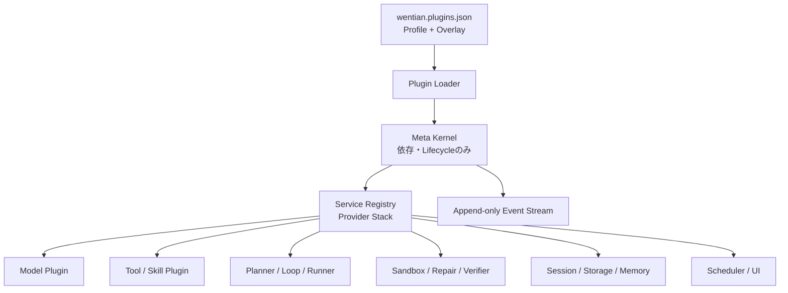
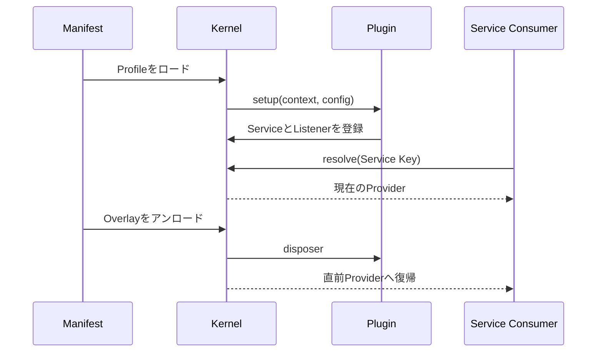

# Wentian Everything-is-a-Plugin Architecture

## 1. 設計目標

Wentianは、DeepSeek Harnessの「Meta FrameworkはPluginのロード・アンロードと依存関係だけを担当する」という考え方を採用し、具体的なAgent能力をPluginとして構成します。モデル、Tool、Skill、Session、Sandbox、Storage、Loop、Scheduler、UI、Planner、Selector、Runner、Repair、Verifier、Memoryを同じLifecycle Contractで扱います。

Kernel（カーネル）は業務判断やAgent処理を持ちません。Plugin同士はService Seam（サービス境界）とEvent（イベント）だけで連携します。



## 2. LEGO式組立の保証

- Service Definition、Provider、Consumerを分離します。
- 同じServiceを後から提供するとOverlayとして有効になり、アンロードすると直前Providerへ戻ります。
- `requires`をTopological Order（トポロジカル順序）で解決し、循環を拒否します。
- 初期化途中で失敗すると、そのロード操作で生じた登録を逆順にRollbackします。
- Event Listener、Service登録、Plugin固有Disposerはアンロード時に解除されます。
- Profile継承とOverlayにより、ソース変更なしで構成を変更できます。
- Runtime Reloadは新しいPlugin Treeの完全ロード後にActive参照を原子的に交換し、失敗時は旧Runtimeを維持します。
- Lifecycleと独自Eventは連番のTrajectoryとして記録されます。

## 3. Manifest

既定Manifestはリポジトリ直下の`wentian.plugins.json`です。`WENTIAN_PLUGIN_MANIFEST`で別ファイルを選択できます。

```json
{
  "version": "1.0",
  "activeProfile": "standard",
  "modules": [
    { "id": "company.repair", "module": "./plugins/company-repair.js" }
  ],
  "profiles": {
    "minimal": { "plugins": [{ "id": "core.model" }, { "id": "core.loop" }] },
    "standard": {
      "extends": "minimal",
      "plugins": [{ "id": "core.repair" }, { "id": "company.repair" }]
    }
  },
  "overlays": [{ "id": "core.repair", "enabled": false }]
}
```

相対ModuleはManifestディレクトリー配下だけをロードできます。Package Pluginは任意コード実行となるため既定禁止であり、管理者が`WENTIAN_ALLOW_PACKAGE_PLUGINS=true`を設定した場合だけ許可します。

## 4. Plugin Contract

```typescript
const plugin = {
  id: 'company.repair',
  kind: 'repair',
  version: '1.0.0',
  requires: ['core.storage'],
  provides: ['wentian.repair.planner'],
  async setup(context, config) {
    const disposeService = context.provide(REPAIR_PLANNER_SERVICE, companyRepairPlanner);
    const disposeListener = context.on('repair.completed', recordRepair);
    return async () => {
      disposeListener();
      disposeService();
    };
  }
};
export default plugin;
```

`setup()`内で登録したServiceとEvent ListenerはKernelも追跡するため、Pluginが明示的に解除しなくてもアンロード時に回収されます。

## 5. 実行Profile

| Profile | 用途 |
|---|---|
| `minimal` | Model、Tool、Session、Sandbox、Storage、Loopだけの最小構成 |
| `standard` | 全15能力を組み合わせた標準構成 |
| `review` | 読み取り・Planner・Selector・Runner・Verifier中心の構成 |

## 6. 可観測性

`GET /v1/manager/plugins`はロード済みPlugin、現在有効なService Provider、Lifecycle Eventを返します。API Keyを設定した環境では既存のGateway認証が適用されます。



## 7. 安全境界

Plugin化はSafety Policyの撤廃を意味しません。認証変更、破壊操作、Workspace外書込みなどの中央制約は、交換可能な実装より外側の実行境界でも検証します。外部Pluginは信頼済みコードとして同一Processで動くため、導入前のコードレビューとVersion固定が必要です。

## 8. 主要ファイル

| ファイル | 責務 |
|---|---|
| `src/plugin-kernel.ts` | Service、Event、依存解決、ロード、アンロード、Rollback |
| `src/plugin-config.ts` | Manifest、Profile継承、Overlay、外部Moduleロード |
| `src/plugin-services.ts` | 型付きService Seam |
| `src/wentian-plugin-runtime.ts` | 組み込みPluginとRuntime初期化 |
| `src/plugin-runtime.ts` | Active Runtime参照 |
| `wentian.plugins.json` | 既定の組立構成 |
