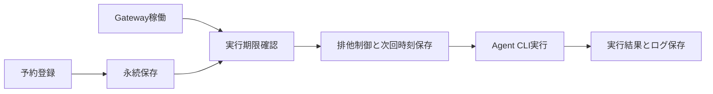

# タスク予約と定期実行

指定日時の単発実行、一定間隔の繰り返し、毎日の時刻指定に対応します。既存のエージェント（Agent）実行を利用します。予約の登録だけでは実行されません。ゲートウェイ（Gateway）を起動してください。

```powershell
# 常駐プロセスを起動します。起動済みの場合は予約対応版へ再起動してください。
wentian daemon start

# 日本時間で指定日時に一度だけ実行します。未来の日時を指定してください。
wentian schedule add --at "2026-10-02T18:00:00+09:00" --prompt "プロジェクトの状態を調べて報告してください"

# 登録から30分後に初回実行し、その後も30分間隔で実行します。
wentian schedule add --every 30m --prompt "プロジェクトの状態を調べて報告してください"

# 日本時間で毎日09:00に実行します。
wentian schedule add --daily 09:00 --timezone Asia/Tokyo --prompt "本日の作業候補を整理してください"

# 予約ID、次回時刻、実行状態、直近の結果を表示します。
wentian schedule list
wentian schedule pause <ID>
wentian schedule resume <ID>
wentian schedule remove <ID>
```

`--at` はタイムゾーン（Time Zone）付きISO形式が必須です。`--every` は `s`（秒）、`m`（分）、`h`（時間）、`d`（24時間）を受け付けます。`--daily` のタイムゾーンを省略すると登録端末のものを保存します。毎日の予定には夏時間の変化も反映します。

`--workspace` で作業フォルダー、`--server` で接続先（既定 `http://127.0.0.1:8787`）、`--model` でモデル（Model、既定 `wentian-auto/local`）を指定できます。Gatewayを別ポートで動かす場合は、登録時に `--server` を合わせてください。依頼文と作業フォルダーは登録時に保存され、実行のたびに新しいAgentプロセスを起動します。

予約はインストール先の `.wentian/schedules/tasks.json`、実行ログ（Log）は同じフォルダーの `logs/` に保存します。ソースから直接起動した場合は起動フォルダーを基準とします。CLIとGatewayで別の起動フォルダーを使う場合は、両方に同じ絶対パスの `WENTIAN_SCHEDULE_ROOT` を設定してください。

## 実行時の動作

- Gatewayは約1秒間隔で期限を確認します。実行は直列で、長いタスクがあると後続の予約は遅れます。
- 同じ保存先を使う複数Gatewayでも、実行中の同一予約は重複実行しません。
- Gateway停止やPCのスリープ中は実行できません。再開時に過ぎた予定を1回へまとめ、繰り返し予約は次の未来時刻へ進めます。
- 実行前に予定を保存し、単発予約は無効化します。失敗や中断は自動で再試行しません。定期予約は次の予定を維持します。
- 一時停止は次の実行から有効です。実行中の処理は継続します。再開時は次回時刻を再計算します。単発予約の日時が過去なら、新しい予約を登録してください。
- 実行中の予約は削除できません。実行ログは予約削除後も残ります。
- 子プロセスの実行上限は30分です。成功状態はCLIの正常終了を示します。タスク内容の成果物は実行ログと実ファイルで確認してください。
- OSの自動起動設定は追加しません。PC再起動後はGatewayを起動してください。



PowerShell版とPython版の補助スクリプト（Script）も同じ引数を受け付けます。

```powershell
pwsh -NoProfile -File scripts/schedule-task.ps1 add --every 30m --prompt "状態を確認してください"
python scripts/schedule-task.py add --daily 09:00 --timezone Asia/Tokyo --prompt "状態を確認してください"
```
