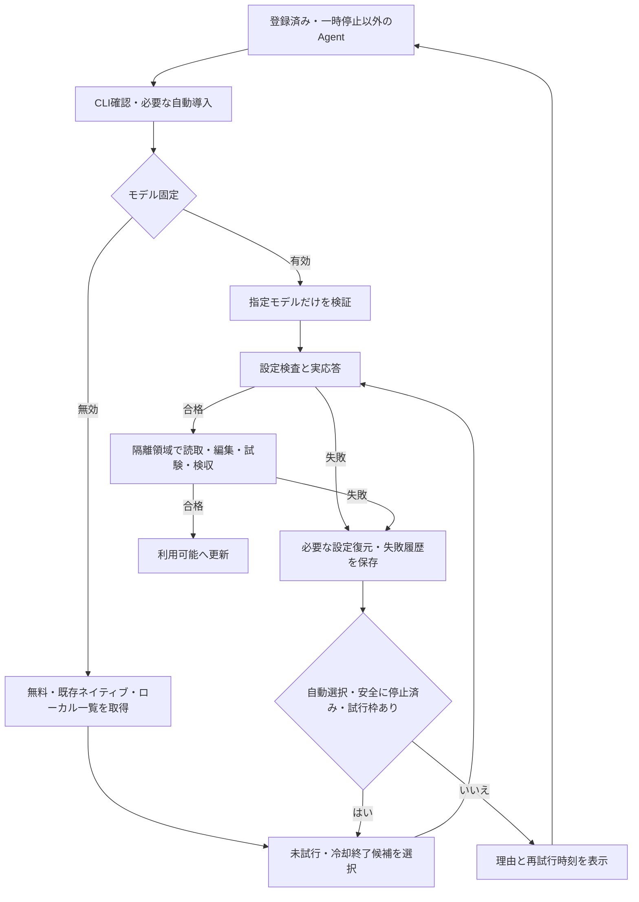

# Agentのモデル自動選択と復旧保守

更新日: 2026-10-23。対象はControl CenterのAgent一覧、モデル選択API、常駐保守、会話・作業ランナーです。

本書の `<INSTALL_ROOT>` は `WENTIAN_INSTALL_ROOT`（通常は `wentian` ランチャーが指定するインストール先）です。未設定の直接起動ではcwdが基準です。環境設定は起動元シェル・OS、または `<INSTALL_ROOT>/.env`（`WENTIAN_ENV_FILE` で変更）へ記載し、変更後にDaemonを再起動します。既存のプロセス環境変数は `.env` より優先します。

## 利用者操作

モデル列の「モデル変更」の直前に「モデルを固定」のチェックボックスを置きます。中国語表示は「指定模型」、英語表示は「Pin model」です。既定は未選択で、モデル変更ボタンは無効です。チェックしたAgentのボタンだけを有効にします。管理者以外・処理中の変更は拒否します。

| 状態 | モデル変更 | バックグラウンド保守 |
|---|---|---|
| 未選択・初期状態 | 無効 | 実在する候補を取得し、接続から実作業の検収まで自動実施 |
| 選択済み | 有効 | 指定モデルだけを検証。失敗しても別モデルへ変更しない |
| 固定解除 | 無効へ戻る | 旧認定を無効化し、候補探索と一連の検証を再開 |

固定とモデル選択は再起動後も保持します。旧版の保存済みモデルIDだけでは固定しません。固定解除時もモデル・プロバイダー・接続先を削除せず、利用者設定として保持します。選択を変更した途中で古い検証が終わっても、新しい選択を上書きしません。

固定を有効にしたとき、保存済み選択が空でも接続台帳に現在モデルがあれば、そのモデルと接続先を保持します。チェックしただけで稼働中のモデルを空欄へ戻しません。どちらにもモデルが無い場合にだけ、モデル変更画面での選択を待ちます。

この節の保存ファイル：モデル選択と固定は `agent-model-preferences.json` です。既定では `<INSTALL_ROOT>/.wentian/agent-model-preferences.json`、`WENTIAN_AGENT_MODEL_PREFERENCES` が最優先です。未指定の場合は接続台帳のディレクトリに連動するため、`WENTIAN_AGENT_CONNECTION_CACHE` の変更でも移動します。管理画面のチェック・モデル選択、モデル選択APIから保存・反映し、保存ファイルを直接編集した場合はDaemon再起動で再読込します。

## 自動復旧

一覧を取得できることと、そのモデルが使えることを分けます。CLI生存確認、候補取得、接続設定と実応答、隔離領域での実ファイル読取り・編集・試験・検収を順番に確認します。実施していない工程へ合格を付与しません。モデル専用の作業検証が合格したAgentだけを利用可能へ戻します。

候補はAgent公式の無料一覧、利用者が既に設定したネイティブモデル、利用者設定および標準のループバック接続口が返した会話用モデル一覧から取得します。一つの一覧取得や旧モデル設定の確認に失敗しても、独立した候補の確認を継続します。存在を確認できない旧モデルIDを候補として捏造しません。新規アカウント・有料契約・任意モデルのダウンロードは自動作成しません。

候補はモード・プロバイダー・接続先・モデルIDの組で識別します。成功記録はCLI版、利用者の選択、保守方針、設定指紋と結び付けます。作業証跡もプロバイダー・接続先を含めて照合し、同名モデルの別接続へ合格を流用しません。

接続だけ成功して実作業が失敗した場合、自動選択ではその候補を冷却して別候補を検証します。同じサイクルで直前の候補を繰り返しません。失敗履歴は最大48件を保持し、未試行候補を先に、再試行可能な過去の失敗候補を古い順に確認します。候補一覧の先頭だけに固定される状態を防ぎます。接続の試行は1回最大4候補、実作業後の復旧は1サイクル最大2回で区切り、残りは次回の保守へ引き継ぎます。接続失敗の冷却は60秒、作業失敗は既存の段階的な再試行間隔を使用します。

CLIが起動できて接続に失敗しているAgent、接続済みAgentの再検証、未導入CLIの導入の順で処理し、同じ段階では利用者の優先順を維持します。接続候補は1回の確認で最大180秒の応答待ち枠を共有し、候補数倍の待ち時間で後続Agentを塞ぎません。一覧取得・設定検査と実作業には各処理の既存期限を適用します。導入できなかった理由もサイクルの最終結果に保持します。

停止要求・一時停止・登録解除・環境の禁止設定を尊重します。設定の並行変更や子プロセスの停止不明を無視して次モデルを起動しません。CPU・メモリ・通信・ディスクの既存負荷制御とプロセス間排他も維持します。

認証切れ、利用枠上限、サーバー停止、未導入モデルなど、試行だけで解消できない前提条件は理由を残して再確認します。「全Agentの利用可能を目指す」は、未検証の合格表示や既存権限の拡大を意味しません。

この節の状態・設定・証跡は以下の場所で確認します。

| 情報 | 既定保存先 | 保存先変更 |
|---|---|---|
| 接続結果・候補履歴・有効期限 | `<INSTALL_ROOT>/.wentian/agent-connections.json` | `WENTIAN_AGENT_CONNECTION_CACHE` |
| 作業能力の合否・再試行時刻 | `<INSTALL_ROOT>/.wentian/agent-work-capabilities.json` | `WENTIAN_AGENT_WORK_CACHE` |
| 作業検証の実ファイル・詳細結果 | 作業能力台帳と同じディレクトリの `work-verification/<時刻>-<Agent ID>-<UUID>/` | 作業能力台帳に連動 |
| 自動保守の有効・無効・再試行間隔 | 接続台帳と同じディレクトリの `agent-maintenance-settings.json` | `WENTIAN_AGENT_MAINTENANCE_SETTINGS` |

登録・一時停止はマシン設定ディレクトリの `agent-registrations.json`・`agent-exclusions.json` です。`WENTIAN_AGENT_REGISTRATIONS_FILE`・`WENTIAN_AGENT_EXCLUSIONS_FILE` に個別指定がなければ `WENTIAN_CONFIG_DIR`、さらに未指定ならWindowsの `%LOCALAPPDATA%/wentian/` 等のOS既定先を使います。[公開機能と制限](feature_scope.md)に代替先を含む優先順位を記載しています。

保守の開始・停止・再試行間隔・作業検証の有効設定は `/#agents` の統一管理から変更します。資源制約は [公開機能と制限](feature_scope.md)に従い、80%・90%は実装値です。接続・作業の成功台帳を直接編集して合格扱いにしません。

## ローカルモデルの起動前確認

保守の候補に存在しても、未ロードのローカルモデルへ接続確認の推論を送らないよう `src/maintenance-model-admission.ts` で確認します。LM Studioは `/api/v1/models` の該当 `loaded_instances`、Ollamaは `/api/ps` の実行中モデルをGETで確認します。ロード状態が未確認・未ロードなら設定適用・推論・作業検証を保留し、台帳は `status=pending`・`maintenanceDeferred=true` と保留理由を持ちます。接続台帳 `agent-connections.json` の保存先と環境変数は前節の表を参照してください。モデル固定中も同じ確認が必要です。

接続記録が有効でも作業検証前に再確認し、保守用Hostedランナーでは各推論直前にも確認します。保守の内部フラグ `WENTIAN_MAINTENANCE_LOADED_ONLY` は子プロセスへ渡す実装上の制約であり、利用者が設定する運用項目ではありません。未実行の推論を失敗試行として蓄積しません。これは事後の資源監視やディスク容量保護とは別の起動前制御です。[公開機能と制限](feature_scope.md)も参照してください。

## Gooseの既存CLI連携

Goose固有の候補に加え、既に利用者が設定したCodexモデルをGoose公式の`codex`プロバイダー経由で試します。認証値をコピーせず、元のCLIが既存設定を読みます。この接続はGoose独自の推論モデルではなく、Gooseから既存CLIへの連携として扱います。

導入済みGoose 1.43.0には、新しいモデルIDを子CLIへ渡さない互換性問題があります。Wentianは一時的な起動入口を生成し、子CLIへモデルID、実行領域、非対話設定、権限を明示します。Gooseが生成した子CLI引数は転送せず、プロンプトだけを標準入力で継承します。会話・接続確認はread-only、制作工程は既存ランナーと同じworkspace-writeの範囲で実行し、無制限権限の引数を拒否します。入口は実行終了・停止確認後に削除します。

実装は`src/goose-codex-bridge.ts`、Python入口は`scripts/run-goose-codex.py`、PowerShell入口は`scripts/run-goose-codex.ps1`です。接続指紋には元のCLI設定も含めます。モデル名の一致と実ファイル検収を省略しません。

Gooseは実モデルによる単体・Wentian経由の読取、限定修正、独立したTester・Verifierの実行記録、ホスト受入と反映を検証したため、標準の能力定義へ`file_write`と`terminal`を追加します。利用者の別設定で能力を制限した場合は、その設定を維持します。読取だけの古い合格は編集・試験・検収の再検証を省略する根拠にしません。

互換性の根拠: [Goose 1.43.0公式Codexプロバイダー実装](https://github.com/aaif-goose/goose/blob/v1.43.0/crates/goose/src/providers/codex.rs)。このプロバイダーは公式には非推奨のため、今後のCLI変更でも接続・作業の再検証を必須とします。

## APIと検証

この節のモデル選択APIは前述の `agent-model-preferences.json` を更新し、対象Agentの再確認を要求します。接続・作業台帳は再確認の実行結果として更新されます。

一覧は`manualModel`を返します。管理者限定の`POST /v1/manager/external-agents/:id/model-selection`はbooleanの`manual`だけを受け付け、未登録・未対応は404、処理中は409、不正入力は400です。既存のモデル変更APIも固定中だけ受け付けます。選択変更後に対象Agentだけの保守を要求し、全体の対象範囲を狭めません。

回帰試験は一時台帳、模擬CLI、模擬モデル一覧を使用します。既定ボタン無効、チェック位置・状態遷移、管理者認可、入力検証、固定解除と設定保持、旧モデルからの復旧、一覧障害、候補巡回、接続成功後の作業失敗、固定モデルの維持、並行変更、CLI・方針の変更、モデル・接続先別の証跡照合を検査します。Goose互換入口は実際のPython・PowerShellを使い、引数上書きの拒否と標準入力の継承を確認します。実Agentを起動する運用検証は、この隔離回帰試験と区別して記録します。
