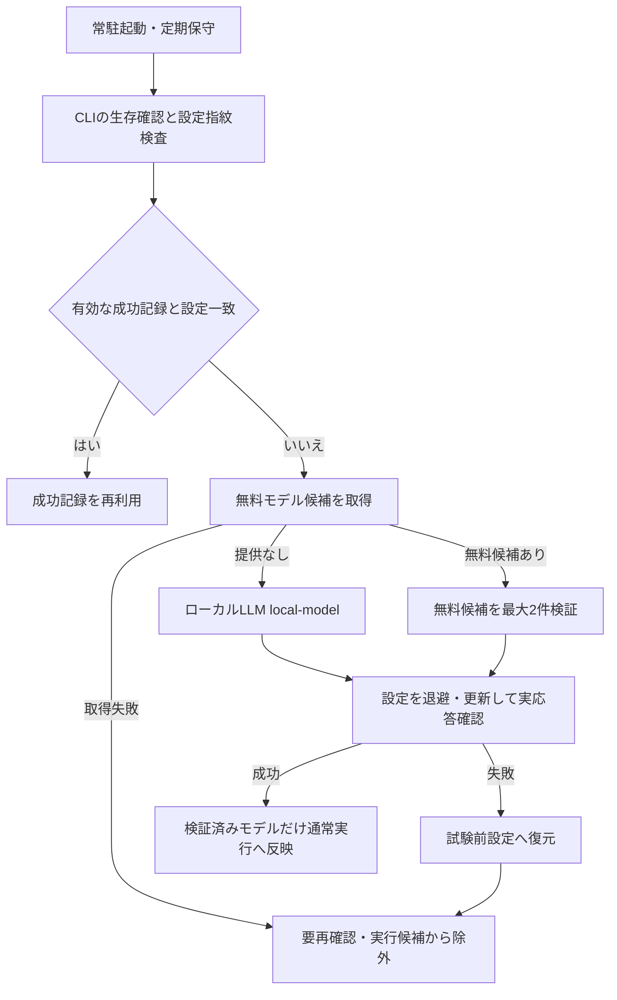

# エージェント接続設定の内部自動保守

Wentian Gatewayの常駐サーバー（Daemon）が、生存確認（Health Check）に加えて、モデル一覧取得、接続設定更新、実応答検証を実行する。運用者が個々のエージェントを手動設定する運用から、内部保守へ移行した。

## 方針

- OpenCode、Kilo、CrushはCLIのモデル一覧、Clineは公式APIの無料カテゴリ（Free Category）を確認する。無料と識別できるIDだけを候補にする。
- 無料候補の取得成功と実応答成功は別判定とする。無料候補が応答しない場合は再確認待ちとし、有料モデルやローカルLLMへ自動迂回しない。
- 無料提供のないGoose、Claude、Hermes、OpenClaw、および無料一覧が明示的に空のエージェントは `http://127.0.0.1:1234/v1` の `local-model` を使用する。
- 補助モデル（Small Model）も同じ無料・ローカルモデルへ整合させる。有料モデルへの自動切り替えを行わない。
- 変更前設定を退避し、試験に失敗した候補の設定を復元する。並行変更を検出した場合は上書きせず停止する。
- 指定された確認文字列を独立行で受信した場合だけ成功とする。コマンドのエコーやツール呼び出しを成功に数えない。
- CLI生存確認だけでは接続失敗したエージェントを実行候補へ戻さない。
- Gatewayから実行中のエージェントの接続設定は、その実行が終了するまで保守を延期する。
- 指紋は設定の構造から計算し、CLIによる整形だけの変更で再検証を繰り返さない。

## 実行と記録

待ち受け開始時と既定5分周期の保守で設定指紋（Fingerprint）・CLI版・方針版を検査する。正常な実応答記録は24時間、失敗記録は15分再利用する。設定変更・版変更・有効期限切れで再検証する。各候補の応答検証は90秒上限。保守は直列実行し、プロセス停止を確認できなければ後続の起動を止める。

管理者セッション（Admin Session）で `POST /v1/manager/external-agents/maintenance` を呼ぶと、内部保守を非同期で開始する。任意のモデルや接続先は指定できない。`GET /v1/manager/external-agents` の各 `connection` に方式・モデル・成否・期限・試行結果を返す。手動開始も有効な記録を再利用する。

記録先は `.wentian/agent-connections.json`、待機候補群（Ready Pool）は `.wentian/external-agent-readiness.json`、退避先は `.wentian/connection-backups/`。秘密値と応答本文は保守記録に出力しない。退避ファイルは元設定を含むためGit管理対象外とする。

`WENTIAN_AGENT_CONNECTION_MAINTENANCE=false` で接続保守を停止できる。PythonとPyYAMLが必要。Python実行ファイルは `WENTIAN_MAINTENANCE_PYTHON` で指定できる。Python版とPowerShell版の接続設定ブリッジ（Bridge）を同梱しているが、通常運用ではGateway内部から呼び出す。

## 検証範囲

実応答確認は接続の確認であり、ファイル操作能力や成果物の正しさを保証しない。従来の能力別候補制限と実作業の検収を維持する。未導入・認証不足・無料枠制限は保守が検出して除外し、パッケージの自動インストールや有料認証の購入は実施しない。

一覧取得、実応答失敗、ローカルLLM選択、指紋変化、期限、プロセス停止不明、退避・復元・並行変更拒否を自動試験で検証する。単体試験の保守キャッシュは実環境から隔離する。

2026-10-02の内部保守で、次の状態を記録した。これはモデルの一覧だけではなく、Gatewayが起動した接続確認の結果である。

| エージェント | 接続方式・モデル | 結果 |
|---|---|---|
| OpenCode | 無料 `opencode/nemotron-3-ultra-free` | 実応答成功 |
| Kilo | 無料 `kilo/kilo-auto/free` | 実応答成功 |
| Goose・Hermes・Claude | 社内 `local-model` | 実応答成功 |
| Crush | 無料候補 | 再確認待ち。設定競合を検出した試行は復元を停止 |
| OpenClaw | 社内 `local-model` | 再確認待ち。実応答検証未成功 |
| Cline | CLI起動確認が失敗 | 再確認待ち。Windows用CLIバイナリー欠落 |

失敗した3件は通常実行の待機候補群へ追加しない。現在の状態は管理APIを正とし、本表は検証時点の記録として扱う。
