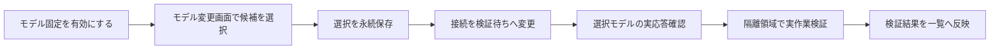

# 外部エージェントのモデル表示・選択

一覧の列順は `No → 外部エージェント → モデル → リアルタイム状態 → 最終確認 → 補足 → 操作` とします。
モデル列には接続記録のモデルIDと、使用中または検証待ちの表示、管理者用の「モデルを固定」チェックボックス、その直後にモデル変更ボタンを置きます。2026-10-23改訂の自動選択仕様は [モデル自動選択と復旧保守](agent_automatic_model_maintenance.md) にまとめます。

## 選択候補

| 分類 | 候補の取得元 | 使用方法 |
| --- | --- | --- |
| Agent提供の無料モデル | CLI（コマンドライン / CLI）のモデル一覧、Clineの無料モデル一覧 | Agentの提供元へ接続 |
| Wentian内部モデル | Gateway（ゲートウェイ / Gateway）の管理モデル一覧 | Gateway経由で登録済みプロバイダーへ接続 |
| その他のモデル | CLIの提供モデル一覧 | 提供元の既存認証と料金条件で接続 |
| 明示指定 | 利用者が入力したモデルID・プロバイダーID | Agent既存の認証設定で接続。候補を取得できない場合やCodexに使用 |

候補一覧は応答・実作業の合格を保証しません。モデル変更後は選択モデルで接続と作業能力を再確認します。
内部モデルに外部Agentへの委任モデルを含めず、循環委任を防ぎます。
Agent側の一覧取得失敗は画面へ知らせ、取得できた内部モデルを残します。

## モデルID・プロバイダーIDの明示指定

既定の設定ファイルが無い、またはCLIが候補一覧を返さない場合も、画面の「モデルIDを直接指定」からモデルIDと任意のプロバイダーIDを入力できます。入力は識別子の形式だけを検証し、保存後に対象Agentの接続と実応答を検証します。検証に失敗した場合は保存した選択を残し、失敗理由を一覧へ表示します。

- GooseはプロバイダーIDとモデルIDを起動引数（`--provider` / `--model`）で明示します。認証設定ファイルは変更しません。
- Codexは既存の `.codex/config.toml` の `model` / `model_provider` を読み、専用の非対話ランナー（`codex exec --json`）へ渡します。設定が無い場合はモデルを推測せず、明示指定を求めます。
- 明示指定も管理者だけが実行でき、実行中・導入中のAgentは拒否します。

## 保存と自動保守

選択情報は `.wentian/agent-model-preferences.json` に保存します。既定は自動選択です。`manual: true` が保存されたAgentだけを固定し、自動保守で別モデルへ切り替えません。旧版でモデルIDだけが保存されている場合も、チェックボックスを有効にするまでは自動選択として扱います。チェックを外しても以前のモデル・接続先設定は消しません。
設定変更前の合格記録を新しいモデルへ引き継がず、接続記録を検証待ちへ変更します。
実行中・導入中のAgentはモデル変更を拒否します。確認中の選択変更も、古い結果で上書きしません。

`GET /v1/manager/external-agents/:id/models` は現在モデル・選択情報・分類済み候補を返します。候補が無い場合は警告を返し、画面は明示指定を案内します。
`POST /v1/manager/external-agents/:id/model-selection` は管理者限定で `{ "manual": true }` または `{ "manual": false }` を受け取ります。変更後は旧接続認定を無効化し、対象Agentの保守を要求します。
`POST /v1/manager/external-agents/:id/models` は管理者かつモデル固定中に限定し、`{ "choice": "分類:モデルID" }` を受け取って現在の候補以外を拒否します。`{ "nativeModel": "モデルID", "provider": "プロバイダーID" }` の明示指定も受け付け、識別子の形式を検証してから保存します。固定を解除したAgentへのモデル変更はHTTP 409です。
選択後のAPI応答は検証待ちの一覧です。バックグラウンド（Background）保守の結果は10秒ごとの表示更新で確認します。

接続設定ブリッジ（Bridge）はPowerShellとPythonの両方で `native` とGateway接続を扱います。
Gatewayの認証値は環境から読み、選択APIやモデル一覧へ返しません。
