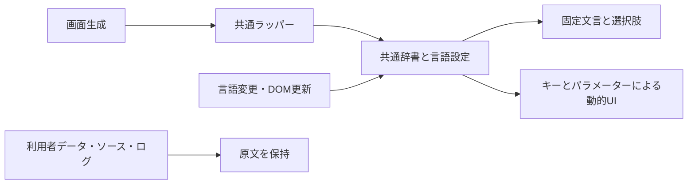

# 共通UIの多言語表示

## 共通処理と今回の不足

`withAppearance()`（`src/appearance-ui.ts`）は日本語・英語・中国語の辞書、言語設定、DOM更新監視を各画面へ組み込む。独立画面は `withCenterShell()`、管理画面と工作台は既存の共通ラッパーを通す。

従来は辞書への完全一致が基本で、未登録文言は原文のまま残る。並列工程・モデル学習画面の辞書不足、選択肢の個別列挙、動的な文章の連結、閉鎖済みサイト欄などの試験不足により、メニューだけ翻訳されても本文に日本語が残っていた。

## UIを追加するときの扱い

- 固定文言は共通辞書へ日本語・英語・中国語の組で登録する。高度な機能の辞書は `src/advanced-ui-translations.ts`。
- 固定の選択肢には `select[data-ui-options]` または `option[data-ui-label]` を指定する。共通処理は表示ラベルを変更し、送信する `value` は保持する。
- 数値・名前などを含むUIは `window.wentianUi.message(element, key, params)` を使う。辞書キーとパラメーターを要素へ記録し、言語切替時にも再描画する。専用のテキスト要素へ適用し、操作ボタンなどの子要素を置かない。
- パラメーターはそのまま表示する。状態など辞書で翻訳すべき値だけ `{uiKey: '実行中'}` として明示する。APIの状態列挙を表示語へ対応付ける処理は、利用者の自然言語の意図判定ではない。
- 利用者が名付けたサイト、スキル、モデル、入力、成果物、コード、実行ログは自動翻訳しない。`data-no-translate` で本文と属性を保護する。`pre` は通常は翻訳対象外だが、明示したメッセージ要素では翻訳する。
- 確認ダイアログはDOM監視の対象外なので、表示時に共通の `t(key, params)` を呼ぶ。



## 検証範囲

`application-language-audit.test.ts` は11画面の静的英語表示を監査する。`advanced-ui-language.test.ts` は並列工程、モデル学習、管理画面のモデル管理・エージェント追加・閉鎖済みサイト欄を、API固定応答で描画し、英語→中国語→日本語→英語へ切り替える。削除確認は取り消し、学習・導入・削除の実サービスは呼ばない。既存の `appearance-ui.test.ts`、`site-editor-ui.test.ts`、`workflow-center.test.ts` も確認する。

全機能のすべてのAPIエラー・実行ログ・外部由来コンテンツまで翻訳済みとするものではない。新画面には静的監査と、実際の動的描画を含む三言語試験の両方を追加する。

## Skillの名前・説明・手順

スキル一覧の識別子は従来 `#skills` の翻訳除外に該当し、詳細も `SKILL.md` 原文だけだった。見出しや固定文言の監査では、一覧と本文の未対応を検出できていなかった。

各スキルと同じディレクトリの `display.json` に、`ja`・`en`・`zh` ごとの `title`・`description`・`content` を定義する。同梱の `incident-triage`・`project-overview`・`verified-delivery` に三言語を用意した。工作台は共通言語設定を参照して一覧と開いている本文を再描画し、識別子は併記する。

一覧APIでは表示名と説明、詳細APIでは翻訳本文も返す。既存の `content`、実行時の `loadSkill()`、識別子と原本ハッシュは維持する。原本を機械的に翻訳・変更する処理はない。同名の利用者定義が優先された場合は、その定義と同じ場所にある翻訳だけを使う。翻訳がない、または不正な場合は原文を表示する。

`skill-localization.test.ts` は三スキルの全言語、開いた本文の言語切替、識別子・原本・利用者定義の保持を検証する。`workbench.test.ts` は認証済み詳細APIの翻訳応答も検査する。

## モデル常駐と画面説明

モデル管理には状態変更と常駐管理の別パネルがある。状態変更パネルだけでなく、`residencyStatus` 内の有効・無効の説明、所有・要求数・最終利用、予熱フォーム、結果通知も辞書へ登録した。閉鎖済みサイトの画面説明はナビゲーションが後から生成するため、静的HTMLだけでは検査できない。試験では実際に該当メニューへ切り替え、`viewLead` も検査する。

## CLI

CLIはブラウザーのlocalStorageを参照できないため、独立した明示設定を使う。優先順位は、そのプロセスで指定した `--language ja|en|zh` または `/language`、`WENTIAN_CLI_LANGUAGE`、保存済み設定、未設定時の日本語。`/language ja|en|zh` はユーザー単位の `cli-language.json` に保存する。試験や別環境では `WENTIAN_CLI_SETTINGS_FILE` で保存先を変更できる。

```text
wentian agent --language zh
wentian agent --language en
wentian agent --language ja
```

対話中の `/language` は現在値を表示し、引数付きでは切替と保存を行う。起動時の更新案内、入力・回答枠、プレースホルダー、状態欄、コマンド候補とヘルプは `cliText()` の共通辞書から表示する。入力、回答本文、モデルID、ファイル名、JSONの機械可読データは表示辞書による置換をしない。

明示したCLI言語はCLI内の既定回答言語としてAIへ渡す。既存の `WENTIAN_RESPONSE_LANGUAGE` がある場合はそちらを優先する。CLIを起動していないWebサーバーに、端末の保存言語を既定回答言語として適用しない。本文からの固定キーワード・文字種による言語推定は追加していない。

`cli-language.test.ts` は設定・UI・回答指示を、`conversation-cli.test.ts` は実CLIとローカル模擬APIでの三言語とJSON出力を検証する。`slash-picker-opentui.test.ts` はBunで入力欄・状態欄・候補を実描画して確認する。利用者の既存会話や設定を試験で変更しない。

## 今回の検証結果

- Nodeの関連回帰試験：101件成功、失敗・除外なし。
- BunのSkill表示とOpenTUI実描画試験：4件成功。
- `npx.cmd tsc --noEmit` と `git diff --check`：成功。
- サーバー再起動後、ホーム・工作台のHTTP 200、説明の翻訳辞書、Skillの言語切替処理の配信を確認。
- `/health` の状態は `fallback_ready`。本記録はモデル実行環境の全面的な正常性を示すものではない。
