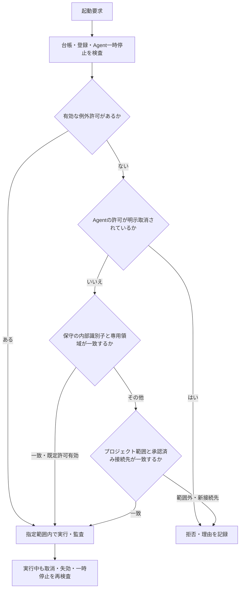

# 既定の保守権限とプロジェクト共通実行範囲

2026-10-29。利用者の「合理的な既定値で人の操作を減らす」指示に基づく現行仕様。旧来の全Agentへの期限付き許可を日常保守に要求する方式を置き換える。

## 利用者の操作

| 用途 | 既定動作 | 人が操作する条件 |
|---|---|---|
| 接続確認・設定の診断・モデル一覧読取り・CLIヘルプ | 保守専用領域で実行。Agent別の承認・更新は不要 | 既定許可を自分で無効化・取消した場合の復元 |
| 実作業能力の検証 | 作業検証専用領域と、その内部の制作コピーで実行 | 上位の保守禁止、一時停止、資源保護があればその設定・原因に従う |
| プロジェクト内の依頼・ファイル作業 | プロジェクト範囲を一度設定し、現在の接続先を使うAgentで共有 | 初回、作業範囲の拡大、新Agent・接続先の追加・変更、または明示取消後 |
| 同じ接続先内でのモデル変更 | プロジェクトの許可を再利用 | 接続先が変わる場合は再設定 |
| Agentの一時停止・再開 | Agentを利用・保守対象から除外・復帰する | 人が停止・再開を選んだとき。権限の取消状態は変更しない |
| 特定Agentだけの一時的な例外 | 高度な設定に既存の期限付き許可を残す | 通常運用では不要 |

初期値は専用領域の自動保守を許可する。通常プロジェクト、Temp全体、ホーム全体、Wentianインストール全体を、この既定許可へ含めない。保守の推論では合成した検証入力と設定済み接続先を使用し、プロジェクト本文の送信をこの既定許可で認めない。

内部保守AIのソース調査・候補検証はこの外部Agent向けCLI実行許可とは別の製品機能である。製品の `src/` と `docs/` だけを限定的に読み、設定・無視対象・リンクを除外して候補を専用領域へ保存する。一部アダプターは隔離試験と競合検査を通った場合だけ独立監督が自動配備し、配備後も全Agentを再検証する。詳細は[公開機能と制限](feature_scope.md)を参照する。

プロジェクトの初回許可は、既定表示された作業場所と設定済み接続先、ホストアカウント実行の説明を確認し「このプロジェクトでの実行を許可」を押す。複数Agentへの同じ入力、時間指定、追加の確認ダイアログは要求しない。許可は取消まで継続する。過去の期限付き許可を無期限のプロジェクト許可へ勝手に拡大しない。

## 画面

- `/#agents`：Agentごとの既定の保守権限・取消状態、実行範囲設定への直接リンクを表示。「再確認」はそのAgentの確認・保守を依頼する操作で、許可の発行・取消ではない。
- 自動保守の統一管理：既定の保守権限の有効・無効を表示。一時停止と取消の違いを説明する。
- `/execution-permissions`：既定設定とプロジェクト範囲を先頭に表示。Agent別の一時許可は折りたたんだ高度な設定へ移す。`?agent=<ID>` で対象Agentを選択して開ける。
- 明示取消後に「選択Agentの既定利用を復元」を押しても、Agentの一時停止は解除しない。
- 表示・動的状態・エラー・操作は日本語・英語・中国語を同時に更新する。

## 実行判断

保守の内部識別子はJavaScriptの `Symbol` であり、HTTP本文、モデル出力、文字列の `maintenance=true` では作れない。作業場所は実パスで照合し、専用領域から外部へのリンクを許可しない。

制作コピーへのプロジェクト許可の引継ぎは、ホストがコピーを作った後にプロセスメモリー内の `WeakMap` へ登録した対応だけを使う。モデルやHTTP本文が申告したコピー元・コピー先・任意のTempディレクトリーから許可を取得できない。元プロジェクトの取消と接続先変更はコピー内の実行にも反映する。

これらはWentian側の実行制御であり、外部CLIに対するOSサンドボックスの保証ではない。既存の書込み制限・受入試験・資源保護・モデル固定・Provider送信停止を維持する。AIは範囲内の復旧を選び、範囲外の操作では必要な追加設定と根拠を示す。

## 保存形式と移行

既存の `execution-grants.json`（`WENTIAN_EXECUTION_POLICY_FILE` で変更可能）の `version:1` と `grants` を維持し、`access` を追加する。

| 項目 | 内容 |
|---|---|
| `access.maintenance` | 専用領域の既定保守許可。初期値true |
| `access.revokedAgents` | 既定許可とプロジェクト共通許可を使用させないAgent |
| `access.projects` | プロジェクトの実パス、接続先の指紋、ホスト実行可否、版識別子、操作者、設定日時 |
| `grants` | 従来のAgent別の期限付き例外。期限を自動延長しない |

起動時に一度だけ移行する。従来の台帳、明示取消の監査記録、既存の期限付き許可を保全する。取消は新しい既定値で復活させない。破損台帳や残留ロックを上書き・削除して実行を強行しない。

上位の `maintenance-controls.json`、Agentの登録・一時停止、環境設定は引き続き有効。`WENTIAN_DEFAULT_MAINTENANCE_ACCESS=false` は既定の保守許可を固定禁止にする。この環境設定を画面から解除しない。

接続先指紋はAgentごとのProvider、base URL、接続方式を使用し、モデル名を含めない。プロジェクト許可保存時に画面取得時点の全接続先のダイジェストを再照合する。新しい接続先やAgentを未確認のまま既存の許可へ追加しない。

## API

管理者認証、同一Origin、操作者の認証側確定を維持する。通常の保存・復元後は、保存済みの自動保守が有効な場合だけ保守要求を通知する。停止した自動保守を勝手に再開しない。

| API | 用途 |
|---|---|
| `GET /api/execution-permissions` | `access`、既存の例外、接続先、監査を取得 |
| `PUT /api/execution-permissions/defaults` | `maintenance` の保存、または `agent` と `restore:true` による明示復元 |
| `POST /api/execution-permissions/projects` | `root`、`shareContext:true`、`allowHostAccount`、`expectedTargetsDigest` でプロジェクトを設定 |
| `DELETE /api/execution-permissions/projects/:id` | 指定プロジェクトの許可を取消 |
| 既存の `POST /grants`、`DELETE /grants/:agent` | Agent別の例外作成・全許可の取消 |
| `GET /v1/manager/external-agents/maintenance` | 保存先や秘密値を含まない `executionAccess` の概要も返す |

実行監査の `started.authorization` は `maintenance`、`project`、`temporary` のどの許可で実行したかを記録する。依頼本文・認証情報は記録しない。

## 検証

試験は一時領域と模擬接続先へ分離する。既定の実プロセス起動、期限切れとの分離、旧取消移行、一時停止、実行中取消、偽装識別子、領域外・リンク拒否、プロジェクト共用、モデル変更と接続先変更の区別、制作コピー継承、管理認証、Origin、三言語の操作を検証する。稼働サービスの反映と最終確認は実施後に記録する。

2026-10-29の既定権限実装時の全試験は1299件中1291件成功、8件スキップ、失敗0件。その後のソース調査追加後には関連44試験と型検査を再実行した。独立したブラウザー環境で日本語・英語・中国語、幅1440px・390pxの6条件を確認し、模擬プロジェクトの許可を一度の操作で保存した。実サービスでは保守既定権限が有効であることをAPIで確認し、opencodeの設定済みモデルを実プロセスで読み取った。前後の期限付き許可件数は18件で変わらず、監査には `authorization: maintenance` が記録された。証跡は `.wentian/runtime/test-default-access-accepted-20261029.log`、`.wentian/runtime/default-access-browser-final-20261029/result.json`、`.wentian/runtime/default-access-real-process-20261029.json` に保存した。

実サービスのログイン後画面は、対象Edgeウィンドウが最小化されており自動操作から確認できなかった。ブラウザー試験の実サービス側画像にはログイン画面が重なっており、認証後画面の検証済み証跡としては扱わない。
