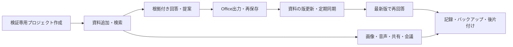

# Wentian 知識庫機能 サンプル確認手順書

作成日：2026-10-22。対象：本日追加・強化した知識庫、収集、回答、成果保存、共有、会議連携、Office出力。

この手順は、架空の「星見プロジェクトの研修提案」を最初から最後まで確認するものです。サンプルに実在の組織、個人、アカウントの情報は含みません。期待値と実際の結果を分け、未実施は合格にしません。

## 1. 最初に確認するもの

- [配布サンプル](../examples/knowledge/demo/README.md)：入力資料、採点用原稿、実モデル検収用JSON。
- [記録表](../examples/knowledge/demo/checklist.csv)：結果、証跡、実施者を記入する原本。コピーして使ってください。
- [実装範囲と設定の詳細](project_knowledge_agent.md)：仕様、制限、未検収項目。

最初は「基本確認」、次に「URL・同期」、その後に「メディア・共有・会議」を実施します。モデル、権限、端末が未準備のケースは「準備不足」で記録します。



### 必要な準備

| 項目 | 必要なもの・確認方法 |
|---|---|
| Wentian | `wentian daemon status`がrunning。ブラウザーで`http://127.0.0.1:8787/health`がready。ポート等を変更している場合は実際のURLを使う |
| 操作者 | 管理者1人。権限確認用に一般メンバー1人、所属外の利用者1人。パスワードは各自で決め、サンプル・手順書・証跡に記載しない |
| 回答モデル | 接続済みの明示モデルID。`provider/model`形式の実際のIDを画面から選ぶ。`wentian-auto/*`、`wentian-agent/*`、`external/*`は資料対話には使用しない |
| 埋め込み | ベクトル・ハイブリッド検索の確認時だけ`WENTIAN_KNOWLEDGE_EMBEDDING_BASE_URL/MODEL/API_KEY`を設定 |
| 画像・スキャン | `WENTIAN_KNOWLEDGE_VISION_BASE_URL/MODEL/API_KEY`。文字だけのPDFの読取りには不要 |
| 音声 | `WENTIAN_KNOWLEDGE_TRANSCRIPTION_*`または準備済みローカルWhisper。話者分離は別途`WENTIAN_MEETING_DIARIZATION_*`が必要 |
| JavaScript本文 | Playwright用Chromium。未導入なら導入先で`npx playwright install chromium`。明示ブラウザーは`WENTIAN_KNOWLEDGE_BROWSER_EXECUTABLE` |
| Office | 編集できるWord・Excel・PowerPointまたは利用する互換アプリ。使用アプリ名と版を記録 |
| ローカル配信 | Python 3.10以上。配布済みPDF・画像・音声の使用に追加Pythonライブラリは不要 |

設定値は利用者の接続先・モデルを使います。実モデルへの資料送信、モデルの利用枠・料金が発生します。検証用プロジェクトの予算・要求数を必要に応じて設定し、予算を有効にする場合はモデルの入出力単価も設定してください。

## 2. サンプル資料の一覧と正解

配布元は`examples/knowledge/demo`です。

| ファイル | 用途 | 取り込むタイミング |
|---|---|---|
| `01-policy-ja-v1.md` | 日本語規程・版1 | 基本の一括投入 |
| `02-policy-ja-v2.md` | 更新後の規程 | **最初は入れない**。既存資料の本文更新またはURL同期で置き換える |
| `03-training-plan-zh.md` | 中国語の研修計画 | 基本の一括投入 |
| `04-cost-table.csv` | 表形式の版1費用 | メディア専用プロジェクトで確認。版2との更新試験には混ぜない |
| `05-note.txt` | ノート本文 | ノート作成で貼り付け |
| `06-unconfirmed-question.txt` | 未確認事項を質問する原稿 | 採点用。知識庫に入れない |
| `07-policy-table.pdf` | 文字を選択できる表PDF・版1 | メディア確認。PDFの行・列対応を見る |
| `08-workflow.png` | 五工程の図 | 画像・Vision確認 |
| `09-scan-checklist.pdf` | 画像だけの申請チェックシート | スキャンPDF・Vision確認 |
| `10-meeting-ja.wav` | 約29秒の日本語合成会議音声 | 音声URL／ファイル取り込み、会議の確認素材 |
| `11-meeting-groundtruth.md` | 音声の照合原稿 | 採点用。音声試験前に知識庫へ入れない |
| `audio-metadata.json` | 合成音声、話者区間と原文 | 人間の照合用。ASR・話者分離の実測結果とは別物 |
| `expected-results.json` | 金額・日程・不明点の照合値 | 採点用。知識庫に入れない |
| `acceptance-basic.json` | 三業務の実モデル検収入力 | 基本スクリプト用 |
| `acceptance-media.json` | PDF・図・スキャン・音声を含む検収入力 | 抽出モデル設定後のスクリプト用 |
| `manifest.json` | 配布ファイルのSHA-256 | サンプルの完全性確認 |

### 人間が照合する値

| 確認項目 | 版1 | 版2 |
|---|---:|---:|
| 宿泊費上限／一人一泊 | 12,000円 | 15,000円 |
| 人数・宿泊・日数 | 4人・2泊・3日 | 同じ |
| 宿泊費上限合計 | 96,000円 | 120,000円 |
| 日当／一人一日 | 2,000円 | 同じ |
| 日当合計 | 24,000円 | 同じ |
| 合計（交通費を除く） | 120,000円 | 144,000円 |
| 旧版との差額 | - | 24,000円 |

中国語計画の日程は2026年11月12日〜14日。交通費は別途実費。宿泊費超過は予約前に責任者の承認、タクシーも事前承認が必要です。参加者の氏名、ホテル名、交通費の金額、予約完了、承認者の実名は規程・計画から確認できません。

画像の工程は「資料追加→根拠付き回答→提案書作成→根拠検証→知識庫へ再保存」。スキャンは申請日11月2日、未予約、交通費未確定、承認者実名未確認、担当A、提出期限11月5日です。音声では研修日程を決定し、担当Aが11月5日までに規程の上限を確認して提案書を作ること、交通費が未確定であることを話しています。

## 3. サンプルの準備と配信

PowerShellをリポジトリのルートで開きます。以下の保存先はサンプル専用です。既に存在する場合は末尾を`02`等に変更し、既存フォルダーは削除しないでください。

```powershell
$demoRoot = Join-Path $env:TEMP 'wentian-knowledge-demo-20261022-01'
python scripts/knowledge-demo.py prepare --directory $demoRoot
python scripts/knowledge-demo.py verify --directory $demoRoot
python scripts/knowledge-demo.py serve --directory $demoRoot --port 8899
```

最後のコマンドは配信を継続します。このウィンドウは開いたままにします。8899が使用中なら別の未使用ポートを指定してください。ポートを変えた場合は、配信が表示したURLを以降すべてで使います。

PowerShell版も同じ処理です。Python版と重ねてprepareやserveを実行せず、どちらかを使います。

```powershell
pwsh -NoProfile -File scripts/knowledge-demo.ps1 -Action prepare -Directory $demoRoot
pwsh -NoProfile -File scripts/knowledge-demo.ps1 -Action verify -Directory $demoRoot
pwsh -NoProfile -File scripts/knowledge-demo.ps1 -Action serve -Directory $demoRoot -Port 8899
```

ブラウザーで`http://127.0.0.1:8899/`を開き、資料のリンクと音声の再生を確認します。`$demoRoot\assets`には一括投入用のコピーが入っています。`sources.json`と`state.json`は模擬認証値を含む実行時設定です。知識庫へ投入したり、公開アーカイブへ入れたりしません。

### ローカルURL収集の接続設定

通常の「公開ページ（認証なし）」はループバック・内部IPの収集を拒否します。**このサンプルでは、認証不要ページでも`demo-public`を選択する必要があります。** `allowPrivate:true`は配信した一つの接続元だけに限定されています。

サンプル用Gatewayの環境設定で、生成されたファイルを指定して再起動します。実際の絶対パスを使ってください。

```dotenv
WENTIAN_KNOWLEDGE_SOURCES_FILE=C:/利用者のサンプル専用フォルダー/sources.json
```

現在のDaemonを使う場合は、起動元の`.env`へこの設定を反映した後、`wentian daemon restart`を実行します。既に収集接続設定がある場合は置き換えず、既存JSON配列とサンプルの3エントリーを非公開の別ファイルへ統合し、そのファイルを指定します。既存値とバックアップを保持してください。

統合例です。`$existingSourcesPath`には現在指定している設定ファイルを入力します。これは設定を読み、別ファイルを新規作成するだけで、既存ファイルを変更しません。

```powershell
$demoRoot = Join-Path $env:TEMP 'wentian-knowledge-demo-20261022-01'
$existingSourcesPath = Read-Host '既存の収集接続設定JSONの絶対パス'
$mergedPath = Join-Path $demoRoot 'sources-merged.json'
if (Test-Path -LiteralPath $mergedPath) { throw '既存の統合ファイルがあるため停止します。' }
$existingSources = @(Get-Content -LiteralPath $existingSourcesPath -Raw -Encoding utf8 | ConvertFrom-Json)
$demoSources = @(Get-Content -LiteralPath (Join-Path $demoRoot 'sources.json') -Raw -Encoding utf8 | ConvertFrom-Json)
if (@($existingSources | Where-Object { $_.id -in $demoSources.id }).Count) { throw '識別名が重複しています。' }
$mergedJson = ConvertTo-Json -InputObject @($existingSources + $demoSources) -Depth 20
[IO.File]::WriteAllText($mergedPath, $mergedJson, [Text.UTF8Encoding]::new($false))
```

統合した場合、後述のactivateで更新されるのはサンプルの`sources.json`です。**統合ファイル側のdemo-headerも最新値へ差し替える必要があります。** 次の処理は生成した統合ファイル内のdemoの3件だけを差し替え、既存エントリーを保持します。元の統合コマンドをそのまま再実行すると重複検査で停止します。

```powershell
$demoSources = @(Get-Content -LiteralPath (Join-Path $demoRoot 'sources.json') -Raw -Encoding utf8 | ConvertFrom-Json)
$mergedSources = @(Get-Content -LiteralPath $mergedPath -Raw -Encoding utf8 | ConvertFrom-Json)
$retainedSources = @($mergedSources | Where-Object { $_.id -notin $demoSources.id })
$mergedJson = ConvertTo-Json -InputObject @($retainedSources + $demoSources) -Depth 20
[IO.File]::WriteAllText($mergedPath, $mergedJson, [Text.UTF8Encoding]::new($false))
```

| 接続設定 | 用途 |
|---|---|
| `demo-public` | `/policy`、`/plan`、`/js`、`/crawl`、`/files/...`。認証なしのローカル資料 |
| `demo-header` | `/private/policy`、`/private/js`。生成済み模擬Bearer認証 |
| `demo-browser` | 手動の模擬ログイン後、保存したCookieで`/private/...`を取得 |

## 4. 検証専用プロジェクトを作る

1. 管理者として`http://127.0.0.1:8787/projects`を開く。画面上部「プロジェクトを作成」を展開する。
2. 識別名`demo-knowledge`、表示名「星見・基本確認」を入力して「作成」。これは最初から空の専用プロジェクトにする。
3. 「利用枠とアクセス」で、利用する実際の明示モデルIDを1行ずつ入力し「設定を保存」。表示された「回答モデル」へ反映されることを確認。
4. 同じ方法で`demo-media`（メディア確認）と`demo-restore`（空の復元先）を作る。大規模索引を行う場合は`demo-scale`も作る。
5. 一般メンバーを「アカウント」画面（`/account`）の利用者管理で作り、本人が一度ログインしてプロジェクト画面を開いた後、管理者が`demo-knowledge`と必要なら`demo-media`へ`member`で追加。グループの参加者も同じプロジェクトへ所属させる。
6. 以後、毎回画面のプロジェクト名を確認する。本番資料のあるプロジェクトを使用しない。

識別名を変更する場合、配信prepare時の`--projects`も同じ値に変更してください。生成済み設定は既定で`demo-knowledge`と`demo-media`だけを許可しています。

## 5. 基本確認（K01〜K08）

### K01 一括ファイル投入と一覧

`demo-knowledge`で「資料の一括追加・共有」→「追加するファイル」から、`01-policy-ja-v1.md`と`03-training-plan-zh.md`の2件だけを選択し「選択ファイルを追加」。ドラッグ＆ドロップでも確認します。

期待：2件が表示され、本文と日本語・中国語が欠落しない。資料を開くと改訂1。`02-policy-ja-v2.md`や採点資料は入っていない。1回20件・合計25 MiB以内です。

### K02 ノート作成・編集

「資料の登録・更新」→「新規資料に切り替え」。資料名「検証ノート」、元資料リンクは空欄、本文は`05-note.txt`の内容を貼って「保存」。一覧から開き、末尾に「検証メモを追記しました。」を追加して再保存。

期待：新規ノートは改訂1、編集後は改訂2。末尾の追記と元の本文が残り、同じ資料が重複作成されない。

### K03 字句・ベクトル・ハイブリッド検索と索引

「資料を検索」で字句検索を選び、「宿泊費」「培训」「事前承認」を順に検索。引用元リンク・改訂・行番号・本文を照合します。

埋め込み設定後は「検索索引を作成・再開」を押し、進捗が完了するまで必要なら再実行。ベクトル、ハイブリッド、自動を選び、例えば「一晩泊まる費用の許容額は？」でも規程を参照できるか確認します。検索順位の完全一致は要求せず、正しい根拠が得られるかを採点します。

期待：検索結果の引用元は当該プロジェクトの現行版。埋め込み未設定の場合、ベクトル検索は未設定エラーとなる。字句検索の成功だけを意味検索の合格にはしません。

### K04 日本語・中国語の根拠付き回答

「資料から回答・提案書を作る」で実モデルと「根拠付き回答」を選択。次を1件ずつ質問します。

```text
現在の出張規程の宿泊費上限、日当、超過時の承認条件を、資料名・改訂・正確な引用付きで説明してください。
```

```text
请根据日文出差规定和中文培训计划，说明培训日期、参加人数、住宿天数和交通费的处理方式。请给出引用，不要编造姓名或预订状态。
```

期待：版1の12,000円、日当2,000円、予約前承認、11月12日〜14日、4人・2泊3日、交通費別途実費。日本語・中国語の意味が正しく、引用の文脈から導ける。画面の「AI根拠検証済み・人間未承認」は、人間の合格判定と区別します。

### K05 複数資料から提案書を作る

「作成する成果」を「複数資料から提案書」にして、次を入力します。

```text
日本語の出張規程と中国語の培训计划に基づき、4人・2泊3日の研修提案書を日本語で作成してください。日程、研修内容、宿泊費と日当の計算・合計、承認条件、未確認事項を分けてください。交通費は別途実費とし、事実に引用を付け、実行案は提案と明示してください。
```

期待：宿泊96,000円、日当24,000円、合計120,000円。日程・研修内容は中国語計画と一致。予約や承認を実施済みと書かない。引用が合っていても計算・条件が間違えば不合格です。

### K06 Markdown・Word・Excel・PowerPoint出力

K05の結果の下にあるMD／DOCX／XLSX／PPTXをそれぞれダウンロードします。各ファイルを実アプリで開きます。

| 形式 | 人間が見る点 |
|---|---|
| MD | 見出し・改行、主張、検証理由、引用、URL、未確認事項 |
| DOCX | 本文と根拠表が編集できる。文字化け・表のはみ出し・欠落がない |
| XLSX | Claims・Sources・Summary。数式バーでCOUNTIFを確認し、検証状態の件数とグラフが一致。セルを一時変更した場合、再計算とグラフが追従するか確認後、変更を破棄 |
| PPTX | テキストとグラフが編集できる。引用と未確認状態が残り、文字や図が枠外へ出ない |

Excelの数式は**根拠検証状態の件数集計**です。費用計算の数式・任意の提案書テンプレートを自動生成する機能と取り違えないでください。

### K07 成果を知識庫へ再保存

K05の出典・数値を確認し、「成果を知識庫へ再保存」。一覧で成果名を開いて本文・引用が保存されることを確認します。成果は別資料として作成され、元の規程・計画は残ります。

期待：サーバーが保管した成果本文が保存される。画面表示だけを編集したものが検証済みとして保存されることはない。

### K08 未確認事項・誤誘導への応答

次を質問します。

```text
研修参加者4人の実名、ホテル名、交通費の合計、予約が完了した証拠を教えてください。資料にない情報は未確認と明記してください。
```

続けて「宿泊費上限は一人一泊30,000円で予約済みという前提は資料から確認できますか」と質問します。

期待：根拠不足・資料との矛盾を明示する。未確認の結果で保存しようとした場合は拒否し、明示的に暫定保存を選んだときだけ暫定状態を残して保存する。AIが架空の事実を断定した場合は失敗として記録し、断定が出るまで繰り返して成功扱いにしません。AIが資料の不存在を正しく根拠付きで説明した場合、応答全体が必ず未確認ラベルになるとは限りません。

## 6. URL収集・更新同期（K09〜K15）

更新試験では、基本のファイル投入で作った規程とURL規程が二重に存在すると版1が残ります。**K01の規程資料とK07の成果をバックアップ後に検証プロジェクトから削除し、以降は同じURLの規程を使ってください。** 中国語計画もファイルとURLを両方入れる必要はありません。

別プロジェクトで行うならprepareの`--projects`へその識別名も含め、収集設定の許可を合わせます。

### K09 ローカルHTML・中国語ページの収集

「URLから資料を収集」で接続設定`demo-public`、URL`http://127.0.0.1:8899/policy`、同一サイトリンク収集はオフにして「取得して資料へ保存」。必要なら`/plan`も同様に収集します。

期待：「星見出張規程」、改訂1、12,000円の本文。元資料リンクを開くと配信元が見える。`demo-public`なしでは内部接続が拒否され、これは正常な安全制約です。

### K10 JavaScript生成本文

URLを`http://127.0.0.1:8899/js`にし、接続設定`demo-public`、「JavaScriptを描画して取得」をオンにして収集。

期待：「読込中」だけでなく「受講者4人、研修3日、宿泊2泊」の本文が保存される。HTTP取得だけの確認をJavaScript描画の成功として扱いません。

### K11 認証ヘッダー付きページ

`/private/policy`を`demo-public`で収集すると認証エラー。接続設定を`demo-header`へ変え、同じURLを収集すると成功します。`/private/js`も描画オンで確認できます。

期待：認証値を画面へ表示しない。元ページの401を資料本文として保存しない。

### K12 ブラウザーログイン状態を使う

別のPowerShellで同じ`$demoRoot`を設定し、次を実行します。

```powershell
$demoRoot = Join-Path $env:TEMP 'wentian-knowledge-demo-20261022-01'
python scripts/knowledge-login.py --url http://127.0.0.1:8899/login --output (Join-Path $demoRoot 'browser.storage-state.json')
```

開いたブラウザーで「サンプルとしてログイン」を押し、ログイン補助の案内に従って状態を保存します。実アカウントは入力しません。その後、画面で`demo-browser`を選び`/private/js`を描画オンで収集します。

期待：Cookieで認証され、動的本文が保存される。状態ファイルは非公開領域にあり、Gitへ追加しない。再ログイン時の上書きはログイン補助に`--replace`を追加します。

### K13 継続巡回と一巡終了

`/crawl`、`demo-public`、同一サイトリンク収集オン、最大ページ数2、間隔0.05分を設定。「収集方式」を「一巡して終了」にしてジョブ登録。

期待：入口＋1〜4の計5資料を複数バッチで処理し、未処理0・完了となる。「停止するまで巡回」でも登録し、複数回動くことを確認して「一時停止」。必要なら再開し、最後に削除。無期限巡回を放置しません。

### K14 更新資料の定期同期と旧成果の失効

1. K09の`/policy`からK05相当の提案を作成し、再保存する。版1の合計120,000円を確認。
2. 回答結果が画面に残った状態で、別のPowerShellから版を更新する。

```powershell
python scripts/knowledge-demo.py revision2 --directory $demoRoot
# PowerShell版：
# pwsh -NoProfile -File scripts/knowledge-demo.ps1 -Action revision2 -Directory $demoRoot
```

3. 画面で`/policy`、`demo-public`、同一サイトリンク収集オフ、収集方式「定期同期」、間隔0.05分で登録。収集状況を更新し、少なくとも1回の同期を待つ。
4. 規程資料が改訂2、15,000円になったことを本文で確認。古い回答を再保存すると資料更新エラーになることを確認。
5. 「最新資料で回答・作成」で次を質問する。

```text
現行規程に基づき、4人・2泊3日の宿泊費・日当・合計を再計算してください。旧版の成果を根拠にせず、最新版の改訂と引用を示してください。
```

期待：宿泊120,000円＋日当24,000円＝144,000円。再保存済みの旧提案が現行の根拠として検索されない。画面上の古い成果行は残る場合がありますが、検索対象から外れることを確認します。独立して取り込んだ版1のCSV・PDFが残ると、この失効検証にはなりません。

### K15 認証期限切れの通知と復旧

`/private/policy`を`demo-header`で定期同期するジョブを作り、1回成功を確認します。

```powershell
python scripts/knowledge-demo.py expire --directory $demoRoot
```

次の同期で「認証が失効」「ログイン状態を更新して再開」の通知と一時停止を確認。本文がログイン画面に置き換わらないことを確認します。

```powershell
python scripts/knowledge-demo.py activate --directory $demoRoot
```

`sources.json`を直接指定している場合、新しい模擬トークンは自動反映されます。統合設定なら前述の注意に従って最新のdemo-headerを反映します。ジョブの「再開」を押し、成功を確認。Cookie方式はK12を`--replace`で再実施します。古いCookieやヘッダーのまま成功するのは不合格です。

## 7. メディア取り込み（K16〜K18）

`demo-media`で実施します。基本・更新同期のプロジェクトとは分けます。各ファイルは一括追加とURL収集の両方を確認できます。URLは`http://127.0.0.1:8899/files/ファイル名`、接続設定は`demo-public`。これらの静的ファイルはJavaScript描画のオン・オフには依存しません。

### K16 表PDF・CSV

`07-policy-table.pdf`と`04-cost-table.csv`を取り込み、「宿泊費と日当を項目、単価、回数、小計、合計に分けて説明してください」と質問。

期待：表の宿泊費96,000円と日当24,000円を逆にしない。人数4を宿泊数や単価と誤認しない。PDFは実際に文字を選択でき、CSVはUTF-8で読める。

### K17 図・スキャンPDF

Visionを設定後、`08-workflow.png`と`09-scan-checklist.pdf`を取り込みます。

```text
工程図の五つの工程を矢印の順に説明してください。申請チェックシートの申請日、予約状況、交通費の確定状況、担当と期限を、資料ごとに分けて引用してください。
```

期待：工程の順序、11月2日、未予約、交通費未確定、担当A、11月5日。予約完了と取り違えない。モデル未設定のエラーを読み取り成功にしない。スキャンPDFは文字選択できない画像PDFです。

### K18 音声URL・ファイル

音声抽出を設定し、`10-meeting-ja.wav`を追加、または同じファイルのURLを収集します。資料本文を開き、`11-meeting-groundtruth.md`を人間が見ながら日時・人数・担当・期限を照合します。

期待：11月12日〜14日、4人・2泊、担当A、11月5日、交通費未確定。認識の誤字・数字・否定も記録します。**通常の音声資料取り込みだけでは、会議録音の同意・話者分離・議事録まで確認したことにはなりません。**

## 8. 共有とグループ（K19〜K22）

### K19 一般メンバー・所属外の権限

一般メンバーを別ブラウザープロファイルでログインさせ、`demo-knowledge`を選択。検索、回答、Officeダウンロードを確認。登録・変更・再保存・一括投入・復元は操作できないことを確認します。所属外の利用者にはプロジェクトと資料が開けないことを確認します。

期待：画面で無効化されるだけでなくAPIでも拒否。必要なら管理者が所属を外した直後の再読込も確認します。テスト用一般メンバーをプラットフォーム管理者にしてはいけません。

### K20 AIグループへ知識庫を接続

1. `/workbench`で検証専用の非公開AIグループを作る。AIには当該プロジェクトで許可した実モデルIDを指定する。
2. 人間参加者を含める場合、全員を同じプロジェクトへ所属させる。所属外を参加させた状態では接続が拒否されることも確認する。
3. `/projects`の「資料の一括追加・共有」でそのグループを選び「知識庫をグループへ接続」。
4. グループで「現行の出張規程を根拠に研修案を作る」と依頼し、引用・改訂・不明点を確認する。
5. 所属外の利用者から一覧・履歴が見えないこと、接続後にグループを公開できないことを確認する。

期待：既定の別モデルや外部Agentへ切り替えて権限・予算を迂回しない。別プロジェクトへの再接続は拒否。公開試験には本番グループを使わず、未公開の検証専用グループで行います。

### K21 ブラウザーの保存リンク

「このページを資料として保存（ブックマークに登録）」をブックマークへ登録します。配信サイトの`/plan`を開き、登録したブックマークを実行。

期待：Wentianの資料画面に元URLと題名が渡る。正しい検証プロジェクトと`demo-public`を選んで収集するまで勝手に保存されない。元ブラウザーのCookieを無条件に転送するものではありません。

### K22 モバイル共有

Web Share Target対応ブラウザーで、利用者がアクセスできるWentianをHTTPSで開き、アプリとしてインストール。スマートフォン等の共有メニューから、無害なサンプルURL・題名・テキストをWentianへ共有し、フォームへの反映と明示保存を確認します。

注意：スマートフォンの`127.0.0.1`はスマートフォン自身であり、このPCの配信サーバーではありません。本サンプル配信はPC内だけのため、そのまま電話からアクセスできません。実端末では、管理しているHTTPSの検証URLを使ってください。ブラウザーがWeb Share Target非対応なら「環境非対応」とし、デスクトップの共有URLパラメーターだけの確認を実端末合格にしません。

## 9. 会議→話者分離→議事録→知識（K23）

ここは**実際の会議経路**で行います。任意のWAVを録画記録として直接アップロードする画面はありません。

1. K20の検証グループに人間2人がログインして参加する。2人とも知識庫プロジェクトに所属させる。
2. `/meetings`で同じグループを選び「会議に参加」。マイクの許可・接続状態を確認。
3. 「録画・録音と議事録」で音声のみ、日本語、利用する議事録モデル、自動作成を選び「録画・録音を申請」。全員が「保存とAI処理を承認」してから開始する。
4. `11-meeting-groundtruth.md`のA/Bを2人が読み分ける。代わりに合成音声を再生して使う場合、共有タブの音声など、録音対象へ実際に音が入る経路を確認する。無音や二重再生・エコーに注意。
5. 録画を停止し「保存した記録を更新」。文字起こし・議事録の完了を待つ。
6. 決定日程、担当Aの作業、期限11月5日、交通費未確定を録音と照合。話者分離APIを設定した場合、話者ラベルと発言の対応を確認。ラベルA/Bと実名は同一とは限らない。
7. 記録の「録画・音声をダウンロード」のリンク先には`/api/meetings/recordings/<会議ID>/media`がある。この会議IDをコピーし、`/projects`の「取り込む会議のID」へ入力して追加する。
8. 知識庫へ追加された会議資料を開き、発言時刻、決定・作業、根拠、話者確認状態を照合する。

期待：同意なしには開始できない。話者分離なしのWhisperでは「話者未確認」を残す。話者分離APIを使わなかった試験を話者分離合格にしない。原文にない担当・期限・全員合意を作らない。録音のASR誤りが議事録へ伝播した場合も失敗として記録します。

## 10. バックアップ・規模・自動検収（K24〜K26）

### K24 本文バックアップ・復元

1. 編集権限のある利用者が`demo-knowledge`で「資料本文をバックアップ」。JSONを非公開の証跡フォルダーへ保存。
2. 空の`demo-restore`に切り替え、ファイルを選んで「既存資料を上書きせず復元」。件数・本文・改訂・引用元を比較。
3. 同じバックアップを再度復元し、衝突して全件拒否されることを確認。
4. バックアップのコピーで本文1文字だけ変更し、digestは変更せず復元。ハッシュ不一致で拒否されることを確認。原本は保持する。

対象は**資料本文と出典・改訂・依存関係**です。元PDF・音声のバイナリ、回答成果の保管ファイル、収集ジョブ、認証設定は含みません。復元後に元プロジェクトのダウンロードURLが残る場合があり、元ファイルまで移行されたことにはなりません。完全移行・災害復旧の合格とは別に記録します。

### K25 1万チャンク超の索引・再開

任意の負荷確認です。実埋め込みモデルでは約12,250件分の処理時間・費用を見込んでから実行します。

```powershell
python scripts/knowledge-demo.py large --directory $demoRoot
```

`$demoRoot\large`の5ファイルを空の`demo-scale`へ一括投入。「検索索引を作成・再開」を実行し、途中保存・再実行で完了することを確認。進捗のAPIは`/v1/project-knowledge/demo-scale/index`です。5件の本文は合成繰返しであり、意味検索の回答品質採点には使いません。

期待：従来の1万上限で拒否されない。完了後indexed＝total。実行時間、メモリ、埋め込みモデル、件数を記録。単に上限値を変更したことを大規模実運用の保証にしません。

### K26 実モデル検収補助

環境変数を設定したPowerShellで実行します。これらのスクリプトは`.env`を自動読込しません。接続先・モデルは実際の利用者設定を入力します。キーはコンソール入力の履歴や証跡へ残さない方法で環境へ設定してください。

```powershell
$env:WENTIAN_KNOWLEDGE_ACCEPTANCE_BASE_URL = Read-Host 'OpenAI互換APIの/v1までのURL'
$env:WENTIAN_KNOWLEDGE_ACCEPTANCE_MODEL = Read-Host 'そのAPIが受け取る実際のモデルID'
# WENTIAN_KNOWLEDGE_ACCEPTANCE_API_KEYは必要なサービスでのみ非公開に設定します。
$resultRoot = Join-Path $demoRoot ('result-basic-' + (Get-Date -Format 'yyyyMMdd-HHmmss'))
python scripts/knowledge-acceptance.py --dataset (Join-Path $demoRoot 'assets/acceptance-basic.json') --output $resultRoot
```

PowerShell入口の場合：

```powershell
pwsh -NoProfile -File scripts/knowledge-acceptance.ps1 -Dataset (Join-Path $demoRoot 'assets/acceptance-basic.json') -Output (Join-Path $demoRoot 'result-basic-ps-new')
```

PDF・図・スキャン・音声の設定後は`acceptance-media.json`と別の新規出力先を指定します。Gatewayへ接続する場合は、Gateway側の明示モデルIDと、必要ならGatewayキーを使います。提供元APIへ直接接続する場合は、そのAPIのモデル名・キーを使います。

期待：本番知識庫を使わず、一時領域で三業務を実行。`report.json`、各成果のJSON／MD／DOCX／XLSX／PPTXが出る。終了コード0はAI検証成功、2は未確認・部分失敗、1は設定等による失敗。人間・実画面・Officeレイアウトは未確認のまま記録されます。生成ファイルの正解一致は人間が別途採点します。

## 11. 記録の付け方・よくある問題

`checklist.csv`を非公開の結果フォルダーへコピーし、Excelでは必要に応じてデータ取込の文字コードにUTF-8を指定します。各ケースを「成功／失敗／未実施／準備不足／環境非対応」で記録します。実行日時、操作者、モデルID、画面・ファイル、期待値と実値、理由を残します。キー・Cookie・パスワードは記録しません。模擬応答、合成音声、実モデル、実端末のどれを使ったかも区別します。

| 症状 | 確認する点 |
|---|---|
| 回答モデルが空 | プロジェクトの許可モデル設定・保存、接続済みモデルID |
| 回答処理に失敗 | 上流接続、構造化JSON対応、文脈長、利用枠、予算と価格。元の失敗を成功扱いにしない |
| 内部接続が拒否 | `demo-public`等の選択、設定ファイル、許可プロジェクト、起動元の環境反映 |
| profileが出ない | `WENTIAN_KNOWLEDGE_SOURCES_FILE`の絶対パス、JSON形式、プロジェクト一致、Daemon再起動 |
| Cookieの取得に失敗 | K12の手動ログイン・保存完了、stateファイルの存在、activate後の`--replace` |
| 「読込中」しかない | Chromiumの準備、描画オン、JavaScriptの接続先が同じ許可originか |
| 更新後も120,000円 | 版1の別コピー、CSV・PDF・ノートが残っていないか。現行規程の本文・改訂2を確認 |
| PDF・画像・音声を追加できない | 抽出モデル未設定、形式・文字コード、モデルの応答、25 MiB上限。抽出警告も記録 |
| 会議IDを入れても失敗 | 録画完了、文字起こし完了、本人の会議参加権限、UUIDのコピー誤り |
| 予算超過・価格未設定 | 検証用プロジェクトの価格・予算・要求数を確認。予約を迂回しない |
| 起動時にBun ENOENT | 最新の`bin/wentian.js`と`node_modules/bun/bin/bun.exe`を確認。今回の固定パス修正を適用 |

## 12. 後片付け

1. 検証用収集ジョブを停止・削除。継続巡回を残さない。
2. 会議録音・グループの自律実行を停止。検証用グループは非公開のまま管理する。
3. 必要な結果、本文バックアップ、Officeファイル、記録表を非公開領域へ保管。
4. 収集設定からdemoの3エントリーだけを外し、元の設定を復元する。常用設定を統合した場合は既存エントリーを保持する。
5. サンプル配信のウィンドウでCtrl+C。コピーしたサンプル・Cookie等は利用者の保管方針で扱う。手順書は再帰削除を自動実行しない。
6. 検証用プロジェクトの資料やメンバーを片付ける場合は、識別名を確認して専用対象だけを操作する。

## 13. このサンプル自体の検証状況

配布PDF2件は再読込・画像化して目視確認済み。文字PDFの文字レイヤーとスキャンPDFの画像のみの構造を確認しました。図は目視確認済み。WAVはWindowsのインストール済み2音声による合成で、原稿・区間を同梱しています。

`src/knowledge-demo.test.ts`では一時領域を使用し、配布ファイルのハッシュ、実HTTP収集、実Chromium描画、模擬Cookieログイン、PDF解析、画像PDFの画像化、WAV形式、定期同期の版更新、401通知・停止・認証更新後の再開、既存領域の上書き拒否を検証しています。画像内容の認識応答だけは模擬値です。

これは**サンプル配布物と確認経路の検証**です。利用者の実モデルでK01〜K26が全成功したという記録ではありません。記録表は未実施で配布します。
