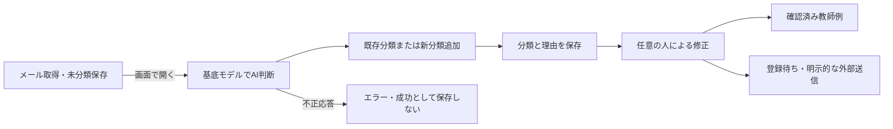

# Mail Solutions 現行仕様

> 設計方針の更新: [公開機能と制限](feature_scope.md)に、直近期間優先・GatewayへのAI集約・BusinessRecordsとの役割分担を整理した。以下は現行実装の記録であり、新方針が実装済みという意味ではない。

2026年10月10日更新。対象画面は `/sites/mail-solutions/`。本書は現行動作を示し、10月8日の設計案とは区別する。

## 分類と操作

未分類（pending）メールを開くとAI（人工知能 / Artificial Intelligence）が先に判断し、既存分類を再利用、必要なら新分類を追加し、結果と理由を保存する。人の確認は必須ではなく、修正は任意。「AIで分類・必要な分類を追加」で再実行し、補足指示を入力できる。

分類を自由追加・改名できる。改名後も分類IDを維持する。分類名は1〜200文字、制御文字・同名重複は禁止、最大300分類。抽出対象は技術者（personnel）、案件（project）、その他（other）。既存分類の抽出対象変更は拒否し、別分類を追加する。分類設定は学習ディレクトリの `taxonomy.json` に保存する。

AI結果は状態 `analyzed`、由来 `ai`、実モデル名・理由を保持する。確認者・確認日時・検証済み確信度を捏造せず、確認済み教師例として登録しない。推論中の修正はリビジョン（更新世代 / Revision）で保護する。登録待ち・登録済みメールは直接変更できない。

## モデルとAPI

既定はWentianの有効な学習設定の基底モデル。確認済み設定は `Qwen/Qwen2.5-0.5B-Instruct`。固定版・既存キャッシュ（Cache）・既存Python環境を使い、追加学習差分と追加ダウンロードは使わない。推論は直列化、上限120秒。本文を匿名化し、基底モデルへの本文入力は先頭2000文字に制限する。完全なJSON（ジェイソン / JSON）を検証して採用する。

`WENTIAN_MAIL_PROPOSAL_MODEL` 明示時は、指定モデルへ既存の直接推論APIで接続する。外部エージェントへ委任しない。

|方式・パス|動作|
|---|---|
|`GET /api/mail-operations`|`categories`、`taxonomyRevision`、互換の `taxonomy` と業務状態|
|`POST /api/mail-operations/taxonomy`|`revision`、`name`、`profileKind` で追加。`path` 指定で改名|
|`POST /api/mail-operations/messages/:id/category-proposals`|AI提案のみ。保存しない|
|`POST /api/mail-operations/messages/:id/ai-classify`|メールの `revision` 照合、AI判断・分類追加・保存|

管理者認証と同一オリジン（Origin）検証を適用する。

## 外観・取得・保存

外観はライト（Light）、ダーク（Dark）、グラス（Glass）、ベントー（Bento）、ミニマル（Minimal）。選択はブラウザへ保存し、管理画面で共通初期スタイルを設定できる。

IMAP（アイマップ / IMAP）自動取得はソースごとの設定と間隔に従う。新着と過去分の進捗を保持し、既読化・移動・削除はしない。10月10日の最終検証時点は有効、300秒間隔、377件、保存された同期エラーなし。これらは固定値ではない。

主保存先はSQLite（エスキューライト / SQLite）と原文ファイル。MinIO/S3とPostgreSQL（ポストグレスキューエル / PostgreSQL）は任意の外部保存・複製先で必須ではない。DuckDB（ダックディービー / DuckDB）への移行は実施していない。

## 検証と未対応

型チェック・関連テスト11件成功。Python Playwright（パイソン・プレイライト / Python Playwright）とEdgeで、模擬AIによる分類追加・保存、自由追加・改名、入力保持、教師例登録、再読込保持を確認。実サイトでは基底モデルによる実メール1件の分類・保存に成功した。分類保存とBusinessRecordsへの明示的な送信は別処理。

全メールのバックグラウンド（Background）AI一括分類、実メールの精度評価、入力制限で省略する長文末尾の品質確認は未対応。

- [公開機能と制限](feature_scope.md)
- [公開機能と制限](feature_scope.md)
- [公開機能と制限](feature_scope.md)
- 証跡: `evidence/mail-categories/20261010/result.json`、`evidence/mail-live/20261010/production-ai-result.json`
