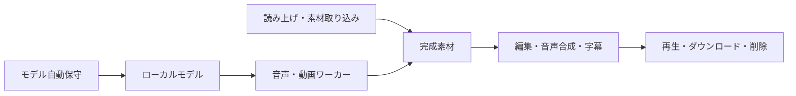

# 音声・動画制作とモデル自動保守

入口は `/media-studio`（音声・動画制作）、`/videos`（AI動画生成）です。管理者でログインして使用します。ComfyUIや外部の有料生成APIを使用しません。

## 実装した制作フロー

| 機能 | 内容 |
|---|---|
| ナレーション | PCにインストール済みの音声を選択。速度・音量の指定、日本語・中国語・英語の実音声を確認 |
| AI BGM | MusicGen Small。文章・長さ・シードを指定、最大30秒 |
| AI 効果音 | AudioLDM Small v2。文章・長さ・シード・生成ステップを指定、最大15秒 |
| 素材取り込み | 音声・動画、16MiB／120秒以内。WAV・MP3／MP4へ正規化 |
| 音声編集 | 最大6トラック、配置開始、切取範囲、音量、反復、フェードイン／アウト、最大120秒 |
| 動画編集 | 切取開始、0.25～4倍速、解像度変更、音声保持／無音化、音声合成、全尺字幕 |
| 動画生成の音声 | 無音／完成音声を選択。音量を指定し、動画尺へ切取・無音補完 |
| 文字起こし | Whisper Tiny、日本語・中国語・英語／自動判定、TXT・SRT・JSON |
| 作品管理 | 進捗、取消、再生、ダウンロード、削除。WAV・MP3／MP4を出力 |

SRTの文字起こし時刻は最大30秒の区間単位です。単語ごとの時刻合わせ、歌声・声の複製、リップシンクは実装範囲に含みません。字幕を焼き込む編集では入力した文章を動画全体へ表示します。



## 最小環境と自動保守

ユーザーの指定により、動画は `optimum-intel-internal-testing/tiny-random-ltx-video` を配置します。これは約1MBのランダム重みの検証用モデルです。文章に沿った実用映像を生成する能力はなく、画面にも検証専用と表示します。持ち込み動画の編集・音声合成は実用の素材で利用できます。本番LTXモデル約28GBは取得していません。

音声は MusicGen Small 約2.37GB、AudioLDM Small v2 約1.69GB、Whisper Tiny 約0.16GB、設定込みで合計約4.21GBです。CPU／NVIDIA CUDAを自動選択します。今回の実機検証はCPUのみです。

基盤は起動時と30分ごとに `.wentian/media-model-maintenance/policy.json` を読み、取得許可したモデルを検査します。ファイル不足・容量不一致は再取得し、失敗時は次の保守で再試行します。初回取得の公開コミット番号を記録し、修復でも同じ版を使用します。正常なモデルの自動更新・自動削除は行いません。容量検査は同じサイズの破損まで検出する完全なハッシュ検査ではありません。

管理画面の「基盤のモデル自動保守」で対象を保存できます。`GET /api/media/models` が状態、`PUT /api/media/models` が対象設定です。管理者・同一オリジンの検査を適用します。初期既定は全件無効で、今回の実機ではユーザーの許可に従い4種類を有効化しました。検証サーバーでは無効化します。

```powershell
# 専用PythonとFFmpegの準備。モデルは自動保守の対象設定に従います。
pwsh -NoProfile -File scripts/setup-media-engine.ps1
# 単独保守の実行。秘密情報は不要です。
pwsh -NoProfile -File scripts/maintain-media-models.ps1 -Policy .wentian/media-model-maintenance/policy.json
# 実ワーカー、CPU推論、Edge画面を隔離検証します。
pwsh -NoProfile -File scripts/verify-media-production.ps1 -AI -Browser
```

各スクリプトにはPython版があります。生成処理は準備済みのローカルモデルのみを読みます。FFmpegとffprobeはWentian専用フォルダーを優先し、既存PATHは変更しません。Windows版は[FFmpeg公式が案内するBtbNビルド](https://ffmpeg.org/download.html)を取得し、公開SHA256を照合します。

素材は受付時に所有者を検査して複製するため、元素材の削除後も受付済み編集は継続できます。キュー（Queue）は永続化し、再起動で中断された制作は失敗と記録します。再生・Range・ダウンロードも認証と所有者を検査します。

## モデルの利用条件

MusicGenの重みは[CC-BY-NC 4.0](https://huggingface.co/facebook/musicgen-small)、AudioLDMは[CC-BY-NC-SA 4.0](https://huggingface.co/cvssp/audioldm-s-full-v2)です。商用目的には適切な別モデルまたは許諾を用意してください。Whisper Tinyのモデルページは[Apache-2.0](https://huggingface.co/openai/whisper-tiny)を表示しています。

## 検証の証跡

`docs/evidence/media-production/20261007/` に型検査、関連試験、実生成のログ・素材、画面の検証結果を保存します。`report.json` が実際に成功した検査の一覧です。小型動画の生成は既存の動画検証と同じCPU・検証用モデルで確認します。生成品質・音楽の完成度・文字起こし精度の保証とは区別します。

実機では、CPUによる日中英の読み上げ、MusicGen／AudioLDM各1秒の生成と非無音波形、Whisperの文字起こし、4秒の音声編集、音声付き／無音動画、字幕、復号を確認しました。Edgeで実認証から制作・再生・MP3取得・削除まで確認し、ページエラーは0件です。隔離した小型動画モデルの構成ファイルを壊し、自動保守が同じリビジョンで修復することも確認しています（`model-repair.json`）。GPU動作は未検証です。

## 保存した制作例

ユーザーの指定により、検証成果物12例を [examples/media](../examples/media/README.md) へ複製し、制作画面の「保存した制作例」で再生・取得できるようにしました。文章・読み上げ・BGM・効果音・音声編集・無音動画・音声と字幕付き動画・小型モデル動画・文字起こしを含みます。作成元と検証用の性質を各例に表示します。通常の作品一覧から削除してもサンプルは保持します。

再保存は `scripts/preserve-media-examples.ps1` またはPython版で行います。サンプルのAPIにも管理者認証を適用し、任意パスや形式を受け付けません。
