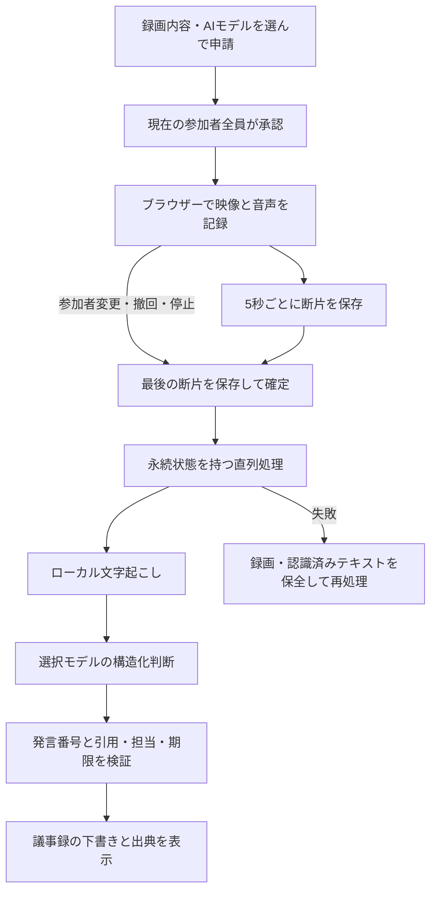

# 会議の録画・録音、文字起こし、議事録

Wentianのビデオ会議 `/meetings` に、参加者全員の承認を条件とした記録機能を追加した。既存の会議・画面共有・遠隔支援と同じ画面から利用する。

## 利用方法

1. 会議に参加し、必要なマイク・カメラ・画面共有を有効にする。
2. 保存内容を「映像と音声」または「音声のみ」から選ぶ。文字起こし言語と議事録モデルを選択する。
3. 「録画・録音を申請」を押す。相手には記録内容・AI処理・選択モデルが表示される。全参加者が承認すると開始する。
4. 「録画停止・承認撤回」で停止する。途中参加・退出・切断・承認撤回でも停止する。続ける場合は新たに全員の承認を得る。
5. 自動作成が有効なら、保存完了後にローカル文字起こし、選択モデルによる議事録作成を順番に実行する。
6. 記録一覧で録画・音声・文字起こしをダウンロードし、議事録の下書きと発言の引用を確認する。議事録はJSONでも保存できる。

記録するブラウザーのタブを開いたままにする。録画を止め、保存完了を確認してから閉じる。録画中のタブ終了には確認を表示するが、ブラウザー強制終了・回線断では最後の断片が失われる可能性がある。保存済み部分は保持し、「中断した録画の保存済み部分を確定」から途中までの記録として確定できる。

マイク・カメラは録画開始で勝手にオンにしない。受信できている映像・共有画面を1280×720の一覧映像に合成し、自分と相手の音声を混合する。音声のみの場合は映像を記録しない。録画を行うブラウザーで取得できなかったメディアは保存できない。

自動作成を外すと、保存後に作成者が手動で文字起こし・議事録を実行できる。議事録モデルを選ばずに保存した場合は、文字起こしまでを実行する。保存後に承認対象外のモデルへ無断で送信しない。

## 同意とアクセス権

- 会議に接続した本人の申請をHubが保持し、現在の全参加者の承認を照合する。他の会議や第三者の申請IDは使用できない。
- 録画中の参加者構成が変わると承認を失効させる。終了直後の最後の断片を保存する猶予は30秒で、以降の追加アップロードを拒否する。
- 保存開始・追加・確定・再処理は作成者本人だけに許可する。閲覧・ダウンロードは同じグループの有効な人間メンバーに限る。参加権限は各APIで再確認する。
- 更新APIは別サイトからの操作を拒否する。録画・文字起こし・議事録の応答はキャッシュ禁止とする。
- 文字起こし処理とAI処理の直前にも作成者の参加権限を確認する。録画や本文を公開ページへ自動掲載しない。

## 保存と再開

保存先は `WENTIAN_MEETING_RECORDINGS_ROOT`、未指定時はワークスペースの `.wentian/meetings/recordings`。作成者・同意・保存形式・モデル・処理状態・断片ハッシュをメタデータに保持し、本文は別ファイルに保存する。実行時データをGitや公開用アーカイブへ追加しない。

| 項目 | 内容 |
|---|---|
| `capture.bin` | 元のWebMまたはMP4。ダウンロード時に適切な拡張子を付ける |
| `recording.json` | 同意・所有者・断片ハッシュ・状態。原子的に更新する |
| `transcript.json` / `transcript.txt` | 時刻付きの発言区間とテキスト |
| `minutes.json` | 引用付きの議事録下書き |

ブラウザーは5秒ごとに断片を送信する。サーバーは連番とSHA-256を照合し、同じ断片の再送は重複保存しない。保存途中のメディアとメタデータのサイズ差は再送時に修復する。リンク経由の保存・IDによるパス逸脱を拒否する。

| 上限・設定 | 内容 |
|---|---|
| `WENTIAN_MEETING_RECORDING_MAX_BYTES` | 原録画1件の上限。既定1GiB、設定上限4GiB |
| `WENTIAN_MEETING_RECORDING_QUOTA_BYTES` | 保存先の原録画合計。既定10GiB、設定上限1TiB |
| HTTP断片 | 最大8MiB |
| ブラウザーの未送信分 | 最大24MiB。超過時は停止して保存済み部分を残す |
| 録画時間 | 最大4時間 |
| 一覧 | 新しい記録から100件。本文は詳細表示時に取得 |

全体のAI処理は直列化する。再起動時には待機中・処理中の記録を再開する。処理に失敗しても元の録画を消さず、認識済みの文字起こしを保持する。通常終了で処理を中断した場合は次回起動時の再開待ちにする。保存上限に達した場合は、保存先の整理または利用者による上限変更が必要になる。容量の上限は原録画に適用し、処理中の一時ファイルと出力文書は別途容量を使用する。

## 音声認識とAI議事録

文字起こしは既存の音声制作環境を再利用する。`scripts/setup-media-engine.ps1 -Download transcribe` またはPython版で準備したローカルWhisper、FFmpeg、Pythonを使用する。Pythonは `WENTIAN_VIDEO_PYTHON`、モデル保存先は `WENTIAN_AUDIO_MODEL_ROOT`、FFmpegは `WENTIAN_FFMPEG` 等の既存設定に従う。会議処理でモデルを勝手にダウンロードしない。

入口は `scripts/meeting-transcribe.py` とPowerShell版。音声を16kHz・モノラルへ復号し、30秒ずつ認識する。無音を文章として扱わず、音声区間の時刻を保存する。元録画は保全し、正常完了時の一時WAVは削除する。ローカルワーカーの上限は30分。未準備・形式不正・時間超過は未完了として表示する。

議事録モデルはWentianで利用可能なモデルから利用者が選ぶ。選択した接続先の利用条件に従って文字起こしを処理する。長い会議は約4000文字以内の区間に分け、発言番号を保持して要約・決定事項・対応事項・未解決事項を作成する。全体の入力上限は120000文字。上限超過は途中の発言を黙って捨てず、文字起こしを残して未完了とする。

AIはJSONで分類と内容を判断する。固定キーワードで決定事項や担当者を分類しない。各項目の区間番号と完全一致の引用を照合し、引用で裏付けられない担当・期限は未確認とする。形式や引用が不正なら一度再依頼し、再度検証できなければ議事録を合格扱いしない。内容の正しさ全体を機械的に保証するものではなく、画面には下書きとして表示する。発言者の自動識別・単語単位の時刻付けには対応しない。

## API

| API | 用途 |
|---|---|
| `GET /api/meetings/recordings/config` | モデル選択肢・容量上限 |
| `GET /api/meetings/recordings?group=ID` | 会議の記録一覧 |
| `POST /api/meetings/recordings` | 承認済み申請から保存先を作成 |
| `PUT /api/meetings/recordings/:id/chunks/:sequence` | 断片の追加・再送 |
| `POST /api/meetings/recordings/:id/finish` | 保存確定。partialで途中までと明示可能 |
| `POST /api/meetings/recordings/:id/process` | 保存済みデータの作成・再処理 |
| `GET /api/meetings/recordings/:id` | 状態・文字起こし・議事録の詳細 |
| `GET /api/meetings/recordings/:id/media` | 元の録画・音声のダウンロード |
| `GET /api/meetings/recordings/:id/transcript` | 時刻付きテキストのダウンロード |

## 検証

自動試験は一時領域とモデルの模擬応答を使用し、本番の会議・カメラ・マイク・外部サービスを変更しない。全員同意、権限失効、終了後の追加拒否、容量制限、再送、再開、引用不正、UIの開始・最終断片保存を確認する。

実ブラウザーでは合成キャンバス映像と発振器の音声を用い、映像＋音声と音声のみの両方で二つの断片を保存し、ダウンロードと議事録表示を確認した。別の一時領域では合成読み上げ音声から、実ローカルWhisper・選択したローカルモデルによる議事録生成まで合格した。実際の人間参加者の録音は行っていない。

検証入口は `scripts/verify-meetings.py` とPowerShell版。`--evidence-dir` / `-EvidenceDirectory` で保存先を指定でき、既定は非公開の `.wentian/verification/meetings`。今回のブラウザー画面・処理記録・最終試験ログは `.wentian/verification/meeting-recordings` に保存した。

最終検証はNode 42件・Python 6件が成功し、Python／PowerShellの構文検査とTypeScript型検査も成功した。

追加の実ブラウザー検証では、2参加者の実WebRTC接続・全員承認後の開始・相手側からの停止が成功した。保存ファイルを復号し、1280×720の映像と両参加者の合成音声（440Hz／880Hz）が含まれることを数値で確認した。
