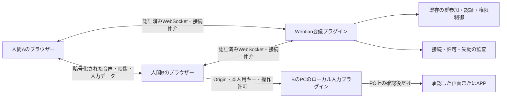
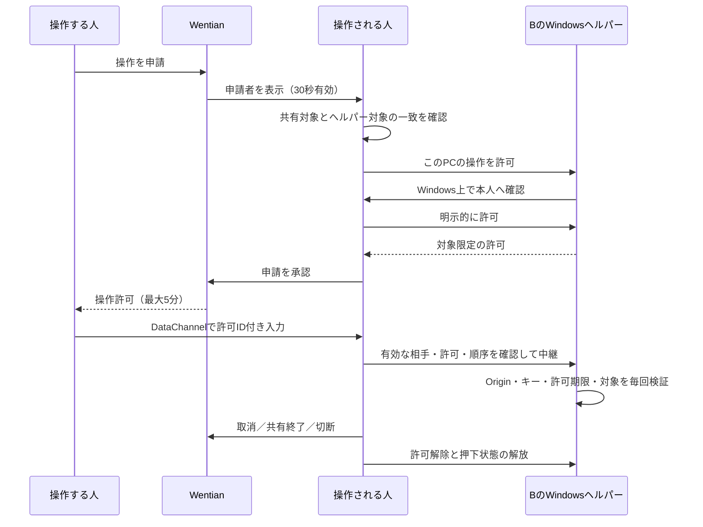

# Wentian ビデオ会議・画面共有・同意付き遠隔支援 仕様書

## 目的と実装範囲

既存のAIグループに、人間の音声・ビデオ会議、デスクトップ／APPウィンドウ／ブラウザータブの共有、相手の同意を得たWindows遠隔支援を追加する。会議、接続仲介、OS入力を分離し、最小カーネルへ映像処理やOS操作を組み込まない。

会議は `/meetings?group=<群ID>`。左メニュー「ビデオ会議」と、群会話・孵化器の「ビデオ会議」から開く。招待リンクのコピー機能を持つ。既存のメニュー表示設定で3権限の表示を変更できる。既に保存した表示設定は勝手に上書きしないため、新項目が出ない場合は管理者が表示対象へ追加できる。

既定方式はWebRTCのP2Pメッシュで、外部サービス登録・LiveKit導入・有料APIを必須にしない。同一LANではICEサーバー未指定で試行でき、異なるネットワーク間では管理者がSTUN/TURNを設定する。既定人数上限6人、設定可能範囲2〜12人。映像と接続数の負荷は参加人数に応じて増えるため、大人数向けSFUの代替を主張しない。

## モジュール構成



- `src/meetings/plugin.ts`: `core.meetings` / `wentian.meetings/1`。
- `hub.ts`: 群単位の参加・接続仲介・操作申請と許可の状態機械。
- `routes.ts`: 認証、会議用一回券、WebSocket、設定、ヘルパー配布、監査。
- `ui.ts`: 会議・共有・承認・遠隔入力のブラウザーUI。
- `tls.ts`: 利用者の証明書による任意のHTTPS入口。
- `scripts/remote-assist-helper.py` / `.ps1`: Windows上のローカル入力プラグイン。

会議プラグインの登録だけではカメラ、マイク、共有画面、ヘルパーを起動しない。AIの判断が必要な議事内容・発言の分類などは実装に固定キーワードで埋め込まない。今回の固定値は接続プロトコル、入力検証、表示、明示設定、安全上限に限定する。

## 参加とメディア

1. 登録ユーザーがログインし、群を選んで会議に参加する。参加時に既存の群参加APIを利用する。
2. 有効な人間メンバーだけに15秒有効・一回限りの接続券を発行する。券は本人のログインと群IDに結び付ける。
3. WebSocket UpgradeはOrigin・ログイン・券を同期検証する。Node/BunのUpgrade契約を考慮し、ディスク読込は券発行時に済ませる。
4. カメラとマイクは初期状態でオフ。本人が切替ボタンを押した時にブラウザーの許可を求める。
5. 画面共有は本人がブラウザーの選択画面でデスクトップ、APPウィンドウ、タブを選ぶ。共有対象をプログラムが黙って指定しない。
6. 共有停止・ブラウザー標準の共有終了・退室ではトラックを停止する。退室は群そのものからの退会ではない。

接続交渉はPerfect Negotiation方式。カメラと共有画面を別ストリームとして扱い、参加後のメディア追加・共有停止でも再交渉する。相手の接続失敗を表示し、再参加を案内する。

初期実装は録音・録画を行わなかった。2026-10-21に、全参加者の承認後に録画・録音を保存し、ローカル文字起こしと利用者が選択したモデルによる議事録を作成する機能を追加した。承認前の記録やAI転送は行わない。仕様と利用方法は [会議記録・文字起こし・議事録](meeting_recordings.md) を参照。

## 遠隔支援の同意手順



管理者であっても他人の代わりに承認できない。同時に一人の参加者へ複数の操作申請・許可を重ねない。本人が拒否した場合は操作を許可しない。

操作できるのは、共有中のデスクトップまたはAPPウィンドウに対応して、本人がヘルパーで選んだ対象だけ。タブ共有からはOS操作を許可しない。ブラウザーはOSのウィンドウ識別子を提供しないため、共有選択とヘルパー選択の一致は本人が二段階で確認する。

APP操作は選んだウィンドウが前面にあり、別ウィンドウに覆われていない入力位置だけを許可する。対象の閉鎖・画面配置の変更は失効または入力拒否とする。複数モニターでは本人が該当画面を選ぶ。

マウス移動・左右中クリック・ホイール、対応するキーボード入力、明示的な64文字以内のUnicodeテキスト送信に対応する。クリップボードやファイルは自動共有しない。ブラウザー予約キー、OSのセキュアアテンション、UACの別権限デスクトップは対象外であり、昇格や防御の迂回は行わない。

## 許可の失効

- 申請は30秒、許可は最大5分。自動延長しない。継続は再申請・再承認する。
- 取消、共有終了、会議退室、相手の接続切断、群参加資格やログインの失効で解除する。
- ローカルヘルパーは2秒ごとの確認を受け、6秒以上途絶えると許可と押下状態を解放する。
- WebSocketは5秒ごとに接続・参加資格を確認し、サインアウト・退会・ミュート・禁止の反映後に閉じる。ネットワーク断の検知には周期的な検査時間がかかる。
- このPCで `Ctrl+Alt+Pause` を押すと、ブラウザーに依存せずヘルパーが許可を解除する。ヘルパーの通常終了でも解除する。
- 待ち行列とメッセージ容量に上限を設け、取消前に受け取った入力を新しい許可で実行しない。

## Windowsヘルパー

会議画面の「遠隔支援プラグインの接続」から `WentianRemoteAssist.zip` をダウンロードできる。認証済みユーザーだけに固定のスクリプトを配布し、サーバーの秘密設定・接続キーは含めない。

操作されるPCで、通常権限のPython 3から起動する。PowerShell版は同じ実装を呼び出す。

```powershell
py -3 .\scripts\remote-assist-helper.py --origin "https://<会議ホスト>:8443"
# ZIPを展開した場合は、展開先のremote-assist-helper.pyを指定する
.\scripts\remote-assist-helper.ps1 -Origin "https://<会議ホスト>:8443"
```

このPC上の `http://127.0.0.1:8787` の会議なら、そのOriginを指定する。ヘルパーは既定で `127.0.0.1:8791` だけに待受する。ランダムな接続キーは操作される本人の画面へだけ入力し、会議サーバーや相手へ送らない。キーは再起動で変わり、ブラウザー保存領域へ永続化しない。

Origin・Host・キーを毎回照合し、任意の外部URLへキーを送らない。ブラウザーがローカルネットワーク接続の許可を求める場合は本人が判断する。環境がHTTPループバック接続を拒否する場合は、本人が信頼する証明書を `--cert` / `--key` で設定し、ヘルパー接続先をHTTPSにする。証明書警告を無視する実装は追加しない。

入力プラグインの契約は `wentian-remote-assist/1`。現行OS入力実装はWindows用。他OSのブラウザーは対応ブラウザーなら会議・画面共有に参加できるが、操作される側としての別OS用入力アダプターは含まない。

## ネットワークと設定

カメラ・画面共有には安全なコンテキストが必要。`http://127.0.0.1` / localhostはこのPCで利用できるが、`http://<LAN-IP>` のような別PCからの平文アクセスでは使えない。LANの他PCからは信頼されたHTTPS証明書を使用する。

任意のHTTPS入口は既存HTTPとCLIの契約を保持して追加する。

```powershell
$env:WENTIAN_HTTPS_CERT_FILE = '<証明書の絶対パス>'
$env:WENTIAN_HTTPS_KEY_FILE = '<秘密鍵の絶対パス>'
$env:WENTIAN_HTTPS_PORT = '8443'
# 必要な場合だけHTTPSの待受アドレスを指定する
$env:WENTIAN_HTTPS_HOST = '<このPCの待受アドレス>'
wentian daemon restart
```

証明書のホスト名・IPの適合と、接続するPCでの信頼設定は利用環境に合わせる。自動的にOSへ証明書を信頼登録しない。既存のHTTPSリバースプロキシを使用する場合は、WebSocket Upgradeを転送し、`WENTIAN_TRUST_PROXY` に実際のプロキシだけを指定する。特定IPだけにHTTPを待受する構成でも、その自己プロキシ元アドレスを信頼設定へ含める。

```powershell
$env:WENTIAN_MEETING_ICE_SERVERS = '[{"urls":"turn:<利用者のTURNホスト>:3478","username":"<利用者設定>","credential":"<利用者設定>"}]'
$env:WENTIAN_MEETING_MAX_PARTICIPANTS = '6'
```

インターネット越しの接続はNATやファイアウォールに依存する。必要なTURNを利用者側で用意し、サーバーの到達性とUDP/TCP許可を確認する。無関係な公開STUN/TURNや利用組織固有のアカウントを既定値にしない。

`WENTIAN_ENABLE_MEETINGS=false` またはカーネルの `core.meetings` 無効化で会議ルートを登録しない。変更後はGatewayを再起動する。

ヘルパーの確認ダイアログは `--language ja|en|zh`（PowerShell版は `-Language`）で切り替える。APP限定操作では、対象外へ切り替わるWindowsキー、Alt+Tab等のグローバルショートカットも拒否する。

## データ・認証・監査

未ログイン、別群の相手、無効な接続券、別Originからの接続を拒否する。公開サイトの閲覧だけでは会議へ参加できない。利用者名は認証情報から取得し、接続仲介の送信者をクライアント指定で偽装させない。

監査は `.wentian/meetings/audit.jsonl`。参加・退出・操作申請・承認・取消・失効の本人IDと時刻、承認した対象名を記録する。音声・映像・キー内容・SDP・本人用接続キーは記録しない。操作データは相手とのWebRTC DataChannelで送る。

## APIとプロトコル

| 経路 | 用途 |
|---|---|
| `GET /api/meetings/config` | 認証済みユーザーのICE設定・人数上限 |
| `POST /api/meetings/ticket` | 本人・群参加を確認して15秒有効の一回券を発行 |
| `GET /api/meetings/helper` | 認証済みユーザーへヘルパーZIPを配布 |
| `/api/meetings/socket?group=...&ticket=...` | 同じOriginの認証済みWebSocket |
| ヘルパー `/status` | 契約版とPC上の対象一覧 |
| ヘルパー `/approve` | PC上の本人確認と対象限定の許可 |
| ヘルパー `/heartbeat`・`/input`・`/revoke` | 許可の確認・入力・解除 |

WebSocketは `signal`、`request-control`、`approve-control`、`revoke-control` を受け付ける。入力用DataChannelは `wentian-control-v1`、各入力に許可ID・単調増加する順序番号を付ける。

## 検証と実機確認の区別

2026-10-20の検証ではNode試験33件・Python試験6件が成功し、型検査も成功した。証跡は `docs/evidence/meetings/20261020-214812/`。一時証明書によるHTTPS/WSS、PowerShellスクリプトの構文、Windows対象一覧の読み取り（17対象）を確認した。実ブラウザーの自己診断でも合成映像とDataChannelの接続成功を確認し、同ディレクトリに画面を保存した。自己診断はカメラ・マイク・画面共有権限を要求せず、実PCへの入力も行わない。

Python版 `scripts/verify-meetings.py`、PowerShell版 `scripts/verify-meetings.ps1` で隔離試験・型検査を実行し、`docs/evidence/meetings/<日時>/` へ証跡を保存する。OpenSSLがある場合は一時的な試験証明書でHTTPSとWSSも検証し、OSの信頼設定を変更しない。

模擬カメラ・OS入力アダプターで共有、本人承認、拒否、失効、共有終了後の入力遮断を検証する。実WebSocketで認証・群分離を確認する。Windowsの対象一覧の読取確認は入力操作とは区別する。実際のカメラ・マイク、相手PCへの入力、インターネット越しのTURN接続は利用環境での実機確認が必要であり、隔離試験の成功だけで実証済みとは扱わない。

参考：[画面共有API](https://developer.mozilla.org/en-US/docs/Web/API/MediaDevices/getDisplayMedia)、[Perfect Negotiation](https://developer.mozilla.org/en-US/docs/Web/API/WebRTC_API/Perfect_negotiation)、[Windowsの前面ウィンドウ制約](https://learn.microsoft.com/en-us/windows/win32/api/winuser/nf-winuser-setforegroundwindow)。
