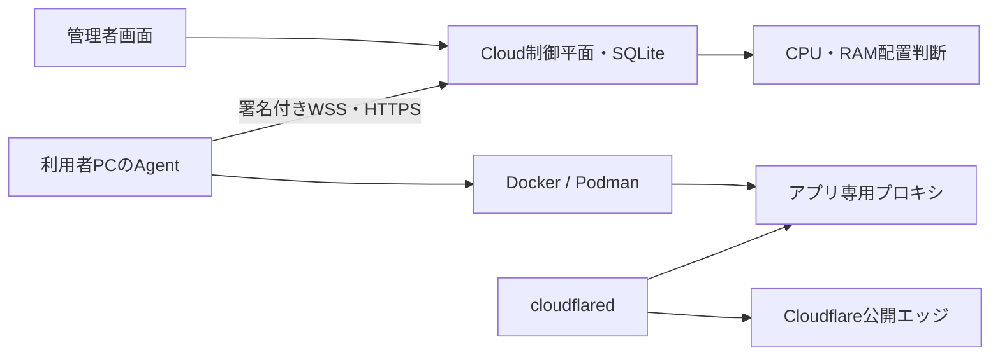

# Personal Cloud基盤の実装・検証記録

2026-10-07時点。元仕様は [公開機能と制限](feature_scope.md)。本記録は5コンポーネントすべての完成、またはM1全受入合格を意味しない。

## 実装した機能

| コンポーネント | 今回追加した内容 | 検証・残条件 |
|---|---|---|
| Cloud・制御平面（Control Plane） | SQLiteの原子更新、所有者別の端末・アプリ・ジョブ・監査、管理者画面、ホスティング用構成 | ローカル実機と実画面で確認。外部ホスティングとTLSは未配置 |
| Agent・端末常駐（Node Agent） | 10分・1回限りの登録コード、管理者承認、Ed25519署名、nonce再利用防止、Windows DPAPIによる鍵保護、WSS生存報告、HTTPSジョブ取得、再接続、二重起動拒否 | Windows実機で登録・操作。macOS/Linux実機は未確認 |
| Tunnel・外向き接続（Outbound Tunnel） | cloudflared起動、検証用Quick Tunnel、通常Tunnelのノード別資格情報、Host制限、公開解除、Quickのメール認証、通常方式のAccess JWT検証 | 署名検証は自動試験済み。実接続はcloudflared導入のWindows確認待ち。正式公開はアカウント・ドメイン未準備 |
| Runtime・実行環境（Runtime） | Docker/Podman診断、Linuxイメージのダイジェスト解決、資源上限、ループバック公開、アプリ専用ネットワーク、管理ラベル照合、正常性確認、更新時の旧版維持、旧版への復帰、停止・再開・削除 | Docker 29.7.2とPodman 6.1.1で実機試験成功 |
| Router・配置判断（Placement Router） | 所有者・承認・失効・接続状態・CPU・RAM・実行環境・アーキテクチャによる候補除外と選択、更新・起動待ちの予約・再送防止。検証済みNVIDIA GPUの選択とアプリ予約のAI資源判定への反映 | 候補判断は自動試験と実画面で確認。複数実PC間の配置とGPU実機は未検証 |

管理画面は `/personal-cloud`。既存メニューの「作業・プロジェクト → Personal Cloud・実行PC」から開く。配備の希望状態、実状態、ジョブ状態、公開確認状態を区別する。

## 利用手順

1. 管理者として画面へログインし、実行PCの名前と登録コードを発行する。
2. 利用者PCに導入済みのWentian CLIで、登録コードを環境変数 `WENTIAN_NODE_ENROLL_CODE` へ設定し、`wentian node enroll --server https://<制御サーバー>` を実行する。ローカル検証のみ `http://127.0.0.1:8787` を許可する。
3. 登録後に環境変数からコードを外し、`wentian node run` を実行する。画面上で名前を確認して承認する。`wentian node diagnose` は登録前でも利用できる。
4. Linuxコンテナイメージ、内部ポート、正常性確認パス、CPUとRAMを指定する。例は非root実行用の `docker.io/nginxinc/nginx-unprivileged:alpine`、8080番、`/`。
5. 配備と正常性確認の成功後、アプリ専用のローカルURLを開く。公開は別操作とし、認証付きが既定。匿名公開は明示的に選択する。

Agentの既定保存先は利用者ホームの `.wentian/node`。`--directory` または `WENTIAN_NODE_HOME` で変更できる。WindowsはDPAPI、他OSは0700の保存領域と0600の鍵ファイルを使う。他OSの資格情報ストア統合は未対応。

GPUを利用するPCでは `wentian node verify-gpu --engine docker` または `--engine podman` を実行する。実コンテナからNVIDIA GPUの名前と番号を確認した証拠を24時間だけ有効にし、対応エンジンへの配置を許可する。GPU予約は論理的な入場制御であり、VRAMの強制上限やMIGによる分割を提供しない。端末の `resources.json` を既存AI判定が読み、アプリ予約分を差し引く。別保存先の場合はAI側も `WENTIAN_NODE_HOME` または `WENTIAN_NODE_RESERVATIONS_FILE` を合わせる。

`compose.personal-cloud.yaml` は制御平面を別ホストへ配置する入口。初期管理者パスワードは `WENTIAN_CLOUD_ADMIN_PASSWORD` で明示指定し、永続ボリュームを使う。公開用のTLSリバースプロキシは別に用意する。`WENTIAN_TRUST_PROXY` は実際に管理するプロキシのIP/CIDRだけを指定し、無制限の信頼を設定しない。Cloudモードでは既存Gateway APIも未認証アクセスを拒否する。今回、外部ホストへの配置は実行していない。

## Cloudflareの無料範囲

Cloudflare Tunnelは無料プランでも利用できる。通常の固定ホスト名にはCloudflareアカウントと管理ドメインが必要。ドメイン取得・更新、追加証明書、他の有料サービスまで無料になる意味ではない。[Cloudflare Tunnel公式](https://developers.cloudflare.com/tunnel/)、[無料化の公式告知](https://blog.cloudflare.com/tunnel-for-everyone/)

Quick Tunnelはアカウント・ドメイン不要の一時URL。稼働保証なし、同時処理200件、SSE未対応、ホスト名は再作成時に変わる。2026-10-07に参照した公式資料では `--allowed-mail` のメール認証が案内されている。対応版のcloudflaredが必要。メール認証・外部接続の実機検証は未実施。[Quick Tunnel公式](https://developers.cloudflare.com/tunnel/get-started/quick-tunnels/)

一般的なフルゾーン構成の無料Universal SSLは、ゾーン頂点と1階層目のサブドメインをカバーする。無料優先なら `app.example.com` を選ぶ。元仕様の `xxxx.ai.example.com` は2階層目なので、その階層をカバーする証明書の方式・費用を別途確認する。[Universal SSLの制限](https://developers.cloudflare.com/ssl/edge-certificates/universal-ssl/limitations/)

通常Tunnelは、ノード側の `WENTIAN_TUNNEL_CREDENTIALS_FILE` に運営側が準備した専用資格情報ファイルを指定する。DNSレコードの接続と証明書の発行は別途必要。認証付き公開では `WENTIAN_ACCESS_TEAM` と `WENTIAN_ACCESS_AUD` を指定し、Accessポリシーを用意する。現在の通常Tunnelは1ノード1アプリの制約がある。運営アカウントのDNS操作用トークンを利用者PCへ配布しない。

## 検証

- 型検査成功。
- PowerShell/Python共通の検証入口で、基盤・メニュー・CLIの22件が成功。その後、起動待ち資源予約の回帰試験を追加した。
- 最終の関連54件が成功。既存AI経路・サイト編集、署名改変、再利用、所有者境界、資源不足、再送、ジョブ実行権、WSS失効、JWT、二重Agent起動、GPU予約と起動待ち予約を含む。
- Docker実機試験：初回配備、再送、正常性確認の120秒失敗、旧版維持、停止、Agent再起動、再開、削除が成功。
- Podman実機試験：同じ一連の操作が成功。
- 実Edge：ログイン、登録、承認、実Agentオンライン、実ランタイム診断、候補表示、画面から配備・停止・起動・削除、モバイル幅。画面のJavaScriptエラー0件。
- 検証用コンテナは終了後に管理ラベルを照合して削除。本番アプリは試験に使用していない。

証拠は 検証フォルダー（実行時に生成する非公開資料） に保存。入口は `scripts/verify-personal-cloud.ps1` と `scripts/verify-personal-cloud.py`。`-Docker` は120秒の失敗検証を含み数分かかる。`-Browser` は分離した一時サーバーと一時認証で動作する。

## 完了扱いにしていない範囲

- 運営Cloudの外部ホスティング、HTTPS、監視、バックアップ運用。
- 正式TunnelのDNS・証明書・利用者認証・別ネットワークからの到達性。Quick Tunnelの実接続。
- ノード失効時の運営エッジ側遮断。実装済みなのは制御接続拒否と接続中Agentへの失効通知後のローカル公開遮断。切断中PCの強制遮断は未対応。
- Tunnelの希望状態の永続化とAgent再起動後の公開自動復旧。現在は公開を再操作する。
- GPUコンテナの実機動作と共有予約の実GPU検証、複数実PC間の配置・障害試験。
- アプリの永続ボリューム・秘密情報・ログ表示・バックアップの管理。
- 短期アクセストークン方式。今回の通信は全要求のEd25519署名と時刻・nonce検査方式。
- ジョブ取消、履歴保存期間の運用、高度なネットワーク分離。

これらは仕様書の受入条件に残す。外部公開成功・M1完成・5コンポーネント全面完成とは報告しない。

## CRAFT向けローカルKubernetesとの関係（2026-10-22追記）

現行のPersonal CloudはDocker／PodmanとNode Agentの配備経路であり、Kubernetesクラスタを構築・操作する実装ではない。CRAFT向けローカル基盤と接続するための[公開機能と制限](feature_scope.md)を別途作成した。Kubernetes用の実行先契約、配備アダプター、Namespace・権限対応、PVC／Secret参照、状態照合等は追加実装が必要であり、本実装記録の検収済み範囲へ含めない。
