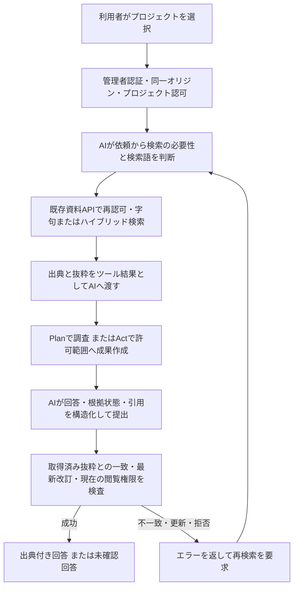
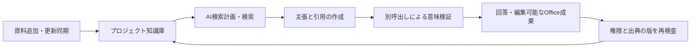

# 作業Agentとプロジェクト知識庫の連携

2026-10-22

## 比較と実装前の状態

「WorkBuddy＋ima知識庫」を、資料を参照しながらAIが作業する構成として整理した。以下はWentianのリポジトリーを確認した実装前後の比較である。imaの公式案内との比較は末尾を参照。製品間の互換性を検証したものではない。

| 機能 | Wentianの実装前の状態 | 今回の変更 |
|---|---|---|
| 作業依頼・計画・実行 | 工作台、外部Agent連携、ワークフローあり | 既存Plan/Actへ知識庫を接続 |
| 複数AIによる成果作成・検証 | AIグループの成果作成で対応 | 群の知識庫接続は今回の対象外 |
| 資料登録 | `/projects`で資料名・元URL・本文を登録 | 既存方式を利用 |
| 資料検索・引用 | 字句検索、出典・行番号・改訂・ハッシュあり | AIの検索ツールと引用付き最終回答を追加 |
| アクセス制御 | プロジェクト所属・編集権限で制御 | 会話開始、検索、引用照合で既存認可を利用 |
| 会話から知識庫を参照 | 一貫した連携経路を確認できず | プロジェクト選択→AI検索→回答・成果作成を実装 |
| 意味検索（Semantic Search） | ベクトル検索は未実装 | 埋め込みモデルによるベクトル検索・ハイブリッド検索、索引保存を実装 |
| URLの自動収集 | 知識庫は本文の手動登録方式 | 公開URLの本文取得・同一サイトの有限巡回・改訂保存を実装 |
| imaへの直接接続 | 専用接続は見つからず | 未実装。imaの認証情報やAPI仕様を仮定しない |

Wentian自身の「作業Agent＋知識庫」の会話連携、ベクトル検索、URL自動収集を実装した。ima専用接続は含まない。認証付き収集・各種資料抽出・JavaScript描画・継続巡回・定期同期は下記の拡張で対象にした。

## 利用手順

1. 管理者でログインし、`/projects`で利用するプロジェクトへ資料を登録する。本文の手動登録に加え、「URLから資料を収集」で公開ページを自動取得できる。
2. Control Centerの会話で「ツールの設定と実行履歴」を開き、「参照するプロジェクト知識庫」を選ぶ。本人が閲覧できるプロジェクトだけを表示する。
3. 「社員が一年に休める日数を教えて」のように依頼する。AIが必要性と検索語を判断し、取得した抜粋を参照する。利用者の質問を固定キーワードで分類しない。
4. 通常のChatで知識庫を選んだ場合、読取り専用のPlan経路で処理する。Actを選び書込み許可パスを指定すれば、資料を参照した成果物の作成もできる。既存の書斎が利用可能なら成果保存ツールも使える。
5. 最終回答の出典リンク、改訂、行番号、引用を確認する。根拠不足は「未確認」と表示する。検索・引用照合の失敗も実行履歴へ残す。

プロジェクトを切り替えると新しい会話にし、別プロジェクトの以前の会話をそのまま引き継がない。知識庫を「利用しない」にすると通常のChat経路へ戻る。知識庫利用には既存Plan/Actと同じ管理者ログインが必要であり、仮想キーや一般メンバーへ作業権限を追加しない。

## 処理と検証



- `search_project_knowledge`は検索語だけを受け取り、AIからプロジェクトや保存先を変更できない。
- 接続オブジェクトはホストが生成する。HTTP本文で送られた同名オブジェクトは破棄する。
- `answer_project_knowledge`は回答、`supported`または`unconfirmed`、引用配列を受け取る。自由本文だけを最終回答として採用しない。
- `supported`には引用を必須とする。引用は同じ要求で取得した抜粋に存在する必要がある。回答直前に既存資料APIで本文を再取得し、改訂・ハッシュ・出典・タイトル・チャンクと引用を照合する。
- 引用元の更新・削除、閲覧権限の取り消しは成功扱いにしない。接続障害を資料ゼロ件と偽って扱わない。
- 資料内の命令は参考データとして扱う。既存の書込み範囲、時間・トークン・試行上限を維持する。

引用照合は、AIの主張が引用から意味的に正しいと導けることや、原資料自体が正しいことの証明ではない。表示は「AI判断・引用照合済み（人間未承認）」とする。成果物の本文と最終回答の引用照合も別であり、保存した全成果物の内容を自動監査するものではない。外部モデルを選択すると、検索した抜粋がそのモデルへ渡る。

## 実装ファイルと検収

- `src/chat-knowledge.ts`: 検索ツール、要求単位の根拠保持、構造化回答と引用照合。
- `src/chat-agent.ts`: 有限のモデル・ツール対話へ統合し、HTTP入力から接続を偽造できないようにする。
- `src/server.ts`: 本人のログインセッションで既存の資料APIへ接続。保存先は既存利用者設定を引き継ぐ。
- `src/chat-agent-ui.ts`: プロジェクト選択、ChatからPlanへの経路選択、プロジェクト切替時の会話リセット。
- `src/dashboard.ts`: 選択した知識庫の要求を会話Agent APIへ送り、送信中のプロジェクト切替を無効化。
- `src/application-ui-translations.ts`: 日本語・中国語・英語の表示。

試験は一時ディレクトリー、模擬AI、Fastifyの内部要求、模擬ブラウザーDOMで実施する。本番資料、実際のモデル、外部サービスを変更しない。対象は検索から引用付き回答、Actによる許可済み成果物作成、架空引用・旧改訂・削除・別会話・別プロジェクト・権限取り消し・不正IDの拒否、未確認回答、言語切替、通常Chatへの復帰である。

実行コマンドと結果は `docs/evidence/20261022_project_knowledge_agent_validation.log` に保存する。実際のモデルによる検索語の品質・資料からの推論品質と、実ブラウザーでの操作検収は未実施。

初回の会話連携検証結果: 上記の関連試験とダッシュボード・言語監査を合わせて51件成功、失敗0。`npm run build`（TypeScript型検査）成功。`git diff --check`で空白エラーなし。検証ログは既存の公開除外方針に従いGitの管理対象外に置き、この結果概要を文書に残す。


## ベクトル検索の設定と動作

管理者のローカル環境設定へ次を指定してGatewayを再起動する。URL、モデル名は利用環境に合わせる。実際の接続先や秘密キーは文書・Git・試験ログへ転記しない。

```dotenv
WENTIAN_KNOWLEDGE_EMBEDDING_BASE_URL=https://your-embedding-service.example/v1
WENTIAN_KNOWLEDGE_EMBEDDING_MODEL=your-embedding-model
# 認証が必要な場合のみ設定する
WENTIAN_KNOWLEDGE_EMBEDDING_API_KEY=
```

ローカルモデルを使う場合も、対応するOpenAI互換の埋め込みAPIのURLとモデルを指定する。`/embeddings`はシステムが末尾へ付ける。接続先は管理者設定に固定し、利用者の質問・資料本文・通常API要求から変更できない。

`/projects`の検索方式で字句・ベクトル・ハイブリッド・自動を選べる。APIは `GET /v1/project-knowledge/:projectId/search?q=...&mode=vector`。`auto`は埋め込み設定済みならハイブリッド、未設定なら字句検索。会話Agentも既存APIの`auto`を利用する。明示的なvector/hybridで未設定なら503を返し、設定済みサービスが失敗した場合も字句検索への無言の切替は行わない。

チャンクごとの正規化ベクトルを生成し、コサイン類似度で順位を付ける。ハイブリッドではベクトル順位と字句順位をReciprocal Rank Fusionで融合する。自然言語の固定辞書やキーワードで意味を代用しない。順位融合の定数は検索順位アルゴリズムのパラメーターであり、利用者の意図分類には使わない。

索引はプロジェクト台帳内に保存し、接続先とモデルのハッシュ・本文ハッシュ・チャンクIDを持つ。秘密キーを索引へ保存しない。再起動後も同じモデルの索引を再利用し、本文更新・資料削除・モデル変更では古い索引を使用しない。索引化中の資料変更は競合として返す。1回32チャンク、最大10000チャンク、ベクトル最大16384次元、処理全体60秒、通信1回30秒に制限する。初回索引がこの範囲で完了しないプロジェクトは分割が必要。旧データの本文・保存場所は変更しない。

外部の埋め込みサービスを設定すると、初回検索時にそのプロジェクトの資料断片と検索語が送信される。モデルと接続先は導入組織の情報管理方針に従って選ぶ。コード実装と模擬APIの検証は済んでいるが、利用環境のモデル設定を勝手に作成したり、実モデルへ資料を送って検証したりはしていない。

## URL自動収集の使い方と範囲

`/projects`の「URLから資料を収集」でURLを入力し、「取得して資料へ保存」を押す。HTMLまたはプレーンテキストの本文を自動抽出して保存する。必要なら同一サイトのリンクも巡回する。最大1〜10ページ、既定は単一URL、リンク巡回指定時は5ページ。HTML内のスクリプトやスタイルは本文に含めない。静的取得ではJavaScriptを実行せず、render=trueの場合は隔離したブラウザーで描画する。文字コードはHTTPのcharsetを読み取り、未指定時はUTF-8として扱う。

APIは `POST /v1/project-knowledge/:projectId/collect`、入力例は`{ "url": "https://your-source.example/page", "followLinks": true, "maxPages": 5, "render": true, "profileId": "your-source" }`。`profileId`は認証付き収集の場合だけ指定する。同一URLを再収集すると本文を更新し、本文の変更時に改訂番号を進める。取得中の手動編集・削除を上書きせず、編集権限は取得前と保存前に再確認する。部分的な失敗は`complete:false`とページ別エラーで返す。保存済みページを他ページの失敗で取り消すことはない。

公開ページに加え、明示的に許可した認証先・社内接続元も対象にした。PDF・画像・音声・動画音声・JavaScript生成本文を抽出でき、継続クロール・定期同期は永続ジョブで実行する。無制限にメモリーや通信を消費させず、取得量と時間の上限に達した内容を完了と偽らない。詳しくは下記の拡張仕様を参照。

## imaとの機能比較と包含関係

imaはTencentの知識庫を基礎としたAIワークスペースで、資料の取り込み・検索・読解・執筆を提供する。[ima公式](https://ima.tencent.com/download)と[Tencentが配信するアプリの説明](https://apps.apple.com/cn/app/ima-%E8%85%BE%E8%AE%AFai%E7%9F%A5%E8%AF%86%E7%AE%A1%E5%AE%B6/id6737188438)を2026-10-22に確認した。外部製品を実操作した検収ではない。

| 比較項目 | Wentian | imaの公式案内 |
|---|---|---|
| 中心となる用途 | 調査・作業実行・成果作成と資料参照 | 知識の蓄積・検索・読解・執筆 |
| 資料に基づくAI回答 | プロジェクト資料検索、引用照合、未確認表示 | 知識庫に基づく質問回答 |
| 知識庫管理 | プロジェクト所属・所有者権限、資料の改訂 | 個人知識庫・共有知識庫 |
| Web資料取り込み | 公開HTML・テキスト、有限の同一サイト巡回 | Webページ等の取り込み |
| ファイル・画像・音声の知識庫化 | URLからPDF・画像・音声等を取得し、本文抽出・Vision・文字起こしへ接続。モデル設定が必要 | ファイル・画像・音声等の取り込みを案内 |
| 検索 | 埋め込みベクトル・字句・ハイブリッドを実装 | AI検索を案内。内部の検索方式は今回未検証 |
| 録音紀要・知識庫広場等 | 同等の一連の体験は未確認 | 製品機能として案内 |
| 作業の実行 | Plan/Act、許可したファイル変更、ワークフロー | 今回の調査では同等範囲は未確認 |
| 複数AIの成果作成 | AIグループで作成・検証 | 今回の調査では同等機能は未確認 |
| モデル・保存先 | 利用者が接続先・モデル・保存先を設定 | Tencentのサービスとして提供 |

Wentianがimaの全機能を包含しているとは言えない。共通する資料活用機能はあるが、対応形式、取り込み経路、共有体験、周辺機能と実際の品質は別々に比較する必要がある。今回のベクトル検索とURL自動収集の完成も、ima全体との同等性を意味しない。


## ベクトル検索・URL収集を含む最終検収結果

関連10ファイルの試験をまとめて実行し、59件成功、失敗0、スキップ0。`npm run build`成功、`git diff --check`で空白エラーなし。実行コマンドと日本語ログは `docs/evidence/20261022_vector_url_collection_validation.log` に保存した。既存方針に従いログはGitの管理対象外である。

字句一致のない質問のベクトル検索、索引の永続化・再利用、モデル変更・本文更新・削除・索引化中の競合、不正ベクトル・上流失敗、公開URLからの複数ページ収集・改訂保存、収集中の編集保護・権限取り消し・内部IP拒否、画面からの収集・検索API送信、既存会話・引用照合・言語表示を確認した。試験の埋め込みとWeb取得は模擬応答を使い、本番資料や実際の外部サービスを変更していない。実モデルの検索品質、実サイトの多様なレイアウト、実ブラウザー操作の検収は別途必要であり、この試験結果に含めない。


## 認証・多形式・JavaScript・継続同期の拡張

### 対象となる情報

| 情報源 | 収集方法 | 必要な設定 |
|---|---|---|
| 公開HTML・テキスト | HTTP取得・文字コード判定・本文抽出 | URL |
| 認証が必要なページ | 保存済みCookie・ブラウザー状態、またはHTTP認証ヘッダー | プロジェクトに許可した収集接続設定 |
| 社内・プライベートネットワーク | 接続元を限定したIP固定通信 | 正確なoriginsとallowPrivate=true |
| JavaScript生成ページ | 独立したPlaywrightブラウザーで描画後に本文とリンクを抽出 | render=true、Chromiumまたは指定ブラウザー |
| PDF | ページ別本文抽出、スキャンページを画像へ描画 | スキャン・図表の解釈はVisionモデル |
| パスワード保護PDF | PDF解析器へ秘密設定のdocumentPasswordを渡す | 接続設定にdocumentPassword |
| 画像 | Visionモデルの構造化した文字・図表抽出 | Vision接続先・モデル |
| 音声・動画の音声 | 既存Whisper環境または互換文字起こしAPI | local指定または文字起こし接続先・モデル |
| DOCX・XLSX等 | 既存の会話添付抽出器を再利用 | 対応形式のURL |
| その他の独自形式 | 管理者指定の抽出サービスへ接続 | EXTRACTOR_URL。JSONでtextとconfirmed=trueが必要 |
| 継続クロール・定期同期 | 永続キュー、定期バッチ、停止・再開、再起動からの再開 | 収集ジョブの方式・間隔 |

「すべての情報を収集可能」は、情報源の種類を一律に対象外とせず、認可済みの取得・抽出経路を用意するという製品方針である。第三者のアクセス権を取得できること、暗号やDRMを解除できること、判読不能な原本を正確に復元できること、Web上の全情報を完全に取得済みであることを保証する表示にはしない。権限不足、期限切れセッション、未設定モデル、部分的な通信失敗、判読不能、形式未対応は未取得・未確認として結果に残す。動画の映像内容自体をフレーム解析する機能は今回の音声文字起こしとは別である。

### 認証付き収集の設定

`examples/knowledge/sources.example.json`を非公開の利用者設定領域へコピーし、`WENTIAN_KNOWLEDGE_SOURCES_FILE`で指定する。`projects`は使用を許可するプロジェクトID、`origins`は正確な`scheme://host:port`。内部接続は`allowPrivate=true`を明示する。HTTPヘッダー、Cookie、ログイン状態ファイル、PDFパスワードはAPIの一覧・会話・試験ログへ出さない。通常の画面には接続設定の識別名だけを返す。

通常はGET/HEADだけを許可する。読取りAPIがPOSTを要求するサイトでは、管理者がサーバー側でも読取り権限に限定したアカウントを用意し、正確なURLを`readPostUrls`へ登録する。ブラウザーが生成したPOSTでも、この設定のない送信先へは送らない。

ブラウザー状態は利用者自身がログインして作成する。パスワードやMFAの値をWentianの引数・ログへ入力しない。保存先は非公開の場所を明示する。Python版とPowerShell版は同じNode.js実行部を呼び出す。

```powershell
python scripts/knowledge-login.py --url https://your-source.example/login --output C:/private/wentian/source.storage-state.json
# PowerShell版
pwsh -NoProfile -File scripts/knowledge-login.ps1 -Url https://your-source.example/login -Output C:/private/wentian/source.storage-state.json
```

ブラウザー内でログインして対象を表示できた後にEnterを押す。ファイル更新はPythonの`--replace`またはPowerShellの`-Replace`を明示する。`storageStatePath`へ保存したファイルを設定する。セッションが失効したらこの操作で更新する。新しい導入環境では`npm ci`後に`npx playwright install chromium`でブラウザーを準備するか、`WENTIAN_KNOWLEDGE_BROWSER_EXECUTABLE`で利用者のブラウザーを指定する。

ブラウザーは通常利用のプロファイルから隔離し、HTTP通信はDNS検査・IP固定の取得器へ転送する。認証情報の送信先は設定したoriginsに限定する。Service Workerと直接WebSocketを無効化し、経路外通信は到達しないプロキシへ固定する。必要な通信が取得できなかった場合は部分取得として表示する。継続通信のあるページは取得時点の本文と警告を保存し、定期同期で更新できる。ページ内の画像・Canvas・SVGもVision設定済みなら画像化して抽出する。未設定・判読不能・処理上限の場合は未確認の警告を残す。[Playwrightの通信経路制御](https://playwright.dev/docs/api/class-browsercontext#browser-context-route)と[認証状態の扱い](https://playwright.dev/docs/auth)を参照。

### 抽出モデル

`.env.example`の`WENTIAN_KNOWLEDGE_VISION_*`と`WENTIAN_KNOWLEDGE_TRANSCRIPTION_*`を使用する。接続先とモデルの組織固有の既定値は置かない。音声で`WENTIAN_KNOWLEDGE_TRANSCRIPTION_MODE=local`を選ぶと、既存のWentian音声環境を再利用する。音声モデルとPython・FFmpegの準備は既存の音声機能と共通である。外部モデルを設定した場合、取得した資料の画像や音声がその接続先へ送信される。

Visionの回答は`{text:string,confirmed:boolean}`を検証し、未確認・空本文・出力上限で中断した結果を正常な抽出にしない。PDFは本文だけでなく、Vision設定済みの場合は各ページの図表も読む。Vision未設定で図表を検証できない場合は警告を付け、完全取得とは表示しない。スキャンだけのPDFはVisionなしでは本文抽出成功にしない。

2026-10-23以降、PDFの文字抽出と画像化は、一時ブラウザー内のPDF.jsで実行する。NodeのネイティブCanvas部品は使わない。PlaywrightのChromiumを準備するか、既存の `WENTIAN_KNOWLEDGE_BROWSER_EXECUTABLE` で利用者がブラウザー実行ファイルを指定する。利用者の通常プロファイルは使用せず、仮想接続元に対して導入済みPDF.jsの許可資産だけを返し、外部通信・Service Worker・WebSocket・ダウンロードを拒否する。ファイル25 MiB、500ページ、1ページ1,600万画素・PNG 10 MiB、ブラウザー起動後1資料5分を上限とし、呼出元の中断も伝播する。スキャン画像は従来どおり設定済みVisionモデルへ渡す。ブラウザーでの画像化成功と実モデルの認識精度は別に検収する。

抽出本文が10万文字を超えた場合、原文を切り捨てず複数資料へ分割する。出典は元URLと`#wentian-part=N`で追跡できる。再収集で資料が短くなった場合は、同じ収集元の不要になった旧パートだけを原子的に除去する。取得中の編集・削除は競合で保護する。

### 継続収集と定期同期

`/projects`の「継続収集と定期同期」で方式と間隔を選び、ジョブを登録する。

- 一巡して終了: 対象リンクをバッチに分けて巡回し、一巡したら終了する。
- 停止するまで巡回: フロンティアを消化し、指定間隔で再巡回する。利用者が一時停止・削除するまで継続する。
- 定期同期: 指定間隔で対象を再取得する。リンク巡回も指定した場合は一巡を完了してから次回の同期へ進む。

APIは`POST /v1/project-knowledge/:projectId/collection-jobs`。通常の収集入力へ`mode:once|continuous|sync`と`intervalMs`を追加する。一覧はGET、操作は`POST .../collection-jobs/:id/pause|resume|delete`。本人の編集権限を確認し、実行中はジョブを作成した利用者の現在の所属・有効状態も再確認する。無効化・権限取り消し後も保存を続けることはない。

ジョブと未処理URL・訪問済みURLは知識庫ルート内の非公開SQLiteへ保存する。Gateway稼働中に実行し、再起動後は保存したバッチ境界から再開する。中断したバッチは再取得されることがあるが、資料はURLと改訂によって重複・上書き競合を防ぐ。停止操作では実行中の通信・ブラウザー・文字起こしへ中断を伝える。取得済み資料をジョブ削除で削除しない。

### 実行上限と取得状況

継続期間はジョブの明示停止までとし、各バッチは1〜10件、全体15分、HTTP通信1回30秒、ファイル1件25 MiB、PDF500ページ、抽出本文1000万文字、未処理URL10万件で保護する。ブラウザーは1ページ500要求・総100 MiBまで。DOCX・XLSX等の既存添付抽出には元の容量・展開上限も適用する。上限を超えた情報を黙って切り捨てた成功結果にはしない。巡回は同一サイトのリンクを対象とし、別サイトは別ジョブ・接続設定で追加できる。

`complete`はエラー・未確認警告・残りの未処理URLがない場合だけtrueになる。ジョブ画面は状態、保存数、未処理数、失敗・未確認の理由を表示する。再取得は取得先のHTTP権限の範囲で行い、対象から消えたURLを理由に保存済みの原本資料を勝手に削除しない。


### 拡張実装の検収結果（2026-10-22）

関連12ファイルの72試験が成功、失敗0、スキップ0。TypeScript型検査と、ログイン補助のJavaScript・Python・PowerShell構文検査も成功した。記録は `docs/evidence/20261022_expanded_collection_validation.log` に保存する。

実ブラウザーで、一時HTTPサーバーが要求する認証ヘッダーを使用し、JavaScriptが別APIから取得して描画した本文を取得した。接続設定ファイルのプロジェクト制限を適用し、その本文を知識庫へ保存するところまで確認した。PDFの実解析・スキャンPDFの実画像化は実行し、Visionと音声認識の応答は模擬APIで検証した。継続ジョブのバッチ間進行、利用者の一時停止、Gateway終了時の中断と自動再開、定期同期、権限取り消し、長文の無省略分割と旧パート除去、画面からの登録・一時停止も検証した。

新規導入に必要なブラウザー配布物も導入し、利用者の通常ブラウザープロファイルは使用していない。実アカウントのログイン、外部サイトの原本、実Visionモデル・Whisperモデルの認識品質は今回の試験に含めず、利用者設定後に対象ごとの検収が必要である。

主な追加ファイルは`knowledge-resource.ts`（認証とIP固定通信）、`knowledge-extraction.ts`（描画・PDF・画像・音声）、`knowledge-collection-jobs.ts`（永続巡回・同期）、`knowledge-expanded-collection.test.ts`、ログイン補助3版である。以前の「対象外」とした説明は、この拡張仕様に置き換える。


## WorkBuddy＋imaの主要用途をWentian単体で扱うための優先順位

Wentian単体でWorkBuddy＋imaの主要用途をカバーする方向は、作業計画・実行、成果物保存、プロジェクト知識庫、引用付き回答、ハイブリッド検索、認証付きページ・PDF・画像・音声の取り込み、継続収集・定期同期として既に実装が進んでいる。ただし、全機能で同等の品質・使いやすさを達成したという判断には追加検収が必要である。「未確認」は機能が存在しないという意味ではない。

| 優先度 | 必要な能力 | 差分・完成条件 |
|---|---|---|
| 最優先 | 実資料での検索・回答品質 | 実モデルで日本語・中国語、表・図・スキャン資料を評価。引用一致だけでなく回答が根拠から正しく導かれるか確認 |
| 最優先 | 取り込みから成果保存までの一貫した体験 | 資料追加→質問→成果作成→知識庫へ再保存を実画面で検収。生成物本文の根拠も確認 |
| 高 | 複数人での知識活用 | AIグループへの知識庫接続、一般メンバーの利用経路、共有・編集権限を整備・検収 |
| 高 | 日常的な資料追加の手軽さ | ファイル一括投入、ブラウザーからの保存、モバイル共有、ノート編集 |
| 高 | 継続運用と規模への対応 | 認証期限切れの通知・復旧、大量資料索引、バックアップ・復元を検収。従来の1万チャンク制限を改善 |
| 中 | 会議から知識への変換 | 録音→話者分離→議事録→決定事項・担当作業→知識庫保存を一貫して検収 |
| 中 | Office成果物の完成度 | Word・Excel・PowerPointのレイアウト・数式・図表・再編集性を実ファイルで評価 |

WorkBuddyとimaの公式連携について利用者から提供された説明では、個人・共有・購読知識庫の検索と引用に加え、成果物をimaへ保存する流れが案内されている。この説明の原文URLは今回の依頼に含まれていないため、公式連携の全仕様を検証済みとは扱わない。Wentianでも資料から成果を作り、根拠を確認して知識庫へ戻す往復を仕上げることを優先する。

まず「社内資料から根拠付き回答」「複数資料から提案書作成・再保存」「更新資料の定期同期と再回答」の3業務を、実モデル・実資料・実画面で検収する。既存コード・検証記録と実環境の結果を区別し、既存機能と重複する開発を避ける。72試験成功には模擬モデルによる検証を含み、実モデルの認識・推論品質を証明した結果ではない。

### 今回追加した実装と使い方

`/projects` でプロジェクトを選択し、資料の一括追加またはURL収集を行う。「資料から回答・提案書を作る」で、そのプロジェクトの許可モデルと作成する成果を選んで質問する。一般メンバーも所属プロジェクトの資料から回答・ダウンロードを利用できる。登録・更新・削除・成果の再保存・復元はオーナーと管理者に限る。モデル呼出しは既存のモデル許可・利用枠・予算予約を通し、キーなしの画面操作で予算を迂回しない。

回答処理は、AIによる検索計画、根拠を付けた主張の作成、別のAI呼出しによる意味の検証を行う。固定の質問キーワードや定型文で回答を決定しない。引用の完全一致に加え、数値・条件・否定・時点・表の対応が根拠から導かれるかを検証する。AI応答の構造不正・引用不一致は処理を失敗とする。矛盾・根拠不足は「未確認・暫定成果」とし、明示的に暫定保存を選ばない限り知識庫へ再保存しない。「AI根拠検証済み・人間未承認」は、人間が品質を保証した意味ではない。同じモデルを別呼出しで使用するため、共通の誤りを見逃す可能性は残る。

未確認事項は削除せず、検証役のAIが依頼・成果・原資料を照合して各項目を `blocking`（結論の成立に必要な不足）または `informational`（未解決の留意事項）に分類する。分類の省略は阻害事項として扱い、重複・欠落・不正な番号は拒否する。依頼範囲外の不足や提案で明記した実施前の確認事項だけを理由に、根拠が揃った回答や提案の保存を一律拒否しない。unknown区分の主張は、正確な引用があり、検証役が資料に明示された未定状態の報告（`documented_absence`）と判断し、意味もsupportedと検証した場合だけ認める。不明な実際の値、分類欠落、引用なしの事実、矛盾、必要情報の不足は未確認のまま保存を拒否する。分類・判断理由・未確認事項は本文と検収記録に保持する。

回答生成と検証には、検索で選ばれたチャンク全文と、同一資料の前後1チャンクを合計32件以内で渡す。検索ヒットを優先し、別の未検索資料を追加しない。表の見出しと金額が境界で分かれる場合も読めるようにし、改訂・ハッシュが変わった資料は拒否する。

引用の書式と意味の不足をそれぞれ1回までAIへ差し戻し、依頼範囲を弱めず修正するよう求める。最大3案で打ち切り、修正後も原資料・引用・意味・不足事項を再検証し、直らない引用や必要情報不足は保存しない。最初の拒否理由と成果案は `revisionHistory` に保持する。上限・仮定を明示した試算と、実費の確定・実施承認に必要な情報は、検証役のAIが依頼の意味から区別する。

成果はサーバー発行のIDと本文ハッシュで管理し、画面から書き換えた本文を検証済みとして受け付けない。回答完了時・再保存時に出典の改訂・ハッシュを再確認する。再保存資料には依存元の版を残す。依存元が更新・削除された成果は検索から外すため、二次資料を介して旧事実を再回答へ持ち込まない。



| 能力 | 実装と利用条件 |
|---|---|
| ファイル一括投入 | 選択・ドラッグ＆ドロップ、1回20件・合計25 MiB。文字コードはUTF-8。PDF・画像・音声等は既存の抽出設定を使用し、一部失敗と抽出警告を表示 |
| ブラウザーから保存 | 画面の保存リンクをブックマークへ登録。現在ページのURLと題名を資料画面へ渡し、利用者が収集を実行。ブラウザーのCookieを自動転送せず、認証資料は管理者登録の収集プロファイルを使用 |
| モバイル共有 | PWAのWeb Share Targetを定義し、URL・題名・共有テキストをフォームへ渡す。対応ブラウザーへインストールした場合に利用可能。実端末の共有メニューは別途検収が必要 |
| ノート | 元資料リンクを空欄にして本文を保存。既存の資料編集で改訂を管理 |
| グループ連携 | 編集権限のある管理者がAIグループを選択して接続。全参加者の所属と各AIの明示モデル許可を確認。私的資料を扱うグループは公開不可、別プロジェクトへの再接続も拒否。所属外には一覧・履歴を表示しない。成果審査に意味検証を追加 |
| 認証期限切れ | HTTP 401/403は認証更新通知付きで収集ジョブを一時停止。ログイン補助で状態ファイルを更新後「再開」。未取得URLは保持。HTTP 200の独自ログイン画面まで自動判別できる保証はない |
| 索引規模 | ベクトルを本文JSONからSQLiteへ分離。32チャンクずつ途中保存し、時間上限時は再実行で残りから再開。進捗APIと「検索索引を作成・再開」を追加。上限は既定10万、`WENTIAN_KNOWLEDGE_MAX_CHUNKS`で1〜100万。検索時は全有効チャンクを走査するため、上限値までの速度・メモリ品質を保証するものではない |
| バックアップ・復元 | 画面から現行の資料本文・出典・改訂・成果の依存関係をJSON出力。整合性ハッシュを検証し、衝突時は全件拒否して上書きしない。取込元バイナリ、回答成果の保管ファイル、収集ジョブ、認証設定、秘密キーは含まない。保存先を移す場合は全文に加えこれらを別途保全する必要がある |
| 会議から知識 | 既存の録音・同意・議事録処理と連携し、閲覧権限のある会議IDから文字起こし・決定・担当作業を知識庫へ追加。話者分離は`WENTIAN_MEETING_DIARIZATION_BASE_URL/MODEL/API_KEY`で設定した`diarized_json`対応APIを使用。25 MiB以内。ラベルが取れなければ失敗とし、従来のWhisperだけの場合は話者未確認と明記。実名と話者ラベルの対応は推測しない |
| Office成果 | DOCXは編集可能な本文・根拠表、XLSXは本文・出典シートとCOUNTIF数式・標準グラフ、PPTXは編集可能なテキストとグラフ。未確認状態を表示し、長文はスライドへ分割。任意の複雑な提案書様式や実Officeでのレイアウト品質まで保証しない |

追加APIは `POST .../:projectId/assistant`、`GET .../artifacts/:id`、`GET .../artifacts/:id/export/md|docx|xlsx|pptx`、`POST .../artifacts/:id/publish`、`POST .../import-files`、`POST .../notes`、`GET .../backup`、`POST .../restore`、`GET .../index`、`POST .../index/prepare`、`POST .../groups/:id/bind`、`POST .../meetings/:id/import`。先頭は `/v1/project-knowledge`。全経路で所属を確認し、変更系は編集権限と同一オリジンも検査する。

### 実資料・実モデル検収の実行方法

`examples/knowledge/acceptance.example.json`を非公開の場所へコピーし、利用を許可された日本語・中国語、表・図・スキャン資料と、更新後の原本を指定する。接続先・モデル・キーは`.env.example`の`WENTIAN_KNOWLEDGE_ACCEPTANCE_*`、埋め込みとVision等は既存の設定から受け取る。スクリプトは環境変数を使用し、`.env`を自動読込しない。実行すると指定モデルへ資料を送信するため、組織が利用を許可した接続先を設定する。

```powershell
python scripts/knowledge-acceptance.py --dataset C:/private/knowledge/acceptance.json --output C:/private/knowledge/results-new
pwsh -NoProfile -File scripts/knowledge-acceptance.ps1 -Dataset C:/private/knowledge/acceptance.json -Output C:/private/knowledge/results-new-ps
```

本番知識庫を使用せず一時知識庫を作成し、根拠付き回答、複数資料の提案・再保存、資料更新・再回答を実行する。出力先は新規フォルダーのみ受け付け、資料ハッシュ・モデル・主張ごとのAI検証結果・Markdown・Officeファイルを保存する。終了コード0はAI検証の全ケース成功、2は未確認・一部失敗、1は設定等による実行失敗。いずれも人間の検収合格を意味しない。`report.json`の人間検収・実画面・Officeレイアウトは未確認のまま残す。

実画面は`/projects`で同じ三業務を操作し、出典の原本と回答の意味、表の行列、図の解釈、最新改訂への追従、Word・Excel・PowerPointでの表示と再編集を人間が確認する。定期同期の実環境検収では収集ジョブのスケジュールを動かして、認証失効→通知→再ログイン→再開まで確認する。補助スクリプトの更新ケースは原本ファイルの更新を隔離領域で適用するもので、実サイトの定期同期や画面検収の代替ではない。

今回、利用を許可された実資料と検収モデルの指定はまだ得られていないため、この実品質検収は未実施である。imaへの直接接続・購読知識庫の互換機能や、imaの全機能との同等性を今回の追加実装だけで達成したとは扱わない。

### 今回の検証記録（2026-10-22）

関連19ファイルの122試験が成功し、失敗0・スキップ0。TypeScript型検査、Python／PowerShell検収補助の構文検査、差分の空白検査も成功した。実装に必要なOffice依存を追加し、導入時に検出した依存パッケージの問題を更新で解消した（依存導入時の監査結果は脆弱性0）。既存のサーバー試験にあった外部Agent数「8」の固定期待値は現行登録数と矛盾していたため、一覧・集計・IDの一意性の検証へ更新した。外部Agentへ作業は依頼していない。

- 引用が完全一致していても主張の数値が矛盾するケースを未確認とし、明示しない暫定保存を拒否した。AI検証IDの不整合・存在しない引用・資料更新後の再保存も拒否した。
- 一般メンバーの回答・出力、編集者だけの投入・保存・復元、プロジェクト間の分離、通常メンバーの利用枠・予算予約、キーの所属を変更できないことを検証した。資料対話は明示モデルと1試行に限定し、別モデルや外部Agentへの切替を計量経路から迂回させない。
- 実Chromiumで、一括投入→URL収集→回答→複数資料の提案→再保存→更新資料の再収集→再回答→DOCXダウンロードを操作した。モデルと資料は隔離した試験用であり、実モデルの品質検収ではない。
- SQLiteで12,250チャンクの分割索引生成・検索、更新時の索引無効化、再起動後の再利用、途中通信失敗後のバッチ再利用を検証した。埋め込みは模擬値であり、大規模実モデルの速度・精度・資源量の保証ではない。
- 認証失効時のジョブ停止・通知・再開、本文バックアップの復元・改ざん検知・衝突拒否、グループの所属確認・公開拒否・別AI検証、話者ラベルの保持・欠落拒否を検証した。
- DOCX・XLSX・PPTXを実際に生成し、OOXMLの整形式、編集可能な本文・出典、数式と標準グラフを確認した。XLSXは再読込してセル値・数式を照合した。実Officeでの視覚検収は未実施である。
- 実資料検収補助は隔離した模擬APIで三業務を実行し、改訂2の再回答と、人間・画面・Officeレイアウトを未確認のまま記録することを検証した。

ログは公開対象外の`docs/evidence/20261022_knowledge_workflow_validation.log`、`20261022_knowledge_workflow_build.log`、`20261022_knowledge_acceptance_syntax.log`へ保存する。既存の72試験の記録とは別の実行であり、件数を合算して品質の証明には使わない。


### 各機能のサンプルと確認手順

[26ケースの確認手順書](knowledge_feature_walkthrough.md)と[架空資料一式](../examples/knowledge/demo/README.md)を追加した。ローカル配信の版更新・模擬認証失効を再現でき、基本業務からメディア、権限、会議、バックアップ、索引規模まで順に確認できる。チェックリストの初期状態は未実施であり、実モデルの品質検収を実施済みとするものではない。
