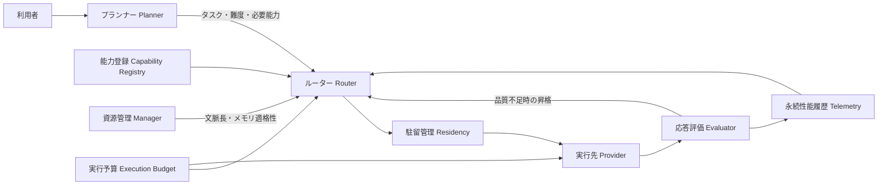

# Wentianの制御基盤改善と検証結果

2026-10-06。プランナー（Planner）、ルーター（Router）、資源管理（Manager）、評価（Evaluator）の境界を分離し、性能履歴、適応的なモデル選択、駐留管理、実行予算、独立検証を実装した。



## 実装内容

| 対象 | 現在の動作 |
| --- | --- |
| 責務分離 | プランナーはモデル・プロバイダー指定を拒否し、タスク、難度、必要能力を出力する。選択は `router.ts`、観測・資源評価は `manager.ts` が担当する。 |
| 能力登録 | プロバイダー設定の `modelProfiles` とエンジンの検出結果を統合する。Ollamaの能力・文脈長・実駐留情報、LM Studioのモデル種別とロード済みインスタンスを利用する。 |
| メモリ評価 | 入力、最大出力、文脈長、バッチ数、画像、既存KVキャッシュ（KV Cache）を考慮する。ロード済みモデルは文脈の追加成長だけを加算し、VRAMに断片化用の余裕を確保する。能力不足は候補から除外する。 |
| 性能履歴 | タスク別の成功、遅延、TTFT、TPS、トークン数、選択遅延、観測時点のRAM/VRAMを本文なしで保存・復元する。TTFTはストリームの初回生成内容を測る。 |
| 予測ルーティング | 同じモデル・タスクの実測が3件以上ある場合、TTFTとTPSから生成時間を予測する。履歴のない速度・品質を実測扱いにしない。 |
| 難度・品質予算 | 難度0～1、economy/balanced/quality/maxで能力、速度、計算資源の重みを変更する。単純な次回タスクでは小さいモデルを再選択できる。 |
| 適応的昇格 | 自動選択・非ストリーム応答で空回答、不正な要求JSON、出力上限による打切りを検出すると、より高い品質の候補へ予算内で再試行する。ツール呼出しだけの正常応答は空回答扱いにしない。 |
| 駐留・予熱・退避 | 同時ロードを直列化し、利用中のリース（Lease）を保護する。Wentian自身がロードした非稼働モデルのみLRUと期限で退避する。他アプリがロードしたモデルは退避しない。LM Studioでは所有インスタンスIDを使う。 |
| 実行上限 | Gatewayの試行、時間、トークン、費用を全候補で共有する。最大出力を事前予約し、使用量不明の失敗も予約を残す。費用上限指定時に単価不明なら実行前に停止する。 |
| ゴール実行 | 時間、試行、失敗、累計トークン、費用、再計画の停止条件を保存する。分類用のプランナー使用量も合算し、再開時も累計予算を引き継ぐ。 |
| 独立検証 | 実装担当と最終検証担当の実モデルID・登録モデル系統を比較する。同一モデル、動的auto/free、独立候補不足では完了扱いにしない。ホスト固定検証プログラムによる能力確認は別の経路とする。 |
| 評価・推薦 | 固定正解の基礎評価、利用者受入・検証結果を保存する。タスク履歴と現在の安全性からモデル候補を推薦し、実測と能力登録だけの候補を区別する。 |
| 画面 | 品質予算の選択と、実測性能・推薦候補の表示を追加する。 |

## 設定とAPI

`/#models` の「プロバイダー（Providers）」欄では、管理者がProviderを追加・編集・削除できます。設定は `.wentian/provider-management.json` に保存し、削除した組み込みProviderやファイル定義Providerは同ファイルの削除IDで再起動後も除外します。APIは `POST /api/providers`、`PUT /api/providers/:id`、`DELETE /api/providers/:id` で、いずれも管理者セッションと同一Originを要求します。秘密値を読むAPI応答には含めません。APIキーは環境変数名の参照を推奨し、直接入力されたキーは管理用ファイルに保存します。

Providerの `priority` は設定値として保持しますが、`wentian-auto/*` の候補順位には使いません。自動選択は引き続きモデル能力、資源適格性、ロード状態、実測性能を基に `router.ts` が決定します。

既存の `providers.json` の対象プロバイダーへ次のように追加する。以下の値は説明用であり実機品質の評価値ではない。

```json
{
  "tokenPrice": { "inputPerMillion": 0, "outputPerMillion": 0 },
  "modelProfiles": {
    "example-coder": {
      "capabilities": { "coding": 0.8, "tool": 0.8, "contextTokens": 32768 },
      "kvBytesPerToken": 65536
    }
  }
}
```

能力スコアは0～1。費用単価は100万トークンあたりの米ドルで、ゼロは明示的な無料設定に限る。ローカル推論のモデルAPI費用はゼロとして扱うが、電力費用は含めない。系統が共通する別名モデルはエージェント選択設定の `modelFamilies` に同じ系統名を登録する。

```json
{
  "model": "wentian-auto/local",
  "wentian_task": "coding",
  "wentian_difficulty": 0.8,
  "wentian_quality": "quality",
  "wentian_min_context_tokens": 32768,
  "wentian_budget": {
    "maxRuntimeMs": 120000,
    "maxAttempts": 2,
    "maxTokens": 20000,
    "maxCostUsd": 0
  },
  "messages": [{ "role": "user", "content": "コードを分析してください" }]
}
```

チャット補完（Chat Completions）の既定上限は10分、3試行、50万トークン。指定値はホスト上限を拡張しない。`max_tokens` と `max_completion_tokens` の形式を維持して出力を制限する。制御フィールドは上流へ転送しない。明示モデルは自動昇格せず、`wentian_adaptive: false` で応答評価による昇格を無効化できる。

レスポンスの `wentian.budget_tokens` は失敗・再試行を含む予算消費、`cost_usd` は費用が判明している場合だけ返す。`x-wentian-request-id` を受入評価の登録に使用する。費用・トークン上限付きの依頼を計測不能な外部CLIへ迂回させない。外部CLIの直接編成も、指定された使用量上限を強制できない場合は実行前に拒否する。

駐留管理は `WENTIAN_ENABLE_STATE_CHANGES=true` と `WENTIAN_RESIDENCY_ENABLED=true` の両方で有効になる。既定は無効で、今回の作業では本番設定を変更していない。有効時の保持期間は既定300秒。資源不足時に管理対象だけを退避し、操作後の状態を検証する。

| API | 用途 |
| --- | --- |
| `GET /v1/manager/performance` | タスク別実測性能 |
| `GET /v1/manager/recommendations` | 履歴と資源に基づくモデル推薦 |
| `GET /v1/manager/residency` | 管理所有・稼働状態 |
| `POST /v1/manager/preload` | 管理者による予熱。`model` と任意の `contextTokens` |
| `POST /v1/manager/evaluations` | 管理者による受入登録。`requestId` と `accepted` / `verified` |
| `POST /v1/manager/benchmarks` | 管理者による検出済みローカルモデルの固定正解評価。`model` |

変更APIは管理者認証を要求する。基礎評価は3問・120秒・8192トークン以内で、生成コードを実行せずホスト側の固定期待値と比較する。

## 実機測定

PowerShell・Pythonの対になる `scripts/benchmark-local.ps1` / `scripts/benchmark-local.py` を用意し、PowerShell入口で実行した。測定証拠（実行時に生成する非公開資料） を保存した。

対象はインストール済み `qwen2.5:7b`、RAM約31.3 GiB、AMD Radeon内蔵グラフィックス。GPU配置を要求したがOllamaの `size_vram` は全回ゼロで、実際はCPU推論だった。GPUの断片化・VRAM増加を実機確認したとは扱わない。

| 条件 | TTFT | ロード時間 | 生成速度 |
| --- | ---: | ---: | ---: |
| 文脈2048・冷間 | 11.335秒 | 10.502秒 | 22.21 TPS |
| 文脈2048・予熱後 | 0.220秒 | 0.119秒 | 22.55 TPS |
| 文脈4096へ変更 | 10.300秒 | 9.646秒 | 23.73 TPS |

文脈長変更で実駐留量は約4.94 GBから5.06 GBへ増加した。3回とも固定の応答確認に合格し、測定前後の駐留モデル一覧は空だった。この3回は起動・文脈変更の基礎測定であり、幅広いコード品質や数学能力の評価ではない。

## 検証と適用範囲

`scripts/verify-routing.ps1` / `scripts/verify-routing.py` は型検査と関連回帰テストを実行する。全体回帰の生ログは 最終テストログ（実行時に生成する非公開資料） に保存する。診断テストは実在するPythonを `WENTIAN_TEST_PYTHON` に指定して実行した。

全体回帰は701件中699件成功、失敗0件、スキップ2件。スキップは非Windows専用のクリップボード拒否試験と、Bun専用のOpenTUI描画試験で、今回のWindows・Node.js環境に合わせた既存条件による。PowerShell入口は関連162件が成功した。最終の時間予算・期限退避試験を追加したPython入口は型検査と関連163件が成功し、同フォルダーの `verify-python.log` に保存した。

メモリ観測は選択時点のシステム全体値であり、モデル専用の使用量として扱わない。KV単価不明時の保守的推定、画像追加容量、断片化余裕にはエンジン依存の誤差がある。開始済みのストリームを途中から別モデルへ再送しない。本文の意味的な正しさは空回答等の構造検査だけでは保証せず、固定正解と受入評価を別に蓄積する。今回の統一予算・適応選択はチャット補完とゴール実行を対象とし、他の互換プロトコルに同じ保証を拡張したとは扱わない。

エンジン操作は公式の [Ollama生成API](https://docs.ollama.com/api/generate)、[Ollama駐留一覧](https://docs.ollama.com/api/ps)、[LM StudioロードAPI](https://lmstudio.ai/docs/developer/rest/load)、[アンロードAPI](https://lmstudio.ai/docs/developer/rest/unload)、[モデル一覧](https://lmstudio.ai/docs/developer/rest/list) に従う。


## 管理サイトからの確認（2026-10-06追加）

通常サイトの入口は `http://127.0.0.1:8787/#improvements`。左メニューの「対応状況」には実装、現在の設定、環境制約、未対応を分けたカードを表示し、関連画面へ移動できる。

- 「モデル管理」：所有モデル、利用中の要求数、最終利用、管理者による予熱。
- 「モデル評価」：ローカルモデルの固定正解評価、成功リクエストへの受入登録。
- 「独立検証」：現在の作業場所の台帳にある担当、実モデル、結果。台帳がなければ未記録を表示する。
- 「検証証拠」：保存済みテスト、CPU実機測定の比較表、ブラウザー検証と証拠画像、既定予算、資料。
- 「AIと会話」：難度、試行、時間、トークン、費用上限。ストリームは構造不合格による再送の対象外。
- 「実行履歴」：選択・切替理由、品質・難度、試行、消費または予約したトークン、判明している費用。変更前の履歴は未記録と表示する。
- 工作台のタスク詳細：残り試行・トークン・再計画・時間、累計費用と費用上限。

型検査と関連26件が成功し、最後の表示修正も関連8件で確認した。PythonのPlaywrightと既存Edgeで、7画面とモバイル表示を検証し、JavaScriptエラーなし。証拠は `evidence/20261006_control_plane/browser/` に保存した。

通常サイトの既存管理者のパスワードを環境から取得できないため、同じ実装を一時認証のローカル検証サーバー（8788）で確認した。検証はモデル操作を実行せず、表示と遷移を確認した。管理操作の送信・結果はDOMテストで別に確認した。通常サイトは稼働中の推論とゴールがないことを確認して再起動し、更新HTMLと管理APIを確認した。既存利用者のログイン成功まで検証したとは扱わない。


## 会話の提供終了モデル対応（2026-10-06）

Ollamaの一覧に残る `deepseek-v4-flash:cloud` がHTTP 410と提供終了メッセージを返すため、自動選択の会話が失敗していた。明示的な提供終了応答だけをモデル単位で記録し、自動選択と推薦から除外する。モデル一覧では選択不可を返し、管理画面に「提供終了」を表示する。通常の入力不正・認証エラーは透過し、利用者の直接指定は元のHTTP 410を返す。除外記録は既存のイベント台帳の保存期間内で再起動後も復元する。

実サイトの自動選択・ストリーム会話で `lmstudio/local-model` から「こんにちは！よろしくお願いします。」を受信した。証拠は `evidence/20261006_control_plane/chat-retirement-live.json`。今回の回帰検証は `retired-model-tests-final.log` に保存する。

## 会話へのファイル・画像添付（2026-10-06）

「AIと会話」の入力欄に「ファイル・画像を添付」を追加した。ファイル選択、ドラッグ＆ドロップ、画像の貼り付けに対応し、送信前に画像や抽出した本文を確認・削除できる。最大4件、各5 MiB、合計12 MiB。対応形式はPNG・JPEG・WEBP、PDF、Word（DOCX）、Excel（XLSX）、テキスト・ソースコード。画像は画像対応モデルへ送り、文書は本文を抽出して送る。添付のみでも送信できる。

添付ファイル自体はサーバーに保存しない。送信すると選択した接続先へ内容が渡る。PDFは文字を含む文書が対象で、画像だけのスキャン文書の文字認識（OCR）は行わない。Excelは保存されたセル値を読み、数式・マクロを実行しない。画像を含む続きの会話も画像対応モデルを要求する。送信失敗時は添付と入力を保持し、失敗した会話履歴を取り消して再試行できる。

PythonのPlaywrightと既存Edgeで、添付・削除・貼り付け・ドロップ・送信失敗後の再試行・続きの会話を確認した。同じ実装の検証用8788番サーバーから実際のGemmaモデルに文書と赤い画像を送り、合言葉と色の応答を確認した。画面エラー0件。PDF・DOCX・XLSXも実際の読取り処理を検証した。関連29件のテストが成功し、証拠は `chat-attachments-tests-final.log`、`attachment-documents-live.json`、`browser/report.json` と添付画面の画像に保存した。管理サイトの「対応状況」「検証証拠」から確認できる。

## 会話のPlan / Actとツール（Tools）（2026-10-06）

会話画面にChat・Plan・Actを追加した。Chatは既存のストリーム会話。Planは `read_file / list_files / web_search / read_web` を使って調査・計画する。Actはそれらに加えて、画面の書込み許可パスに指定したファイルへ `write_file` を実行できる。モードを変えても会話履歴を維持し、計画後にActへ移行できる。Actを選ぶだけでは全ファイルへの書込み権限を与えない。

作業場所はサーバー設定 `WENTIAN_TASK_WORKSPACE`、未設定なら起動時の作業場所。ブラウザーで任意のルートへ切り替えない。許可パスは作業場所からの相対パスを1行1件、末尾 `/` はディレクトリ範囲。書込みの外部パス、リンク、Git領域、内部台帳、`.env`、秘密鍵は対象外。読取りの外部ファイルは下記の明示許可方式で対応する。任意シェル、削除、外部Agentの自動起動は会話ツールに公開しない。書込み失敗や後段のモデル失敗が起きても、すでに成功したファイル変更を自動的に取り消したとは扱わない。

`GET /api/chat/capabilities` と `POST /api/chat/agent` は管理者セッションまたは設定済みGatewayキーが必要。書込み要求は同一オリジンを検査する。内部で既存モデルルーティングAPIを呼び、モデルが返したツール要求だけを実行して結果を返す。画面はツール名、引数、成功/失敗、実出力を表示する。ツール非対応のモデルでは実行できないため、実行証拠を確認する。

モデル試行・トークン・費用・時間は会話の各工程で残予算を引き継ぐ。ツールは1要求最大16回、モデル対話は追加上限8回で、画面の最大試行がそれより小さい場合はその上限を優先する。既定の最大試行3回では、ツール要求と最終回答を含めてモデル呼出しを計上する。上限に達した場合は理由を表示する。

Web検索はBingの公開RSS、ページ読取りは公開HTTP/HTTPS。接続先DNSの全IPと転送先を検査し、内部・予約IPを拒否する。接続を検査済みIPへ固定する。プロキシ設定は `WENTIAN_WEB_PROXY` または `HTTPS_PROXY / HTTP_PROXY` に対応し、プロキシ経由でも検査済みIPへCONNECTする。ページ上限512 KiB、返却本文は最大2万文字。ログイン付きブラウザーの操作やサイト全体の巡回は別機能である。

検証入口は `scripts/verify-chat-agent.ps1` とPython版。試験用の一時ワークスペースと認証を使い、顧客ファイルを書き換えない。結果は `evidence/20261006_control_plane/chat-agent-browser/`、関連回帰は `chat-agent-tests-final.log`、認証とSSEの検証は `chat-agent-api-tests.log` に保存する。管理画面の対応状況と検証証拠にも表示する。

関連34件と型検査が成功した。実ブラウザーでは `ollama/models/custom/Qwen3.6-35B-A3B-Uncensored-HauhauCS-Aggressive-Q4_K_M.gguf` を使い、Plan読取り、Act書込みと実ファイル照合、Webページ取得、Web検索が成功、画面エラー0件。Gemmaによるファイル操作も成功したが、後続試験で上流の利用制限を受けたため、最終の一連の証拠は上記Qwenモデルで採取した。同じ実装の一時認証サーバー8788で操作検証し、通常サイト8787は推論・ゴールがないことを確認して更新した。通常サイトの更新HTML・未認証拒否・証拠APIは `chat-agent-deployment-live.json` に記録する。

### 指定したローカル画像・外部ファイルの読取り

会話の既定はPlanとした。Chatを明示選択した場合は従来の文章応答のみ。Plan/Actで利用者本文に引用符付きのWindows絶対ファイルパスを明記すると、対象ファイルの読取りを許可する。追加の読取り許可欄でも具体的な絶対ファイルを指定できる。外部ディレクトリ全体の探索や書込み権限へ拡大しない。モデル発言や添付資料内のパスから読取り権限を増やさない。

`read_image`を追加し、PNG/JPEG/WEBPの実データを画像対応モデルへ渡す。引用符付きで指定された画像は、モデルがツール要求を返す前に読取りを実行する。本文と画面にBase64は表示せず、パス・容量・実行成否を示す。指定モデルが画像非対応なら、その理由を示して画像対応モデルを自動選択する。失敗時は実際の理由を返し、「ローカルファイルへ一切アクセスできない」と一般論で拒否しない。OS側の読取り権限は変更しない。

利用者が指定したOneDrive内のスクリーンショットで実ブラウザーから検証し、DBeaverとApplicationテーブルの説明を確認した。画面エラー0件、関連16件と型検査が成功。原画像は証拠へコピーせず、結果は `chat-local-image-browser/report.json`、関連テストは `chat-local-image-tests.log` に保存した。検証用サーバーは作業場所を一時フォルダーにしているため、作業場所外の読取りも実確認できている。
