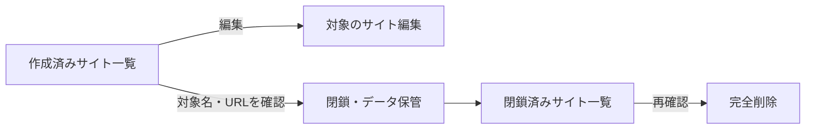

# サイト一覧と閉鎖・完全削除

「サイト制作」のサブメニュー（Submenu）に「サイト編集」「作成済みサイト一覧」「閉鎖済みサイト・完全削除」を配置した。既存の `#site` は編集画面として維持し、一覧は `#site-list`、閉鎖済み一覧は `#site-trash` で開く。

一覧の各行の「編集」は対象サイトを選択して編集画面へ移る。「このサイト削除」は対象名と公開URLを確認して閉鎖し、設定と生成ソースを `.wentian/site-trash/<ID>/` に保存する。完全削除は閉鎖済み一覧から別途確認して実施する。外部フォルダーの原本は対象外。

公開トップの閉鎖には閉鎖記録を残し、初期ページの自動表示を防ぐ。トップを編集画面から保存して再公開すると閉鎖記録を解除する。

完全削除API（Application Programming Interface）は管理者認証の既存範囲内に置き、閉鎖IDと確認値の一致を要求する。削除範囲を専用ゴミ箱内に限定し、リンク（Symbolic Link）を含む領域は拒否する。

型チェック（Type Check）と関連する17件の自動テスト（Automated Test）が成功。画面要素の操作テストで編集への遷移、閉鎖確認の取消、対象だけの閉鎖を確認し、保存処理のテストで閉鎖と完全削除の分離、確認値不一致の拒否、他サイトの保持を確認した。

PowerShell版とPython版のブラウザー検証スクリプト（Browser Verification Script）は新しい一覧導線へ更新した。今回の変更について実ブラウザーの再実行と稼働サーバーへの反映は未実施。
