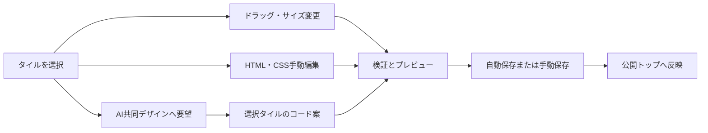

# トップページのタイル編集とAI共同デザイン

管理画面の「トップページ」で、プレビュー内のヘッダー、メイン紹介、公開相談室、各コンテンツ、追加領域、フッターをタイル（Tile）として選択できます。選択欄からの選択も可能です。

タイルをドラッグして移動し、右下のハンドルで拡大・縮小します。X、Y、幅、高さの数値入力でも配置できます。横幅1200の設計領域を基準に横方向の座標を保存し、公開ページの幅へ比例させます。小さい画面では縦並びへ切り替えます。重なりも許可します。

「選択タイルのHTML・CSSコード」で手動編集し、「タイルへ適用」でプレビューへ反映します。「保存して公開トップへ反映」で公開します。CSSは選択タイルのルートに適用するプロパティ宣言です。HTMLのスクリプト・イベント属性と不許可スタイルは保存時に除去します。

「AIと共同でデザイン」は、正常確認済みエージェント（Agent）へ選択タイルとデザイン要望を渡します。エージェントが返したHTML・CSSと座標を検証し、選択タイルだけに適用します。自動保存は既定で有効です。成功時は公開ページへ反映し、公開側は約5秒以内に更新します。自動保存を外した場合はプレビューを確認して手動保存できます。

公開相談室タイルを変更しても、公開中の相談室一覧と参加入口をシステムが追記して維持します。古いリビジョン（Revision）の案による上書きは拒否します。レイアウトとコードは `.wentian/public-site.json` の `tiles` に保存します。

タイルの移動・サイズ変更・手動コード保存、選択範囲だけのAI編集、公開への保存、不正な座標・CSSの拒否をテストしています。AI応答はモック（Mock）で検証し、実ブラウザーの見た目と実エージェントへの編集依頼は未確認です。
