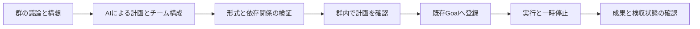

# Wentian Startup Forge

## 目的と参照

群聊を、構想から事業仮説・AIチーム・検証・実行タスク・成果物へつなぐ。参照は https://octask.ai/ （2026-10-17確認）。役割分担するAIチームと共有文脈、計画から成果までの連携を参考にした。Octaskとの接続や同等機能の全面実装を意味しない。

## 操作

`http://127.0.0.1:8787/workbench#groups` で管理者ログインし、対象の群を選択する。「Wentian Startup Forge · 構想を事業へ」を開き、目的・顧客・制約・期限等を入力する。

1. 「AIチームで計画を生成」：群の直近の議論と入力構想から、価値提案、顧客仮説、検証計画、リスク、担当チーム、依存関係付きタスクをAIが生成する。生成は非同期で、状態・活動履歴を表示する。
2. 計画・担当・成果物・検収条件を確認する。生成中は停止でき、失敗時は再生成できる。
3. 「実行タスクへ登録」：既存Goalへ、担当指示・成果物・検収条件・依存関係を保持して登録する。登録時点は一時停止状態であり、実施済みとは扱わない。二重登録を抑止する。
4. 「タスクを実行」：既存のGoal実行APIを利用する。「実行を一時停止」は既存の協調停止を利用する。結果は群内パネルとタスク画面から確認する。

## モジュール構成

- `src/startup-forge.ts`：台帳、構造化計画の検証、管理API、非同期AI処理、Goalへの変換。
- `src/startup-forge-ui.ts`：群聊に追加する独立したUI拡張。
- `src/workbench.ts`：既存管理者ガードの内側でForgeを登録。
- `src/group-agent-responder.ts`：ForgeのJSON出力モード。通常討論と形式を混同しない。
- `src/agent-web-search.ts`：既存のAI検索判断と検索資料を計画入力へ引き継ぐ。構造化計画にはJSONを壊す文字列を追記しない。

保存先は利用者ワークスペースの `.wentian/startup-forge/<group-id>.json`。群の会話用台帳や自律討論ロックと分離し、原子的に保存する。元のメンバー・群の履歴は上書きしない。Forgeの担当チームは事業計画内の役割で、既存群メンバーを自動置換しない。

## API

管理者認証と同一サイト制約は既存工作台と共通。

- `GET /api/workbench/groups/:id/forge`：計画・活動履歴・関連タスク状態。
- `POST /api/workbench/groups/:id/forge/plan`：`{"brief":"構想・目的・制約"}`。
- `POST /api/workbench/groups/:id/forge/cancel`：計画生成の停止要求。
- `POST /api/workbench/groups/:id/forge/register`：実行タスクへの登録。

役割と内容はAIが判断する。実装は人数・長さ・担当参照・先行タスク依存だけを検証し、職種の固定辞書や自然言語のキーワード分岐は用いない。無効JSONは失敗として表示する。計画生成は240秒、チーム1〜12、タスク1〜16を上限とする。

## 検証と制限

- 型検査と隔離試験を実施。生成・失敗・登録・依存関係・二重登録・管理者UI・実行API連携を検証する。
- 再現入口：`scripts/verify-startup-forge.ps1` またはPython版。証跡は `docs/evidence/startup-forge/<日時>/` に保存する。
- 事業仮説の正しさ、法務・決済・公開の承認、事業の成功は自動保証しない。登録だけで実行済みにはならない。実際の実行可能範囲と検収は既存Goalの設定・権限・実行エージェントに従う。
- 現版は群ごとに1つのForge計画を保持する。実行タスク登録後の複数事業・計画改訂、仮想オフィス、専用の課金・投資機能は含まない。

## 検収結果

関連38試験に成功した。さらにPowerShell版の検証入口から型検査と隔離試験18件に成功し、`docs/evidence/startup-forge/20261017T142548Z/` に結果JSON・ログを保存した。Gateway再起動後、管理者ログインした実ブラウザーでForgeパネル、構想入力、計画生成ボタン、初期状態の表示を確認し、画面のJavaScriptエラーがないことを確認した。

本番群へ検証用の事業計画や実行タスクは作成していない。AI計画生成とタスク変換・実行要求の検証は、一時領域・模擬AI・模擬HTTPで行った。実事業の生成・実行結果を検収したという意味ではない。会話履歴の入力は直近12発言・各1000文字までに制限し、構想本文を優先する。

コミット・プッシュは実施していない。

## 独立した「创业孵化器」とゲーム空間（2026-10-17）

入口は `/startup-forge`。Control Center・Workbenchの上位メニューに「✦ 创业孵化器」を追加した。既存認証・群・Forge計画/タスク操作を引き継ぐ独立画面である。

- 3Dゲームアート調の背景：办公室・商场・街边・海滩・教室。
- 透過画像の人物アトラス：8種類。群のメンバーをクリックし、外見を切り替える。外見は役割・モデル・権限を変更しない。
- 実際の群聊メッセージを漫画の吹き出しで表示する。新しいメッセージを取得したら表示を更新し、履歴の回放もできる。人間の発言や舞台上にいない話者は中央の吹き出しに表示する。吹き出しは140文字までの抜粋で、全文は下の会話欄から確認する。
- 一度に舞台へ配置するAIは最大8人。背景・外見の設定はブラウザー内に群ごとに保存する。他のPCへの設定同期は現版では行わない。
- Forge計画生成・登録・実行・停止の既存操作は右側のMission Controlに集約。スマートフォンでは下段へ移動する。縮小動作の設定を尊重する。

実装は `src/startup-forge-room.ts`。素材は `assets/startup-forge/` に保存し、許可した6ファイルだけを配信する。外部CDNや未許可パスを使わない。群・メッセージはtextContentで表示し、メッセージ内HTMLを実行しない。

### 素材の制作記録

imagegenスキルの組み込み画像生成ツールを使用した。背景は1536×1024 PNGを5点、人物は透過PNGの4列2行アトラスを1点制作し、元画像を残してプロジェクトへコピーした。人物画像は角と人物間のalpha=0を確認した。

プロンプトの共通指定：premium cozy stylized 3D startup team simulation game、teal/lavender/amber palette、warm soft lighting、clay materials、camera elevated 25 degrees、中央に人物を配置できる空間、背景に人物・文字・UIを含めない。

各背景の指定：startup office with sunset windows / upscale mall atrium / charming creative street corner / tropical seaside retreat / modern creative classroom。人物は同じ画風の成人8人、各セルへ全身を収め、背景透過・4列2行・重なりなしを指定した。紫髪のデザイナー、眼鏡の開発者、巻き髪の戦略担当、銀髪の研究者、創業者、アーティスト、研究員、プロジェクト管理者の外見を制作した。職務内容は表示する群メンバーの設定を保持する。

関連21試験と型検査が成功。実ブラウザーで背景・人物・専用メニュー・既存Forge操作の表示を確認した。

実ブラウザーで海辺への背景切替と人物形象変更が反映されることを確認した。人間の群参加・退出への入口を独立画面にも設け、発言フォームの本人表示設定を保持した。元の群メンバー・会話・Forge計画は変更していない。検証入口のPython版/PowerShell版に独立空間の試験を追加した。素材は組み込みimagegenで生成しており、使用した最終プロンプトセットは上記の制作記録を参照。コミット・プッシュは実施していない。

## 修正：新会話と履歴回放の分離

以前は10秒ごとに過去の会話を無条件で循環していたため、新しい会話が続いているように見える一方、実討論は人間の投稿で停止したままになっていた。既定を「最新発言の表示・新着待ち」に変更し、履歴の回放はボタン操作時だけ行い、末尾で終了する。新着が来た場合は回放を終了して新着を優先する。

孵化器のMission Controlへ「开始 / 继续讨论」「暂停讨论」を追加した。人間への返答が正常終了した場合は、human理由の協調停止だけを原子的に解除して自律討論を継続する。手動停止、無効化、合意、周回上限、時間上限は解除しない。停止理由・障害の詳細も画面に表示する。

### 残留ロックとWindows起動上限の復旧

実環境では旧サーバーの処理が空のlockファイルを残し、停止済みの群でも新規討論を妨げていた。旧PIDの終了、ロックが現サーバーの起動前の空ファイルであること、保存先が対象ワークスペース内であることを確認し、削除せず `.lock.recovered-20261018` へ退避した。

新規ロックには所有PIDと取得時刻を記録する。終了した所有者のロックは、討論状態が停止済みでも回収する。稼働中PIDのロックは古くても保護する。

さらに長い履歴とWeb検索資料がWindowsの引数長上限を超えてAIを起動できない問題を確認した。CLIへ渡す引用コンテキストを10000文字以内にし、冒頭の目的と末尾の最新情報・出力形式を保持する。中間省略を明示し、元の会話台帳は削除・短縮しない。関連23試験成功。

引数長エラーで候補Agentに30分の待機が残っていたため、修復済みの `ENAMETOOLONG` に対応する群タスクの待機だけを解除した。成功件数・失敗実績・他の役割・別種の障害は変更していない。この限定解除を隔離試験3件で確認した。

実環境で新規発言を確認した。2026-10-18 00:08:06（JST）に今回の討論の1発言目が会話台帳へ追加され、completedTurnsが0から1へ増加した。旧履歴の回放ではなく、新たな保存時刻を持つAI発言である。討論は継続中。利用者の群への追加投稿は行っていない。

自律討論のモード選択に「直到按下停止才结束」を追加した。各回の間の休憩秒数を設定でき、休憩中は次回実行時刻を表示する。詳細は [公開機能と制限](feature_scope.md) の2026-10-18追補を参照。
