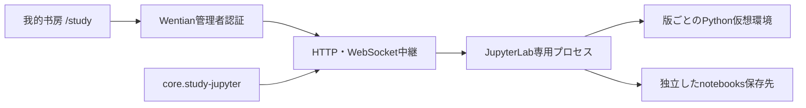

# 我的书房：JupyterLab分離モジュール

2026-10-19追記：[公開機能と制限](feature_scope.md)。Chat・群のMarkdown/Notebook、Forge計画を同じnotebooksルートで確認できる。

2026-10-18

メニュー「我的书房」は `/study` を開き、Wentian画面内に実際のJupyterLabを表示する。公式サイトへのリンクではない。Notebook、Pythonカーネル、コンソール、ファイル管理、ターミナルはJupyterLab側の機能を使用する。

## 構成と保存先



- Plugin：`core.study-jupyter`、サービス契約：`wentian.study.jupyter/1`。
- standardプロファイルに登録。minimalプロファイルには追加しない。登録だけではPythonを導入・起動しない。
- モジュール既定位置：`<Wentian導入先>/.wentian/modules/jupyter`。Plugin設定 `root` または `WENTIAN_JUPYTER_MODULE_ROOT` で変更できる。
- Notebook既定位置：`<タスク作業ディレクトリ>/notebooks`。Plugin設定 `notebooks` または `WENTIAN_JUPYTER_NOTEBOOK_ROOT` で変更できる。既存の作業ディレクトリ方針は変更しない。
- `releases/<版>-<識別子>/` に専用venv、`requirements.lock.txt`、`verification.json` を置く。`active.json` が有効版を指す。
- Jupyterの設定・ログ・実行時ファイルはモジュール内の `runtime/` に分離する。Notebookはリリースの削除・差し替え対象に含めない。

## 操作と認証

管理者が「我的书房」を開くと起動し、「起動」「再起動」「停止」で操作できる。Wentian終了時には専用Jupyterを停止し、親プロセスの強制終了も監視する。

中継は `/study/jupyter/`、制御APIは `/api/study/status`、`/start`、`/stop`、`/restart`。HTTPとWebSocketの両方にWentian管理者認証と同一サイト制約を適用する。内部Jupyterはlocalhostの動的ポートで動作し、内部トークンはブラウザーへ渡さない。WentianのCookieもJupyterへ転送しない。

現段階は管理者共用の書房であり、利用者ごとの隔離環境ではない。セルやターミナルはWentianの実行ユーザー権限で動作する。HTTP転送は要求・応答とも64MiBまで。

## 導入・更新・切り戻し

Python版とPowerShell版を用意した。Python本体は利用者が選択する。検証時はPython 3.11を使用した。

```powershell
# Python版：指定版を別の仮想環境へ導入し、検証後に有効化
py -3.11 scripts/setup-study-jupyter.py --version 4.6.4

# PowerShell版：同じ処理。必要なら -Python でPython実行ファイルを指定
./scripts/setup-study-jupyter.ps1 -Version 4.6.4

# 現在の有効版を再検証
py -3.11 scripts/setup-study-jupyter.py --verify-only
./scripts/setup-study-jupyter.ps1 -VerifyOnly

# 直前の版を再検証し、有効版を戻す
py -3.11 scripts/setup-study-jupyter.py --rollback
./scripts/setup-study-jupyter.ps1 -Rollback
```

保存場所を変更した場合はPython版の `--root` またはPowerShell版の `-Root` に同じ場所を指定する。新しい版への更新時は `--version` / `-Version` を変更し、成功後に画面の「再起動」を押す。自動pip更新は行わない。

候補版のAPI、認証、Pythonカーネル定義、Lab画面を一時領域で検証してから有効ポインターを切り替える。検証失敗時は現在の有効版を保持する。再起動時に新しい版が起動しなければ、実行中だった旧版の再起動を試みる。有効ポインター自体を戻す場合は上記の切り戻しを実行する。

Wentian本体のNode依存へJupyterを組み込まないため、Jupyterの更新は分離して行える。ただし将来の互換性を無条件に保証するものではない。現行の導入検査はJupyter Server 2系を対象とする。未知の接続契約や不正な版指定は拒否し、モジュールの異常をWentian全体の起動失敗に波及させない。

## 検証

```powershell
./scripts/verify-study-jupyter.ps1 -Live
py -3.11 scripts/verify-study-jupyter.py --live
```

型検査と関連10試験に加え、実JupyterLab 4.6.4 / Jupyter Server 2.21.1をNodeとWindowsの通常起動に使用するBunの両方から確認する。実行試験は一時Notebook領域を使い、保存、WebSocket経由のPythonセル実行、停止・再起動後の保存内容維持、未認証拒否、HTMLへの内部トークン非露出を確認する。二つの実バージョン間の更新・切り戻しは今回の実機検証には含めない。

参考：[JupyterLab導入手順](https://jupyterlab.readthedocs.io/en/stable/getting_started/installation.html)、[Jupyter Server設定](https://jupyter-server.readthedocs.io/en/stable/other/full-config.html)、[Jupyter Server認証](https://jupyter-server.readthedocs.io/en/latest/operators/security.html)。

### 今回の結果

`verify-study-jupyter.ps1 -Live` は型検査成功、関連10試験成功、Node・Bun両方の実カーネル検証成功で終了した。Pythonスクリプト2本の構文、PowerShell版2本のUTF-8 BOMも確認した。Wentian再起動後の `/health` は `fallback_ready` を返し、ブラウザーでメニュー・JupyterLab・Python 3ランチャーが一体表示されることを確認した。コミット・プッシュは行っていない。
