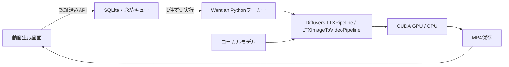

# 動画生成の実装・利用方法

WentianがDiffusersのLTXパイプラインを直接呼び出す。ComfyUIのサービス、ノード定義、ワークフロー、APIは使用しない。

## 操作

管理者で `/videos` にログインする。「AI・接続 → 動画生成」からも開ける。

- 文章から動画を生成する。PNG／JPEGを添付すると起点画像から生成する。
- 解像度、フレーム数、FPS、生成ステップ、避けたい内容、シードを指定できる。
- 待機・生成・保存・完了・失敗を表示する。待機中と生成中は取り消せる。
- 完成したMP4を画面で再生、ダウンロード、削除できる。無音または完成音声を選択して生成する。
- 各管理者は自分の生成記録・動画だけにアクセスできる。



## GPU搭載・非搭載PC

`WENTIAN_VIDEO_DEVICE=auto` が既定。PyTorchからCUDAを利用できればNVIDIA GPU、それ以外はCPUで実行する。CPUはfloat32、GPUは対応状況に応じてbfloat16またはfloat16を使用し、GPU側はCPUオフロード（CPU Offload）とVAEの分割復号を使用する。AMD・Intel GPU用のアクセラレーター実装は含まない。

生成するのはWentianサーバーを動かしているPC。ブラウザーを開いたPCのGPUを自動利用する仕組みではない。別PCで生成する場合は、そのPCにWentianと動画エンジンを導入する。

CPU向けの画面初期値は256×256、9フレーム、8FPS、20ステップ。GPU向けは512×320、49フレーム、24FPS、30ステップ。CPUは短い動画でも長い処理時間と大きなRAMを必要とし、低解像度にすればモデル本体のRAMが不要になるわけではない。すべての非搭載PCで動くことを保証するものではない。資源不足は失敗として表示する。文章の理解や画質はモデルに依存し、実運用では英語の詳細な指示でも比較する。

## 初回準備

CPU版：

```powershell
pwsh -NoProfile -File scripts/setup-video-engine.ps1 -DownloadModel
```

NVIDIA CUDA版：

```powershell
pwsh -NoProfile -File scripts/setup-video-engine.ps1 -Device cuda -DownloadModel
```

Pythonからの同等操作：

```python
import subprocess
subprocess.run(["uv", "run", "--no-project", "--python", "3.11", "python", "scripts/setup-video-engine.py", "--device", "cpu", "--download-model"], check=True)
```

`-DownloadModel` / `--download-model` を付けなければ依存ライブラリだけを準備する。既存Python環境は変更しない。PyTorch 2.8.0、Diffusers 0.35.2、Transformers 4.56.2を採用。CUDA版はCUDA 12.8向けPyTorchホイール（Wheel）を使うため、対応するNVIDIAドライバーが必要。

LTXのDiffusers用コンポーネントは約28GB。セットアップは必要なコンポーネントだけを取得し、同じリポジトリー内の別モデルの単体重みは取得しない。取得時の公開コミットを `wentian-model.json` に記録する。モデルとライブラリのライセンスは導入時に確認する。[公式モデルカード](https://huggingface.co/Lightricks/LTX-Video)、[採用版の公式パイプライン資料](https://github.com/huggingface/diffusers/blob/v0.35.2/docs/source/en/api/pipelines/ltx_video.md)

保存先を変更する場合はセットアップの `-Directory` / `--directory` と、Wentian起動時の以下の環境変数を合わせる。モデル更新中は生成ジョブを実行しない。

| 環境変数 | 内容 |
|---|---|
| `WENTIAN_VIDEO_PYTHON` | 専用Python実行ファイル。既定はインストール先 `.wentian/video-engine` 内 |
| `WENTIAN_VIDEO_MODEL_PATH` | ローカルモデルのフォルダー。同環境の `model` が既定 |
| `WENTIAN_VIDEO_DEVICE` | `auto`、`cpu`、`cuda:0` 等 |
| `WENTIAN_VIDEO_ROOT` | 動画・ジョブ台帳の保存先。既定は `.wentian/videos` |

生成中のモデルダウンロードは行わない。準備不足は画面に表示し、新規生成を拒否する。モデル取得時は公開モデルへ匿名接続し、明示した `HF_TOKEN` がある場合だけ使用する。秘密値は画面・台帳・スクリプト引数へ保存しない。

## ジョブと保存

待機・実行中の合計上限は8件、同時実行数は1件、実行上限は60分。利用者から任意のコマンド、パイプライン、モデルパス、外部画像URLを受け取らない。起点画像は10MiB・2000万画素以内のPNG/JPEGだけを扱う。

一時MP4を完成後に置き換える。再生APIも所有者を検査し、Range要求とダウンロードに対応する。完了後も生成設定とシードを保存し、削除時にMP4・起点画像・要求・ジョブ記録を削除する。

同じ台帳の二重起動は拒否する。正常終了時は実行中ワーカーを停止する。異常終了後の再起動では、生成中だった記録を失敗として明示し、成功や自動再実行にはしない。待機ジョブは維持する。

## 検証

入口は `scripts/verify-video-generation.ps1` と `scripts/verify-video-generation.py`。既定で型検査・関連自動試験を実行する。`-Inference` / `--inference` はCPUで小型ランダムLTXモデルを使って文章・画像から実推論する。`-Browser` / `--browser` は実サーバーと実ワーカーをEdgeで操作する。

隔離検証用モデルは `.wentian/video-verification/model` に置き、診断画面でも「検証専用」と表示する。その後ユーザーの指定で、通常利用先 `.wentian/video-engine/model` にも同じ小型ランダムモデルを配置した。本番モデルの画質、速度、メモリ要件やGPUの動作を確認した証拠には使用しない。証拠は 検証フォルダー（実行時に生成する非公開資料） を参照。

2026-10-07の実施結果：型検査と関連19件が成功。所有者境界、入力制限、8件上限、逐次実行、待機・実行中の取消、台帳再起動、Range、ダウンロードを検査した。CPUの実LTX推論は文章・起点画像の両方で成功し、256×256・9フレーム・8FPSのMP4を復号できた。実Edgeでもログイン、生成、再生、ダウンロード、削除、390px幅を確認し、画面のJavaScriptエラーは0件だった。小型ランダムモデルの映像はノイズであり、内容を理解した動画生成の品質確認ではない。

ユーザーの最小環境の指定に従い、本番モデル約28GBは未取得で、小型ランダムモデルを導入済み。このPCにCPU用の専用環境は準備済み。本番モデルによる生成と実GPUでの生成は未検証。音声生成・編集・合成は同日の追加実装で対応した。長時間動画、画面からのモデル切替、複数PCへの動画ジョブ自動配分は未対応。

## 音声制作・最小環境への拡張（2026-10-07）

音声の選択、音声・動画編集、モデル自動保守を追加しました。現在の構成と検証範囲は[音声・動画制作](media_production.md)を参照してください。ユーザー指定により小型検証モデルを配置し、本番動画モデルは取得していません。
