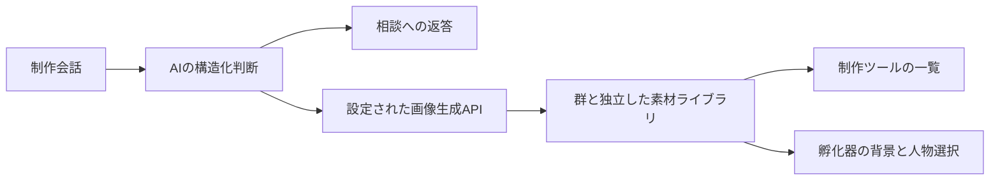

# 背景と人物制作

制作ツールの「背景と人物制作」から `/visual-assets` を開きます。管理者でログインすると、既存の背景5枚・人物8種類と制作済み素材を一覧できます。AIとの会話では、AIが相談への返答と画像制作の必要性・種類・制作指示を構造化判断します。固定キーワードで制作を開始しません。

既定の制作方法は「Wentianに任せる」です。会話、制作判断、利用可能な画像生成プラグインとモデルの選択、実行、素材保存をWentianが担当します。制作画面で個別APIを設定する必要はありません。従来の保存設定にmodeがない場合も既定のWentianモードとして扱い、保存済みの接続情報は維持します。

Wentianの有効なmediaプロバイダーから、modelProfilesに `capabilities.image_generation > 0` と明示されたモデルを候補にします。API型は既存baseUrl配下の `/images/generations` を利用し、認証を再利用します。ComfyUIは既存の実行許可 `WENTIAN_ENABLE_COMFYUI_JOBS=true` を尊重し、実際のノード情報とチェックポイント一覧を照会します。対応する標準ノードが揃った場合だけ、CheckpointLoaderSimpleからSaveImageまでのワークフローで制作します。独自ワークフロー専用モデルの互換性は保証しません。AIの候補外選択は実行しません。

任意で「制作方法の設定」から「接続先・モデルを個別指定」を選択できます。こちらは完全なAPI URL、モデル、必要ならAPIキーを指定します。PNGの `data[0].b64_json` 応答に対応します。`WENTIAN_IMAGE_ENDPOINT`、`WENTIAN_IMAGE_MODEL`、`WENTIAN_IMAGE_API_KEY` は任意設定の初期値として利用し、自動的にWentianモードを切り替えません。

画像生成プラグインがない場合、制作相談は利用できますが新しい画像は生成できません。この状態を個別API設定の必須エラーとせず、Wentian側のプラグイン未準備として表示します。AIの会話能力のみを画像生成可能と判断しません。巨大モデルの取得、無効化されたサービスの有効化、権限拡大はこの変更では行いません。

制作処理は非同期で、画面に検討中・生成中・失敗を表示します。未設定・不正なAI出力・画像取得失敗では、画像を作成済みと表示しません。中断された会話には再送信を案内します。サーバー終了時は進行中の処理を中断します。

素材と会話・設定はワークスペースの `.wentian/visual-assets/` に保存します。APIキーを読取APIで返しません。素材APIは管理者認証下に置き、変更操作には同一オリジン検査を適用します。これらの実行時データを公開用配布物へ含めないでください。

素材は群から独立しています。群を削除しても残り、孵化器の背景・人物選択に表示されます。別画面で制作したあとは孵化器を再読込してください。選択は従来どおりブラウザー内で群ごとに保存します。参考素材の選択は名前と制作指示をAIへ渡します。画像そのものの視覚参照・画素編集・上書きは行いません。人物の透明背景は生成指示に含めますが、生成モデルの対応状況に依存します。

検証コマンドは `scripts/verify-visual-assets.ps1` とPython版です。型検査と関連試験を実行し、試験では実サービスを呼ばず一時領域へ隔離します。

## 2026-10-18 検証結果

- 型検査成功、関連23試験成功。画面調整後に素材専用6試験も再実行し成功。
- 制作画面の共通メニューCSS未読込、人物の縦横比、共通CSSによる空の会話入力欄の非表示を修正。
- 常駐サーバーへ反映し、管理者ログイン後の素材13件・会話入力欄・接続設定をブラウザーで視覚確認。
- 実環境の画像生成接続先・モデルは未設定。実サービスによる新規画像生成は未検証。既存の無関係な変更は維持し、コミット・プッシュは行っていません。

## Wentian既定モードへの変更と検証

- 個別設定を任意にし、既定をWentianに変更。既存プロバイダー設定を再利用する画像ランタイムを追加。
- 型検査および関連28試験成功。模擬APIによる既定経路・明示した個別経路・ComfyUI経路、候補外AI出力の拒否、既存の実行禁止を検証。
- 常駐サーバーへ反映し、ブラウザーで「Wentianに任せる（既定）」の選択と個別設定欄の非表示を確認。
- 実環境の検査では利用可能な画像生成候補は0件。既定モードへの変更は完了しましたが、実画像を制作できる状態にはまだ達していません。会話による制作相談は利用できます。

## Codex画像制作の接続修正

外部Agent一覧への登録と画像生成ランタイムの接続が分離され、画像のReady Poolも一律に空にされていました。Codexを画像制作能力の対象に追加し、専用アダプターをWentian既定ランタイムへ登録しました。

- 登録状態・生存状態・接続検証・利用除外設定を確認し、CLIの `image_generation` 機能フラグを確認したCodexを選択候補にします。
- 利用者が設定したCodexモデル・接続情報を既存の起動処理から引き継ぎます。別のAPIキー入力を要求しません。
- 専用の一時作業場所と `workspace-write` を使用し、危険なサンドボックス回避引数は追加しません。既存の街角画像を画風の参考として渡します。
- 成功という文章だけを信用せず、作業場所内の通常ファイル `output.png` の保存先・PNG署名・サイズ・解像度を検査します。検収後に画像制作の証跡を記録します。実画像の成功証跡がない場合、一般の画像Ready Poolには登録しません。
- Codex接続設定のモデル等が変わった場合、過去の画像制作証跡は一致しなくなります。成功証跡の有効期限は24時間です。

修正時点の型検査と関連34試験は成功。実CLIの読取専用確認では `image_gen__imagegen` が公開されていると応答しました。実際の画像制作・保存の結果は下記に追記します。

### 実画像制作の検収結果

- 初回の実行では `--image` の可変長引数に制作指示が取り込まれ、Codexが「指示なし」として終了。`--` で画像引数と制作指示を区切る修正を行い、再現防止試験を追加。
- 最終の型検査・関連36試験成功。成功報告だけで画像がないケースや、接続モデルの変更による証跡失効も検証。
- Wentianの制作画面から既定モードで再実行し、Codexの内蔵image_genで「公園背景」を生成。2026-10-18 09:51 JSTに共通素材へ保存。
- 素材ID: `9c17e86b-b95f-4503-b13a-04efb8f67b34`。PNG、1672×941、2,940,599バイト。
- 保存先: `.wentian/visual-assets/9c17e86b-b95f-4503-b13a-04efb8f67b34.png`。群とは独立した素材として保持。
- 画像を目視検収し、人物なしの公園、木・花壇・ベンチ・遊歩道、中央の人物配置用空間を確認。
- 制作画面の一覧への追加と成功メッセージを確認。孵化器の背景選択にも表示され、実際に適用して既存人物・漫画気泡と一緒に表示できることを確認。
- 実行時の画像検収証跡は `.wentian/codex-image-evidence.json` に保存。利用者の接続情報と実行時データは公開用文書へ転記していません。コミット・プッシュは行っていません。
